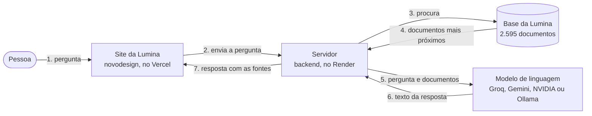

# Lumina 3.0

A Lumina é a assistente conversacional do **Projeto ELLAS** (*Equality in Leadership for Latin American STEM*) sobre igualdade de gênero em ciência, tecnologia, engenharia e matemática (STEM) na América Latina. Ela responde com base na sua própria base de conhecimento, de 2.595 documentos: uma parte vem do Projeto ELLAS, e o restante foi coletado de bases públicas internacionais para a Lumina. Em cada resposta, a Lumina mostra de onde veio cada dado.

O Projeto ELLAS é liderado pela Universidade Federal de Mato Grosso (UFMT), em cooperação com a Universidad Mayor de San Andrés (UMSA, Bolívia) e a Universidad de Lima (ULima, Peru).

**Branch `Lumina3.0`** · versão 3.0.0 · [Documentação técnica em PDF](docs/documentacao-tecnica/LUMINA_3.0_DOCUMENTACAO_TECNICA.pdf) · [Como rodar na sua máquina](#como-rodar-na-sua-máquina)

## O que a Lumina faz

- Responde perguntas em português, espanhol ou inglês, no idioma em que foram feitas.
- Usa só os documentos da base. Cada dado vem com o número do documento citado ([1], [2]), e o painel "Fontes e métricas" mostra os documentos consultados, com relevância, fonte e link.
- Quando a base não tem o dado, responde "Não encontrei esse dado na base do Projeto ELLAS." Perguntas fora do tema recebem uma mensagem explicando o escopo.
- Avisa quando um número da resposta não aparece nos documentos consultados.
- Entende perguntas de continuação, como "e no Peru?", a partir da conversa anterior.
- Filtra a busca por país e deixa escolher quantos documentos, no máximo, a resposta pode usar.
- Oferece 11 modelos de linguagem. Dois aceitam imagens anexadas, e um deles aceita também vídeo e áudio.
- Lê as respostas em voz alta, com vozes do navegador ou do Google Gemini.
- Guarda as conversas no próprio navegador.

## Como funciona



**Em linguagem simples.** A Lumina não responde de memória. A cada pergunta:
1. o site envia a pergunta ao servidor;
2. o servidor procura, entre os 2.595 documentos da base da Lumina, os mais próximos do assunto, comparando o sentido do texto e as palavras;
3. o servidor envia a pergunta e esses documentos a um modelo de linguagem, com a instrução de responder só com base neles;
4. a resposta volta ao site aos poucos, enquanto é escrita, com a lista de fontes. No fim, o servidor confere se os números citados aparecem nos documentos.

No desenho, a forma arredondada é a pessoa, os retângulos são programas, o cilindro é a base de documentos e as setas seguem a ordem dos números. Essa técnica se chama RAG, sigla em inglês para geração de texto apoiada em busca.

A busca não usa banco de dados. Os documentos e os vetores de cada um (listas de números que representam o sentido do texto) ficam num arquivo pronto, `backend/vector_store_cache.json`, que o servidor carrega na memória quando liga. A busca soma a semelhança de sentido entre os vetores a uma busca por palavras (BM25).

## Base de conhecimento da Lumina

A base da Lumina reúne 2.595 documentos de três origens:
- **Projeto ELLAS:** 1.131 documentos, da ontologia ELLAS e do Censo da Educação Superior, guardados no GraphDB do projeto;
- **bases públicas internacionais coletadas para a Lumina:** 1.436 documentos, da CEPALSTAT, do Banco Mundial, da OECD, da UNESCO e da RICYT, tratados pelos programas da pasta `newdata/`, que fica fora deste repositório;
- **base curada:** 28 documentos escritos à mão.

| Fonte | Origem | Conteúdo | Documentos |
|---|---|---|---:|
| Ontologia ELLAS | Projeto ELLAS | iniciativas, políticas, indicadores, fatores (barreiras e facilitadores), artigos, organizações e comunidades sobre mulheres em STEM na América Latina | 836 |
| Censo da Educação Superior (INEP/MEC) | Projeto ELLAS | participação de mulheres nas matrículas, nos ingressos e nas conclusões de 95 cursos, e 200 instituições | 295 |
| CEPALSTAT (CEPAL) | coletada para a Lumina | indicadores de trabalho, renda, uso do tempo e participação política | 655 |
| World Bank *Women, Business and the Law* | coletada para a Lumina | leis e marcos legais sobre igualdade de gênero | 308 |
| OECD STIP Compass | coletada para a Lumina | políticas de ciência, tecnologia e inovação | 255 |
| UNESCO UIS e DataHub, RICYT e RedIndices | coletada para a Lumina | indicadores de pesquisadoras, graduadas por área e docentes; iniciativas, cátedras e marcos legais reunidos pela UNESCO | 218 |
| Base curada (`conhecimento.js`) | escrita para a Lumina | biografias, fatores e políticas | 28 |
| **Total** | | | **2.595** |

As bases ficam em `backend/base_*.json`, e o índice pronto, em `backend/vector_store_cache.json`. A base curada fica fora do repositório (veja [Limitações conhecidas](#limitações-conhecidas)). Detalhes de cada base: [Parte 1, seção 1.3](docs/documentacao-tecnica/PARTE_1_visao_geral_arquitetura_dados.md#13-bases-indexadas).

## Modelos de linguagem

| Nome na interface | Provedor | Anexos |
|---|---|---|
| Groq (GPT-OSS 120B), o padrão | Groq | não |
| GPT-OSS 120B | Groq | não |
| Gemini 2.5 Flash | Google | não |
| Nemotron 3 Nano Omni | NVIDIA NIM | imagem, vídeo e áudio |
| Mistral Large 4 | NVIDIA NIM | imagem |
| Nemotron 3.5 Super 120B | NVIDIA NIM | não |
| MiniMax M3.1 Flash | NVIDIA NIM | não |
| GPT-OSS 20B | NVIDIA NIM | não |
| Qwen 2.5 1.5B, Phi-3 Mini e Gemma 2 2B | Ollama, num servidor próprio | não |

Cada provedor precisa da sua chave no `backend/.env`. O Groq também reescreve as perguntas de continuação antes da busca, qualquer que seja o modelo escolhido.

## Estrutura do repositório

```text
lumina-ia/
├── backend/                     servidor Node.js (Express 5)
│   ├── server_vetorial.js       rotas da API, montagem da resposta e voz
│   ├── vector_engine.js         motor de busca (vetores e BM25) e reindexação
│   ├── busca_lexica.js          índice de palavras (BM25)
│   ├── anexos.js                anexos de imagem, vídeo e áudio
│   ├── checagem_numeros.js      conferência dos números da resposta
│   ├── ttl_parser.js            export da ontologia (TTL) → base_ellas_ttl_completa.json
│   ├── extrair_inep.js          Censo INEP (consultas SPARQL) → base_inep_extraida.json
│   ├── base_*.json              bases de documentos
│   ├── vector_store_cache.json  índice pronto: 2.595 documentos com vetores
│   ├── avaliacao/               conjunto de avaliação (93 casos) e avaliar.js
│   └── .env.example             modelo de configuração
├── novodesign/                  site: React 19, TypeScript, Vite 8 e Tailwind CSS 4 (tem README próprio)
│   └── src/                     App.tsx, componentes, hooks e src/lib/api.ts
└── docs/documentacao-tecnica/   documentação técnica: três partes e o PDF
```

## Como rodar na sua máquina

**Pré-requisitos:** Git, Node.js 22.12 ou mais novo (ou 20.19 ou mais novo, na linha 20) e uma chave de API do Groq. Na primeira execução, o backend precisa de internet para baixar o modelo que calcula os vetores (23 MB).

**Terminal 1, backend:**

```bash
git clone -b Lumina3.0 https://github.com/oaxiapsolrac/lumina-ia.git
cd lumina-ia/backend
npm ci
cp .env.example .env        # preencha GROQ_API_KEY no .env
npm run avaliar:validar     # deve terminar com "✅ Todos os alvos existem na base (2595 documentos)."
npm start                   # API em http://localhost:3001
```

**Terminal 2, site** (a partir da pasta `lumina-ia`):

```bash
cd novodesign
npm ci
printf 'VITE_API_BASE=http://localhost:3001\n' > .env.local
npm run dev                 # site em http://localhost:5173
```

Abra `http://localhost:5173`. Antes de começar, saiba que:
- o nome da branch tem L maiúsculo: `-b lumina3.0` falha;
- sem `VITE_API_BASE`, ou com o `.env.example` copiado sem edição, o site local conversa com o backend de produção, no Render;
- no Windows sem `printf`, crie o arquivo `novodesign/.env.local` com a linha `VITE_API_BASE=http://localhost:3001`;
- o índice já vem pronto no repositório: não é preciso rodar `npm run reindex`.

O passo a passo completo, com as saídas esperadas e uma tabela de problemas comuns, está na [Parte 3, capítulo 8](docs/documentacao-tecnica/PARTE_3_frontend_quickstart.md#8-guia-de-instalação-e-execução-local-quickstart).

## Configuração

Principais variáveis do backend, em `backend/.env` (lista completa na [Parte 1, seção 1.6](docs/documentacao-tecnica/PARTE_1_visao_geral_arquitetura_dados.md#16-variáveis-de-ambiente-backendenvexample)):

| Variável | Para quê |
|---|---|
| `GROQ_API_KEY` | modelo padrão e reescrita das perguntas de continuação. Obrigatória para conversar |
| `GEMINI_API_KEY` | modelo Gemini e vozes do Gemini |
| `NVIDIA_API_KEY` | modelos da NVIDIA NIM; há também chaves específicas por modelo |
| `OLLAMA_ENDPOINT` | endereço do Ollama, para Qwen, Phi-3 e Gemma |
| `PORT_TESTE` | porta local (3001). A variável `PORT`, definida pela hospedagem, tem prioridade |
| `CORS_ORIGINS` | sites autorizados a chamar a API, separados por vírgula. Vazia, aceita qualquer site |
| `RATE_LIMIT_MAX` | pedidos por IP a cada 60 s em `/search`, `/chat`, `/chat/stream` e `/tts` (padrão 30; `0` desliga) |
| `ADMIN_TOKEN` | liga a rota `POST /reindex` |

No site, a única variável é `VITE_API_BASE`, o endereço do backend, em `novodesign/.env.local`. O valor fica gravado no build: para trocar de backend, é preciso gerar o build de novo.

## Scripts

| Pasta | Comando | O que faz |
|---|---|---|
| `backend/` | `npm start` | sobe a API (porta `PORT`, senão `PORT_TESTE`, senão 3001) |
| `backend/` | `npm run avaliar:validar` | confere se os documentos esperados pelo conjunto de avaliação existem no índice |
| `backend/` | `npm run avaliar:busca` | mede a busca sem chamar modelo: 74 de 77 casos certos e MRR 0,923 na versão publicada |
| `backend/` | `npm run avaliar:respostas -- --modelo groq` | faz as perguntas do conjunto ao servidor local e confere as respostas. O conjunto completo passa da cota diária gratuita do Groq; use `--categoria` para rodar parte dele |
| `backend/` | `npm run reindex` | refaz o índice, em cerca de 3 minutos. Sem o `conhecimento.js`, o índice novo fica sem os 28 documentos da base curada |
| `backend/` | `npm run parse:ttl` e `npm run extrair:inep` | regeneram as bases da ontologia e do INEP. Precisam, respectivamente, do export TTL da ontologia e da credencial do GraphDB (`ELLAS_AUTH_BASE64`), que não estão no repositório |
| `novodesign/` | `npm run dev` | servidor de desenvolvimento em `http://localhost:5173` |
| `novodesign/` | `npm run typecheck`, `npm run build` e `npm run preview` | checagem de tipos, build de produção em `dist/` e prévia do build |

## API

| Rota | Para quê |
|---|---|
| `GET /` | verificação de saúde e lista de rotas |
| `GET /stats` | tamanho e composição do índice |
| `POST /search` | busca nos documentos, sem modelo de linguagem |
| `POST /chat` | resposta completa, de uma vez |
| `POST /chat/stream` | resposta em partes, por Server-Sent Events. É a rota usada pelo site |
| `POST /reindex` | refaz o índice; exige o cabeçalho `Authorization: Bearer <ADMIN_TOKEN>` |
| `POST /tts` | transforma texto em fala, com o Gemini |

```bash
curl -N -X POST http://localhost:3001/chat/stream \
  -H "Content-Type: application/json" \
  -d '{"mensagem": "Quem é Sonia Guimarães?", "modelo": "groq", "topK": 4}'
```

As rotas de busca, conversa e voz não pedem autenticação e usam as chaves do servidor. As proteções são o limite de pedidos por IP e o tamanho máximo do corpo da requisição (25 MB). A referência completa, com exemplos reais de entrada e saída, está na [Parte 2, seção 5.1](docs/documentacao-tecnica/PARTE_2_motor_vetorial_api_capacidades.md#51-referência-completa-de-endpoints).

## Testes e avaliação

O repositório não tem testes unitários. A qualidade é medida pelo conjunto de avaliação em `backend/avaliacao/casos.json`: 93 perguntas em 13 categorias, cada uma com o documento que a busca deve encontrar e o tipo de resposta esperado (responder, dizer que não encontrou o dado, recusar o tema ou contestar uma premissa falsa).
- `npm run avaliar:busca` mede só a busca.
- `npm run avaliar:respostas` mede as respostas do modelo.

Esses comandos substituem o antigo `teste_busca_cli.js`. Detalhes na [Parte 2, seção 5.3.2](docs/documentacao-tecnica/PARTE_2_motor_vetorial_api_capacidades.md#532-o-substituto-avaliacaoavaliarjs), e o catálogo das perguntas que a Lumina consegue responder, no [capítulo 6 da Parte 2](docs/documentacao-tecnica/PARTE_2_motor_vetorial_api_capacidades.md#6-catálogo-de-capacidades-quais-perguntas-a-lumina-consegue-responder).

## Publicação

- **Site, no Vercel:** projeto com Root Directory `novodesign`, Framework Preset Vite (build `npm run build`, saída `dist`) e a variável `VITE_API_BASE` com o endereço do backend, definida antes do build.
- **API, no Render:** serviço que roda `npm start` em `backend/`, com as chaves no ambiente do Render e `CORS_ORIGINS` com o endereço do site. A configuração do serviço não está no repositório. Endereço atual: `https://lumina-backend-zsak.onrender.com`.

No plano gratuito do Render, o serviço dorme quando fica sem uso, e a primeira resposta depois disso pode levar até um minuto; o site mostra "Acordando o servidor…". O processo usa cerca de 417 MB dos 512 MB de memória do plano.

## Limitações conhecidas

- Cada resposta usa no máximo 4 documentos no padrão, e até 8 pelo filtro. Perguntas que pedem listas recebem exemplos, e não listas completas.
- A busca usa só o texto da pergunta; os anexos vão apenas para o modelo. Para o modelo receber o documento certo, o texto precisa dizer qual é o assunto do anexo.
- A base curada (`conhecimento.js`) fica fora do repositório. Sem ela, `npm run reindex` gera 2.567 documentos em vez de 2.595 e perde, entre outros, a biografia de Sonia Guimarães.
- No site, criar, abrir ou excluir uma conversa enquanto a Lumina responde sobrescreve a conversa que estava sendo respondida, no histórico salvo no navegador.
- Se a porta já estiver ocupada, `npm start` mostra a mensagem de servidor rodando e encerra sem erro.

Mais detalhes na [Parte 3, seção 7.5](docs/documentacao-tecnica/PARTE_3_frontend_quickstart.md#75-limitações-conhecidas-do-front-end), na [Parte 3, seção 8.6](docs/documentacao-tecnica/PARTE_3_frontend_quickstart.md#86-problemas-comuns) e na [Parte 2, seção 6.9](docs/documentacao-tecnica/PARTE_2_motor_vetorial_api_capacidades.md#69-limites-de-escopo-o-que-os-dados-atuais-não-respondem).

## Documentação

| Documento | Conteúdo |
|---|---|
| [Parte 1](docs/documentacao-tecnica/PARTE_1_visao_geral_arquitetura_dados.md) | visão geral, desenhos da arquitetura com explicações para leigos, dicionário de dados e preparação das bases |
| [Parte 2](docs/documentacao-tecnica/PARTE_2_motor_vetorial_api_capacidades.md) | motor de busca, referência da API, avaliação e catálogo das perguntas que a Lumina consegue responder |
| [Parte 3](docs/documentacao-tecnica/PARTE_3_frontend_quickstart.md) | site, experiência de conversa e guia de instalação |
| [PDF](docs/documentacao-tecnica/LUMINA_3.0_DOCUMENTACAO_TECNICA.pdf) | as três partes num só arquivo, com sumário |

A documentação descreve o commit `87da800` da branch `Lumina3.0`, com o índice de 2.595 documentos.
