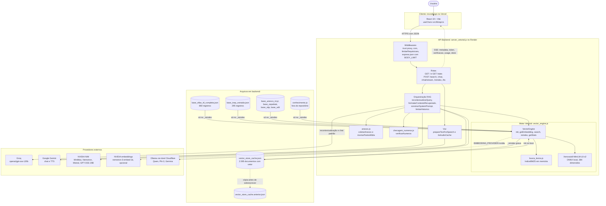
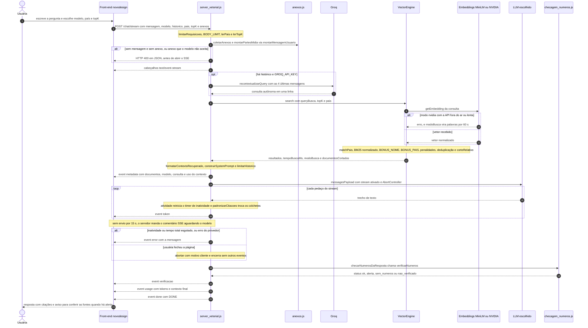

# Lumina 3.0 — Documentação Técnica

## Parte 1 de 3: visão geral, arquitetura e refinaria de dados

| Item | Valor |
|---|---|
| Repositório | `github.com/oaxiapsolrac/lumina-ia` |
| Branch | `Lumina3.0` |
| Commit de referência | `87da800` (11/11/2026): "Lumina 3.0: bases CEPALSTAT, OECD STIP e World Bank WBL e prompt para conversa" |
| Data da análise | 12/11/2026 |
| Arquivos analisados | `backend/package.json`, `backend/.env.example`, `backend/server_vetorial.js`, `backend/vector_engine.js`, `backend/ttl_parser.js`, `backend/extrair_inep.js`, `backend/anexos.js`, `backend/busca_lexica.js`, `backend/checagem_numeros.js`, `backend/avaliacao/avaliar.js`, `backend/base_ellas_ttl_completa.json`, `backend/base_inep_extraida.json`, `backend/vector_store_cache.json`, `novodesign/package.json`, `novodesign/src/lib/api.ts`, `novodesign/src/lib/modelos.ts` e o export `backup_ellas.ttl` (cópia em `teste-lumina-1artigosematec/`) |

### Estado documentado

Este documento descreve a versão publicada (commit `87da800`), com **2.595 documentos** no índice vetorial. Na máquina de desenvolvimento existem mudanças ainda não publicadas, marcadas no texto como **[local, não publicado]**:
- a base Brasil CT&I (`base_brasil_cti.json`), que leva o índice local a 4.598 documentos;
- no `vector_engine.js`, a constante `MAX_TRECHOS_POR_DOCUMENTO`, a penalidade de listas (`BUSCA_PENALIDADE_LISTA`) e o filtro `CONTEXTO_BRASIL_CTI`.

### Correções em relação ao escopo pedido

Quatro pontos do pedido não correspondem ao código. A documentação segue o código:

1. **`anexos.js` não participa da ingestão de dados.** Ele roda em tempo de execução: junta os anexos do chat (imagem, vídeo e áudio em *data URL*) e os converte nas partes multimodais aceitas por cada modelo (`image_url`, `video_url`, `audio_url`). No diagrama da refinaria (seção 2.2) ele aparece fora do ETL, e a seção 3.4 descreve o papel real.
2. **Os dados do INEP não vêm de planilhas.** `extrair_inep.js` consulta por SPARQL o repositório GraphDB `ELLAS-INEP-V1` (`https://app.ellas.ufmt.br/repositories/ELLAS-INEP-V1`), com autenticação Basic.
3. **Os embeddings não dependem de provedor externo por padrão.** O modelo `Xenova/all-MiniLM-L6-v2` roda no próprio servidor, em ONNX, pela biblioteca `@xenova/transformers`. A API de embeddings da NVIDIA é opcional (`EMBEDDING_PROVIDER=nvidia`). Os provedores externos obrigatórios são os de LLM (Groq por padrão) e, para voz, o Gemini.
4. **O índice não tem só ELLAS e INEP.** A versão publicada indexa oito fontes (seção 1.3). ELLAS e INEP são as duas de origem semântica (GraphDB); as demais vêm de pipelines em Python da pasta `newdata/`.

---

## 1. Visão Geral da Lumina 3.0

### 1.1 Propósito

A Lumina é a assistente conversacional do Projeto ELLAS (*Equality in Leadership for Latin American STEM*), liderado pela UFMT em cooperação com a UMSA (Bolívia) e a ULima (Peru). A missão está escrita no prompt do sistema montado por `construirSystemPrompt()` (`server_vetorial.js`): "responder sobre igualdade de gênero em STEM na América Latina usando somente os documentos recuperados abaixo."

A Lumina tem uma base de conhecimento própria, com três origens (contagens na seção 1.3):
- **Dados do Projeto ELLAS**, guardados no GraphDB do projeto:
  - **Ontologia ELLAS:** iniciativas, políticas, indicadores, fatores (barreiras e facilitadores), artigos, organizações e comunidades sobre mulheres em STEM na América Latina. Arquivo: `base_ellas_ttl_completa.json`.
  - **Censo da Educação Superior (INEP/MEC):** participação de mulheres nas matrículas, nos ingressos e nas conclusões de cada curso, agrupados pela classificação CINE, e as instituições de ensino superior cadastradas. Arquivo: `base_inep_extraida.json`.
- **Bases públicas internacionais coletadas para a Lumina:** UNESCO/RICYT, CEPALSTAT, OECD STIP Compass e World Bank *Women, Business and the Law*, tratadas pelos pipelines Python da pasta `newdata/`. Somam mais da metade dos documentos do índice.
- **Base curada** `conhecimento.js`, escrita à mão.

### 1.2 Capacidades funcionais

O servidor `server_vetorial.js` (Express 5, módulo ES) carrega o índice com `await vectorEngine.init()` em *top-level await* antes de registrar as rotas. O `app.listen(PORT)` só acontece depois que o índice está em memória, então o servidor nunca atende uma pergunta com o índice vazio.

**Rotas HTTP**

| Rota | Entrada (corpo JSON, com padrão) | Saída | Observações |
|---|---|---|---|
| `GET /` | nenhuma | `{ status: "online", servico, versao: "3.0.0", endpoints }` | verificação de saúde |
| `GET /stats` | nenhuma | `vectorEngine.getStats()`: `totalDocumentos`, `dimensoesVetor`, `modeloEmbeddings`, `busca`, `paisesIndexados`, `categoriasIndexadas`, `cacheStatus` | chamada pelo front-end em `buscarEstatisticas()` |
| `POST /search` | `query` (obrigatório), `topK = 5`, `pais = null`, `categoria = null`, `minScore = 0.2` | objeto completo de `vectorEngine.search()`: `query`, `totalEncontrados`, `topKSolicitado`, `filtroPais`, `tempoBuscaMs`, `modoBusca`, `documentosCortados`, `resultados` | busca sem LLM. `categoria` passa pela mesma validação de `pais` (`lerPais()`: texto aparado, até 60 caracteres) |
| `POST /chat` | `mensagem = ""`, `modelo = "groq"`, `historico = []`, `pais = null`, `topK = 4`, `imagens = []`, `arquivos = []` | `{ resposta, verificacaoNumeros, tokens_in, tokens_out, contexto, modeloUtilizado, queryUtilizada, documentosRecuperados, metricas }` | resposta única. Envia o contexto ao modelo com a nota de cada documento (`formatarContextoRecuperado(docs, true)`) |
| `POST /chat/stream` | os mesmos campos de `/chat` | Server-Sent Events: `metadata`, `token`, `verificacao`, `usage`, `error`, `done` (`data: [DONE]`) | rota usada pelo front-end (`conversarStream()` em `novodesign/src/lib/api.ts`). Contexto sem a nota (`formatarContextoRecuperado(docs, false)`) |
| `POST /reindex` | cabeçalho `Authorization: Bearer <ADMIN_TOKEN>` | `{ status: "ok", tempoMs, totalDocumentos, modeloEmbeddings, ...resumo }` | 403 quando `ADMIN_TOKEN` não está definido; 401 quando o token não confere. `tokenAdminValido()` compara os tamanhos e depois usa `crypto.timingSafeEqual` |
| `POST /tts` | `texto` (até 20.000 caracteres), `voz = "pt-br-assistant-5"` | áudio binário, com o `Content-Type` devolvido pelo provedor | cadeia de quatro tentativas no Gemini e cache em memória (detalhes abaixo) |

`topK` passa por `lerTopK()`: valores inválidos ou menores que 1 voltam ao padrão da rota, e o teto é `TOPK_MAX = 20`. Sem `mensagem` e sem anexos, `/chat` e `/chat/stream` respondem 400 antes de chamar qualquer serviço externo.

**Funções de apoio ao chat**

| Capacidade | Implementação | Comportamento |
|---|---|---|
| Recontextualização de perguntas de continuação | `recontextualizarQuery(mensagem, historico)` | Com histórico e `GROQ_API_KEY`, envia as 4 últimas mensagens ao Groq (`GROQ_MODEL`, `temperature: 0.1`, `max_tokens: 300` e `reasoning_effort: "low"` quando o modelo é GPT-OSS). A primeira linha da resposta, sem aspas e com mais de 3 caracteres, vira a consulta da busca. Em erro, a busca usa a mensagem original. "me traga mais", depois de uma pergunta sobre Sonia Guimarães, vira algo como "biografia trajetória e carreira de Sonia Guimarães" |
| Memória multi-turno com orçamento | `limitarHistorico(historico, { janela, tokensFixos, reservaResposta })` | Orçamento = `min(HISTORICO_MAX_TOKENS, janela − tokensFixos − reservaResposta)`, nunca negativo. Percorre o histórico do fim para o começo somando `estimarTokens(content) + 4` por mensagem, para quando estoura e descarta as primeiras mensagens até a conversa começar por uma do usuário. Devolve `{ mensagens, descartadas }` |
| Janela e reserva por modelo | `janelaContexto(modelo)`, `reservaResposta(modelo)` | Janela: `QWEN_NUM_CTX` (4.096) para os aliases do Qwen, 4.096 para `phi-3-mini`, 8.192 para `gemma-2-2b`, 1.048.576 para `gemini` e Mistral, 131.072 para os demais. Reserva: 1.536 tokens nos modelos de `MODELOS_LOCAIS` e 4.096 nos de nuvem |
| Estimativa de tokens | `estimarTokens(conteudo)` | `Math.ceil(clean.length / 3.8)`, depois de trocar cada *data URL* base64 por `[MEDIA]`. Usada quando a API não devolve `usage` |
| Medidor de contexto | `calcularUsoContexto(tokensUsados, maxContexto)` | `{ porcentagem, usados, maximo, status }`, com `status` `seguro` (até 60%), `alerta` (acima de 60% até 80%) e `critico` (acima de 80%, inclusive acima de 100%) |
| Citações padronizadas | `padronizarCitacoes(texto)` | Troca `【` e `】` por `[` e `]`, caractere a caractere, para funcionar também token a token no streaming |
| Anexos multimodais | `coletarAnexos()` e `montarPartesMidia()` (`anexos.js`), chamados por `montarMensagemUsuario()` | Valida os anexos antes de qualquer chamada paga e monta as partes `image_url`, `video_url` e `audio_url` conforme o modelo (seção 3.4) |
| Checagem dos números da resposta | `checarNumerosDaResposta()` → `verificarNumeros()` (`checagem_numeros.js`) | Procura cada número da resposta nos documentos recuperados e no que a pessoa escreveu. Não altera a resposta: devolve `status` (`ok`, `alerta`, `sem_numeros` ou `nao_verificado` quando há anexo), `total`, `verificados` e `naoEncontrados` |

**Síntese de voz (`POST /tts`)**

1. `prepareTextForSpeech(texto)` transforma Markdown e tabelas em texto corrido para narração. Texto vazio depois da limpeza responde 400.
2. A chave de cache é `` `${voiceId}::${textoLimpo}` ``. `ttsAudioCache` (um `Map`) guarda até 30 áudios; quando enche, apaga a chave mais antiga (`ttsAudioCache.keys().next().value`), ou seja, descarte por ordem de chegada.
3. Sem cache, o servidor tenta, em ordem:
   1. `sintetizarInteractionsTTS(chave, GEMINI_TTS_MODEL || "gemini-3.8-flash-lite-tts", texto, voiceId)`, em `POST https://generativelanguage.googleapis.com/v1beta/interactions` com `response_format: { type: "audio" }`;
   2. a mesma função com `gemini-3.8-flash-tts`;
   3. a mesma função com `gemini-3.1-flash-tts-preview` e a voz convertida por `mapearVozStudio()` (por exemplo, `pt-br-assistant-11` vira `Puck`);
   4. `sintetizarGemini25TTS()`, em `models/gemini-2.5-flash-preview-tts:generateContent`. Quando o retorno é PCM (`L16`), `pcm16ToWav(raw, 24000, 1, 16)` monta o cabeçalho WAV.
4. Se todas falham, responde com o status da última falha (502 quando não há status).

**Proteções de acesso**

| Mecanismo | Implementação |
|---|---|
| Proxy confiável | `app.set('trust proxy', ...)` recebe `TRUST_PROXY` (número quando só tem dígitos). Sem a variável e com `RENDER` definido, vale 1. Isso faz `req.ip` ser o IP real do cliente atrás do proxy do Render |
| CORS | `cors({ origin: CORS_ORIGINS })` com a lista separada por vírgulas. Sem a lista, `cors()` aceita qualquer origem e o servidor escreve um aviso no log |
| Limite por IP | `limitarRequisicoes` em `['/search', '/chat', '/tts']` (o prefixo `/chat` cobre `/chat/stream`). Janela fixa por IP no `Map` `contadoresPorIp`, limpo por um `setInterval(...).unref()`. Acima de `RATE_LIMIT_MAX` (30) em `RATE_LIMIT_WINDOW_MS` (60.000 ms) responde 429 com `Retry-After`. `GET /`, `GET /stats` e `POST /reindex` ficam fora do limite |
| Tamanho do corpo | `express.json` e `express.urlencoded` com `BODY_LIMIT` (`25mb`), registrados depois do limite por IP para não ler corpos grandes de quem já passou da cota |
| Erros de corpo | o *middleware* final responde 413 (corpo acima de `BODY_LIMIT`) e 400 (`entity.parse.failed`, JSON inválido) em JSON |
| Falhas do processo | `uncaughtException` registra e encerra o processo (`process.exit(1)`), para o Render reiniciar limpo; `unhandledRejection` só registra |

### 1.3 Bases indexadas

O índice publicado tem **2.595 documentos** de oito fontes. Os números abaixo foram contados no cache publicado (`vector_store_cache.json` do commit `87da800`) pelo prefixo do `id`.

| Fonte | Arquivo lido por `_reindex()` | Gerado por | Documentos no índice |
|---|---|---|---:|
| Ontologia ELLAS | `base_ellas_ttl_completa.json` (860 registros) | `ttl_parser.js` sobre `backup_ellas.ttl`, export do GraphDB `EllasV2` | 836 |
| Censo da Educação Superior (INEP/MEC) | `base_inep_extraida.json` (295 registros) | `extrair_inep.js`, SPARQL no GraphDB `ELLAS-INEP-V1` | 295 |
| UNESCO UIS e DataHub, RICYT e RedIndices | `base_unesco_ricyt.json` | `construir_base_lumina.py` e `construir_extras_unesco.py` (`newdata/`) | 218 (UIS 102, RedIndices 42, UNESCO 40, RICYT 34) |
| CEPALSTAT (CEPAL) | `base_cepalstat.json` | `tratar_cepalstat.py` | 655 |
| OECD STIP Compass | `base_stip.json` | `tratar_stip.py` | 255 |
| World Bank *Women, Business and the Law* | `base_wbl.json` | `tratar_wbl.py` | 308 |
| Base curada | `conhecimento.js` (fora do repositório, em `ellas.ufmt/backend/`) | edição manual | 28 |
| SOAAS | `base_soaas_extraida.json` | nenhum script no repositório | 0 (arquivo ausente; o bloco existe em `_reindex()`) |
| **Total** | | | **2.595** |

Dos 2.595 documentos, 1.218 têm o campo `familia` (CEPALSTAT, STIP e WBL), usado na diversificação da busca e no IDF do BM25. A diferença entre os 860 registros da ontologia e os 836 indexados está explicada na seção 3.6.

**[local, não publicado]** A base Brasil CT&I (`base_brasil_cti.json`, gerada em `newdata/brasil_cti_interseccional/`) acrescenta 2.003 documentos (1.528 trechos centrais e 475 do contexto filtrado por `CONTEXTO_BRASIL_CTI`), e o índice local chega a 4.598 documentos.

### 1.4 Stack tecnológica

**Backend**

| Camada | Tecnologia | Detalhe |
|---|---|---|
| Runtime | Node.js, módulos ES (`"type": "module"`) | O `package.json` não tem `engines`. O código exige Node 18 ou mais novo: `fetch` e `AbortSignal.timeout` globais, e o Express 5 também pede Node 18. Versão medida na máquina de desenvolvimento: Node 26.7.0 |
| Servidor HTTP | Express 5 e `cors` | Um processo e uma instância. O limite por IP, o cache de TTS e o índice ficam na memória desse processo |
| Embeddings | `@xenova/transformers` (ONNX Runtime em JavaScript) | `pipeline('feature-extraction', 'Xenova/all-MiniLM-L6-v2')`, 384 dimensões, `pooling: 'mean'`, `normalize: true`. Importado sob demanda, só no modo local |
| Busca | código próprio (`vector_engine.js` e `busca_lexica.js`) | Sem banco vetorial: varredura linear com `produtoEscalar()` sobre todos os candidatos (2.595 × 384 multiplicações por pergunta), somada ao BM25 `IndiceBM25` (k1 = 1,2, b = 0,75) |
| Persistência | arquivos JSON no disco | `vector_store_cache.json` (33,9 MB no commit publicado, com indentação) e a cópia `vector_store_cache.anterior.json`. Não há banco de dados |
| LLM | `groq-sdk` e `fetch` direto | Groq pelo SDK; Gemini, NVIDIA NIM e Ollama por `fetch` com leitura manual do *stream* |
| Configuração | `dotenv` | `dotenv.config({ path: path.join(__dirname, '.env') })`, independente da pasta de onde o processo foi iniciado |

**Provedores externos**

| Provedor | Uso na Lumina | Endpoint | Obrigatório? |
|---|---|---|---|
| Groq | modelo padrão do chat e `recontextualizarQuery()` | SDK `groq-sdk` | sim: sem `GROQ_API_KEY` o servidor sobe, mas o modelo padrão e a recontextualização falham |
| Google Gemini | chat (`modelo: "gemini"`) e `/tts` | `v1beta/models/{GEMINI_MODEL}:streamGenerateContent?alt=sse` (streaming), `:generateContent` (`/chat`), `v1beta/interactions` e `gemini-2.5-flash-preview-tts:generateContent` (voz). Chave no cabeçalho `x-goog-api-key`, não na URL | só para Gemini e voz |
| NVIDIA NIM | MiniMax, Nemotron, Mistral e GPT-OSS 20B; embeddings opcionais | `https://integrate.api.nvidia.com/v1/chat/completions` e `/v1/embeddings` | só para esses modelos ou com `EMBEDDING_PROVIDER=nvidia` |
| Ollama | Qwen 2.5 1.5B, Phi-3 e Gemma 2 | `OLLAMA_ENDPOINT` (padrão `http://localhost:11434/v1/chat/completions`). Em produção é um túnel Cloudflare para a máquina que roda o Ollama | só para os modelos locais |
| GraphDB do ELLAS | fonte da ontologia e do INEP | `https://app.ellas.ufmt.br/repositories/EllasV2` e `.../ELLAS-INEP-V1` | não em tempo de execução: só na geração das bases |

**Roteamento de modelos em `POST /chat/stream`**

Todos os modelos recebem `temperature: TEMPERATURA_RAG` (0,3). O limite de saída é 4.096 tokens (Groq, Gemini e NIM) ou 1.536 (Ollama). As chamadas compatíveis com OpenAI pedem `stream_options: { include_usage: true }`.

| `modelo` enviado (valor do front-end em negrito) | Provedor | Modelo: variável e padrão | Chave | Parâmetros extras |
|---|---|---|---|---|
| **`groq`**, **`gpt-oss-120b`**, `gpt-oss-120b-nvidia`, `nvidia-gpt-oss-120b` | Groq | `GROQ_MODEL` = `openai/gpt-oss-120b` | `GROQ_API_KEY` | `reasoning_effort: ESFORCO_GPT_OSS` quando o modelo é GPT-OSS |
| **`gemini`** | Google | `GEMINI_MODEL` = `gemini-2.5-flash` | `GEMINI_API_KEY` | o prompt do sistema vai em `system_instruction`; o histórico vira `contents` com papéis `user` e `model` |
| **`minimax-m3.1-flash`**, `minimax`, `glm-5.3-flash`, `glm`, `kimi-3`, `kimi`, `nvidia` | NVIDIA NIM | `NVIDIA_MODEL` = `minimaxai/minimax-m3.1-flash` | `NVIDIA_API_KEY` | `top_p: 1`, `reasoning_effort: NVIDIA_REASONING_EFFORT` (`low`) |
| **`nemotron-3-nano-omni`** | NVIDIA NIM | `NEMOTRON_OMNI_MODEL` = `nvidia/nemotron-3-nano-omni-30b-a3b-reasoning` | `NVIDIA_NEMOTRON_OMNI_API_KEY`, senão `NVIDIA_API_KEY` | aceita imagem, vídeo e áudio |
| **`nemotron-3-super-120b`** | NVIDIA NIM | `NEMOTRON_120B_MODEL` = `nvidia/nemotron-3.5-super-vl-120b-a12b` | `NVIDIA_NEMOTRON_120B_API_KEY`, senão `NVIDIA_API_KEY` | nenhum |
| **`mistral-large`**, `mistral`, `mistral-large-4`, `mistralai/mistral-large-4-1t-a52b` | NVIDIA NIM | `MISTRAL_LARGE_MODEL` = `mistralai/mistral-large-4-1t-a52b` | `MISTRAL_LARGE_API_KEY`, senão `NVIDIA_API_KEY` | `reasoning_effort: MISTRAL_REASONING_EFFORT` (`medium`) |
| **`gpt-oss-20b`** | NVIDIA NIM | `GPT_OSS_MODEL` = `openai/gpt-oss-20b` | `GPT_OSS_API_KEY`, senão `NVIDIA_API_KEY` | `reasoning_effort: ESFORCO_GPT_OSS` |
| **`qwen`**, `qwen2.5:1.5b`, `local`, `ic-qwen`, `qwen-2.5-1.5b` | Ollama | `QWEN_MODEL` = `qwen2.5:1.5b` | texto fixo `"ollama"` | nenhum |
| **`phi-3-mini`** | Ollama | `phi3` (fixo no código) | `"ollama"` | nenhum |
| **`gemma-2-2b`** | Ollama | `gemma2:2b` (fixo no código) | `"ollama"` | nenhum |
| qualquer outro valor | NVIDIA NIM | `NVIDIA_MODEL` | `NVIDIA_API_KEY` | os do MiniMax |

Diferenças entre `/chat` e `/chat/stream` que valem para clientes que chamam a API diretamente (o front-end só envia os valores em negrito, então não é afetado):
- Um valor desconhecido de `modelo` vai para o Groq no `/chat` e para o `NVIDIA_MODEL` no `/chat/stream`.
- Só o `/chat` aceita os apelidos `gpt-oss`, `nemotron`, `nemotron-120b`, `nemotron-3-ultra-550b`, `nemotron-omni`, `nano-omni` e `gemma`. No `/chat/stream` eles caem no MiniMax. Como `anexos.js` libera imagem para `nemotron` e `nemotron-omni`, uma imagem enviada com esses apelidos ao `/chat/stream` chega ao MiniMax.
- No `/chat`, a chave do Omni ainda tenta `NVIDIA_NEMOTRON_API_KEY` antes de `NVIDIA_API_KEY`.
- No `/chat/stream`, o rótulo `modeloUtilizado` do evento `metadata` (`modeloDisplay`) é texto fixo, por exemplo "Groq (openai/gpt-oss-120b)", e não muda quando `GROQ_MODEL` ou `GEMINI_MODEL` mudam.

**Front-end (`novodesign/`, publicado no Vercel)**

| Item | Detalhe |
|---|---|
| Base | React 19.3, TypeScript 7.0 e Vite 8.3 (`@vitejs/plugin-react`) |
| Interface | Tailwind CSS 4.3 (`@tailwindcss/vite`), `radix-ui` 1.8, `motion` 14.12, `lucide-react` 1.71 e `clsx` 2.1 |
| Respostas | `react-markdown` 10.1 com `remark-gfm` 4.0 (tabelas e listas do Markdown gerado pelo modelo) |
| Endereço do backend | `API_BASE` em `src/lib/api.ts`: `VITE_API_BASE` quando definido, senão `https://lumina-backend-zsak.onrender.com` |
| Chamadas | `conversarStream()` (`POST /chat/stream`, leitura manual do SSE), `buscarEstatisticas()` (`GET /stats`) e `sintetizarVoz()` (`POST /tts`) |
| Catálogo de modelos | `MODELOS` em `src/lib/modelos.ts`. O campo `midias` espelha `anexos.js`, com uma diferença: o front-end não oferece anexos ao `nemotron-3-super-120b`, que o backend aceita com imagem e vídeo |
| Limites de anexos | `LIMITE_ANEXOS` = 8 imagens, 1 vídeo e 1 áudio; `LIMITE_TOTAL_ANEXOS_MB = 18` (base64 aumenta cerca de 33%, e o servidor aceita 25 MB) |
| Filtros | `PAISES` (Brasil, Bolívia, Peru, México, Chile, Argentina e Colômbia, enviados sem acento e casados por `matchPais()`) e `OPCOES_TOPK = [3, 4, 6, 8]` |

Hospedagem do backend: Render, plano gratuito (512 MB de RAM), em `https://lumina-backend-zsak.onrender.com`. O processo publicado usa cerca de 417 MB depois de subir.

### 1.5 Dependências e scripts (`backend/package.json`)

Identificação: `"name": "projeto-lumina-pibic"`, `"version": "3.0.0"`, `"main": "server_vetorial.js"`, descrição "Arquitetura RAG para a Plataforma ELLAS". Não há `devDependencies`.

| Dependência | Versão declarada | Papel | Onde é usada |
|---|---|---|---|
| `@xenova/transformers` | `^2.17.2` | Roda o modelo de embeddings em ONNX dentro do Node | `vector_engine.js`, `carregarModelo()`, por `import()` dinâmico só quando `EMBEDDING_PROVIDER` é `local` |
| `cors` | `^2.8.6` | Cabeçalhos CORS com lista de origens | `server_vetorial.js` |
| `dotenv` | `^16.4.5` | Lê o `.env` | `server_vetorial.js`, `extrair_inep.js` e o script `reindex` (`import("dotenv/config")`) |
| `express` | `^5.2.1` | Servidor HTTP, *parsers* de corpo e roteamento | `server_vetorial.js` |
| `groq-sdk` | `^1.6.0` | Cliente da API do Groq, com streaming | `server_vetorial.js` (chat e `recontextualizarQuery()`) |

Os demais módulos vêm do próprio Node: `fs`, `path`, `url`, `readline` (leitura do TTL linha a linha) e `crypto` (`timingSafeEqual`). `backend/node_modules` é um link simbólico para `../../teste-lumina-1artigosematec/node_modules`, compartilhado com o projeto irmão.

| Script | Comando | O que faz |
|---|---|---|
| `start` | `node server_vetorial.js` | Sobe o servidor (porta `PORT`, senão `PORT_TESTE`, senão 3001) |
| `parse:ttl` | `node ttl_parser.js` | Gera `base_ellas_ttl_completa.json` a partir do TTL. Aceita `node ttl_parser.js [entrada.ttl] [saida.json]` |
| `extrair:inep` | `node extrair_inep.js` | Gera `base_inep_extraida.json` por SPARQL. Exige `ELLAS_AUTH_BASE64` |
| `avaliar:validar` | `node avaliacao/avaliar.js validar` | Confere se cada documento-alvo de `avaliacao/casos.json` existe na base e se cada expressão regular dos casos compila |
| `avaliar:busca` | `node avaliacao/avaliar.js busca` | Mede só a busca, sem chamar modelo: acertos no top-4 e MRR. Versão publicada: 74/77, MRR 0,923 |
| `avaliar:respostas` | `node avaliacao/avaliar.js respostas` | Faz as perguntas ao servidor local por `/chat/stream` (exige `npm start`; modelo em `--modelo`) e conta citações `[n]`, números sem fonte, erros e tempo médio. Cada rodada é salva em `avaliacao/resultados/` e comparada com a anterior |
| `reindex` | `node -e 'import("dotenv/config").then(() => import("./vector_engine.js")).then(m => m.vectorEngine.reindex()).then(r => console.log(r))'` | Reconstrói o índice sem subir o servidor e imprime o `resumo` |

O `import("dotenv/config")` vem antes do `import("./vector_engine.js")` porque o motor lê as variáveis de busca e de embeddings sob demanda (funções como `provedorEmbeddings()` e `pesoLexico()`), e elas precisam estar carregadas quando `reindex()` começa.

### 1.6 Variáveis de ambiente (`backend/.env.example`)

Legenda da coluna "Lida por": **S** = `server_vetorial.js`, **V** = `vector_engine.js`, **I** = `extrair_inep.js`, **T** = `ttl_parser.js`. "Padrão no código" é o valor usado quando a variável não existe ou está vazia.

**Modelos de nuvem**

| Variável | `.env.example` | Padrão no código | Lida por | Efeito |
|---|---|---|---|---|
| `GROQ_API_KEY` | vazio | `"missing-key"` (o SDK sobe, as chamadas falham) | S | chat padrão e `recontextualizarQuery()`. Sem ela, a recontextualização é pulada |
| `GROQ_MODEL` | `openai/gpt-oss-120b` | igual | S | modelo do Groq no chat e na recontextualização |
| `GEMINI_API_KEY` | vazio | nenhum | S | chat Gemini e `/tts`. Sem ela, `/tts` responde 500 e o chat Gemini emite `error` |
| `GEMINI_MODEL` | `gemini-2.5-flash` | igual | S | modelo do chat Gemini |
| `GEMINI_TTS_MODEL` | `gemini-3.8-flash-lite-tts` | igual | S | primeira tentativa do `/tts`; as outras três são fixas no código |

**NVIDIA NIM** (cada chave específica cai em `NVIDIA_API_KEY` quando está vazia)

| Variável | `.env.example` | Lida por | Efeito |
|---|---|---|---|
| `NVIDIA_API_KEY` | vazio | S, V | chave geral do NIM; também a dos embeddings com `EMBEDDING_PROVIDER=nvidia` |
| `NVIDIA_MODEL` | `minimaxai/minimax-m3.1-flash` | S | modelo dos aliases MiniMax, GLM, Kimi e `nvidia`, e de qualquer `modelo` desconhecido no `/chat/stream` |
| `NVIDIA_REASONING_EFFORT` | `low` | S | `reasoning_effort` dos modelos MiniMax |
| `GPT_OSS_API_KEY`, `GPT_OSS_MODEL` | vazio, `openai/gpt-oss-20b` | S | GPT-OSS 20B no NIM |
| `NVIDIA_NEMOTRON_120B_API_KEY`, `NEMOTRON_120B_MODEL` | vazio, `nvidia/nemotron-3.5-super-vl-120b-a12b` | S | Nemotron 3.5 Super |
| `NVIDIA_NEMOTRON_OMNI_API_KEY`, `NEMOTRON_OMNI_MODEL` | vazio, `nvidia/nemotron-3-nano-omni-30b-a3b-reasoning` | S | Nemotron 3 Nano Omni (multimodal) |
| `MISTRAL_LARGE_API_KEY`, `MISTRAL_LARGE_MODEL` | vazio, `mistralai/mistral-large-4-1t-a52b` | S | Mistral Large 4 |
| `MISTRAL_REASONING_EFFORT` | `medium` | S | `reasoning_effort` do Mistral |

**Ollama (modelos pequenos remotos)**

| Variável | `.env.example` | Padrão no código | Lida por | Efeito |
|---|---|---|---|---|
| `OLLAMA_ENDPOINT` | vazio | `http://localhost:11434/v1/chat/completions` | S | URL compatível com OpenAI do Ollama (em produção, o túnel Cloudflare) |
| `QWEN_MODEL` | `qwen2.5:1.5b` | igual | S | modelo dos aliases do Qwen |
| `QWEN_NUM_CTX` | `4096` | igual | S | só entra em `janelaContexto()`, para o orçamento do histórico e o medidor de contexto. Não é enviado ao Ollama, que usa a própria configuração de `num_ctx` |

**Geração**

| Variável | `.env.example` | Padrão no código | Lida por | Efeito |
|---|---|---|---|---|
| `RAG_TEMPERATURE` | `0.3` | `0.3`; valores fora de 0 a 2 também voltam a 0,3 | S | `TEMPERATURA_RAG`, a temperatura de todos os modelos no chat |
| `GPT_OSS_REASONING_EFFORT` | `low` | `low` (aceita `low`, `medium`, `high`) | S | `ESFORCO_GPT_OSS`, no Groq e no GPT-OSS 20B |
| `HISTORICO_MAX_TOKENS` | `6000` | `6000` | S | teto do orçamento de `limitarHistorico()` |
| `LLM_TIMEOUT_INATIVIDADE_MS` | `90000` | `90000` | S | o streaming é abortado se o modelo passa esse tempo sem mandar nada |
| `LLM_TIMEOUT_TOTAL_MS` | `300000` | `300000` | S | tempo máximo de uma resposta em streaming |

**Busca e embeddings** (lidas sob demanda, em cada chamada, porque `vector_engine.js` é importado antes de o servidor carregar o `.env`)

| Variável | `.env.example` | Padrão no código | Lida por | Efeito |
|---|---|---|---|---|
| `EMBEDDING_PROVIDER` | `local` | `local`; só `nvidia` muda o modo | V | `provedorEmbeddings()`: ONNX local ou API da NVIDIA |
| `EMBEDDING_MODEL` | vazio | `Xenova/all-MiniLM-L6-v2` (local) ou `nvidia/nemotron-3-embed-1b` (nvidia) | V | `modeloEmbeddings()`. Cada modelo tem o seu arquivo de cache (`arquivoCache()`); modelos E5 recebem os prefixos `query: ` e `passage: ` (`prefixos()`) |
| `EMBEDDING_DIMENSOES` | `1024` | `1024` | V | só no modo nvidia: `dimensoesApi()` corta o vetor de 2.048 números para os 1.024 primeiros |
| `EMBEDDING_API_TIMEOUT_MS` | `5000` | `5000` | V | só no modo nvidia: tempo máximo do vetor da pergunta. Os lotes de documentos usam 60.000 ms |
| `BUSCA_PESO_LEXICO` | `0.25` | `0.25`; vazio também vale 0,25 | V | `pesoLexico()`: peso do BM25 normalizado somado ao cosseno. `0` desliga |
| `BUSCA_CORTE_RELATIVO` | vazio | `0.75` (local) ou `0.65` (nvidia); aceita de 0 a menos de 1 | V | `corteRelativo()`: só seguem os documentos com nota de pelo menos essa fração da nota do primeiro |
| `BUSCA_PENALIDADE_ESTATISTICA` | vazio | `0.15` | V | `penalidadeEstatistica()`: desconto dos documentos de categoria `CATEGORIA_ESTATISTICA` quando a pergunta não pede número (`PEDE_NUMERO`) |
| `BUSCA_PENALIDADE_SEM_GENERO` | vazio | `0.25` | V | `penalidadeSemGenero()`: desconto dos documentos com `semGenero` quando a pergunta fala de mulheres ou gênero (`FALA_DE_GENERO`) |

**Servidor e proteções**

| Variável | `.env.example` | Padrão no código | Lida por | Efeito |
|---|---|---|---|---|
| `PORT_TESTE` | `3001` | `3001` | S | porta local. `PORT` (definida pelo Render) tem prioridade |
| `CORS_ORIGINS` | vazio | qualquer origem, com aviso no log | S | origens permitidas, separadas por vírgula. Em produção: o endereço do Vercel |
| `RATE_LIMIT_MAX` | `30` | `30`; `0` desliga | S | requisições por IP e por janela em `/search`, `/chat`, `/chat/stream` e `/tts` |
| `RATE_LIMIT_WINDOW_MS` | `60000` | `60000` | S | tamanho da janela fixa e intervalo da limpeza de `contadoresPorIp` |
| `BODY_LIMIT` | `25mb` | `25mb` | S | tamanho máximo do corpo (anexos em base64) |
| `TRUST_PROXY` | vazio | `1` quando `RENDER` existe | S | `app.set('trust proxy')` |
| `ADMIN_TOKEN` | vazio | rota desligada | S | habilita `POST /reindex` |

**Fontes da reindexação e GraphDB**

| Variável | `.env.example` | Padrão no código | Lida por | Efeito |
|---|---|---|---|---|
| `CONHECIMENTO_PATH` | vazio | o primeiro que existir entre `conhecimento.js`, `../conhecimento.js` e `../../conhecimento.js`, relativos a `backend/` | V | base curada (`caminhoConhecimento()`) |
| `TTL_PATH` | vazio | `backup_ellas.ttl` em `backend/` | V, T | TTL usado por `parse:ttl` e, quando `base_ellas_ttl_completa.json` não existe, pela própria reindexação (`caminhoTTL()`) |
| `ELLAS_ENDPOINT` | `https://app.ellas.ufmt.br/repositories/EllasV2` | nenhum | ninguém | documenta o repositório da ontologia; nenhum arquivo lê a variável |
| `ELLAS_INEP_ENDPOINT` | `https://app.ellas.ufmt.br/repositories/ELLAS-INEP-V1` | igual | I | endpoint SPARQL do INEP |
| `ELLAS_AUTH_BASE64` | vazio | nenhum (o script para com erro) | I | credencial Basic do GraphDB; o prefixo `Basic ` é opcional |

**Divergências entre o `.env.example` e o código**

| Variável | Situação |
|---|---|
| `ELLAS_ENDPOINT` | está no `.env.example`, mas nenhum arquivo a lê. O TTL da ontologia é exportado manualmente do GraphDB |
| `NVIDIA_NEMOTRON_API_KEY` | lida só no `/chat`, como segunda opção da chave do Omni; não está no `.env.example` |
| `PORT`, `RENDER`, `RENDER_EXTERNAL_URL`, `PUBLIC_URL` | definidas pela plataforma de hospedagem, fora do `.env.example`. `PORT` escolhe a porta. `RENDER` liga o `trust proxy` e, com `RENDER_EXTERNAL_URL` e `PUBLIC_URL`, só define a URL impressa no log de inicialização (`BASE_URL`) |
| `BUSCA_PENALIDADE_LISTA` | **[local, não publicado]**: lida pelo `vector_engine.js` local (padrão 0,15), ausente do `.env.example` |

`avaliacao/avaliar.js` também lê `EMBEDDING_PROVIDER`, `PORT` e `PORT_TESTE`, para saber qual cache usar e onde está o servidor local.

---

## 2. Desenhos da Arquitetura

Cada desenho deste capítulo vem acompanhado de uma explicação em linguagem simples, para quem não é da área, seguida da leitura técnica.

### 2.1 Arquitetura geral de componentes



**Em linguagem simples**

**O que o desenho mostra.** As peças que fazem a Lumina funcionar e como elas se ligam. É um mapa do sistema: mostra quem fala com quem, e não a ordem dos acontecimentos. A ordem está no desenho da seção 2.3.

**Como ler.**
- A forma arredondada no alto ("Usuária") é a pessoa que usa a Lumina.
- Cada retângulo é uma peça do sistema: um programa ou uma parte de um programa.
- Os cilindros são arquivos onde ficam guardados dados.
- As molduras com título agrupam as peças que ficam no mesmo lugar: a página, o servidor, a pasta de arquivos do servidor e os serviços externos. Dentro da moldura do servidor, uma moldura menor separa o motor de busca.
- A seta contínua indica que uma peça envia algo para outra ou a aciona. O texto sobre a seta diz o quê, ou quando.
- A seta pontilhada indica um caminho especial: a resposta voltando para a tela, a cópia de segurança do índice e um modo opcional de cálculo pela NVIDIA.

**As três partes.**
1. **A página** que a pessoa abre no navegador, chamada de *front-end* e publicada no Vercel. Ela mostra a conversa e envia as perguntas. As chaves de acesso aos serviços de inteligência artificial não ficam nela.
2. **O servidor**, chamado de *backend* e publicado no Render. Ele recebe a pergunta, procura na base da Lumina os documentos relacionados a ela e prepara o pedido para o modelo de linguagem.
3. **Os serviços externos**: Groq, Google Gemini, NVIDIA e modelos menores no Ollama. Eles executam os modelos de linguagem, que são os programas que escrevem o texto da resposta. O Gemini também transforma a resposta em voz, quando a pessoa escolhe uma voz do Gemini.

**O caminho de uma pergunta.**
1. A página envia a pergunta ao servidor pela internet.
2. O servidor faz verificações iniciais: de onde vem o pedido, quantos pedidos o mesmo endereço fez no último minuto e o tamanho do envio.
3. Se a pergunta depende da conversa anterior, como "e no Peru?", o servidor pede antes ao Groq que a reescreva por inteiro, para a busca saber do que se trata.
4. O motor de busca procura, entre os 2.595 documentos da base, os mais próximos da pergunta. Para não refazer um trabalho demorado a cada pergunta, os documentos já ficam preparados num arquivo (`vector_store_cache.json`), lido quando o servidor liga. Os arquivos das bases originais só são lidos quando esse índice é refeito.
5. O servidor junta a pergunta e os documentos encontrados e pede ao modelo de linguagem escolhido que responda usando só esses documentos.
6. A página recebe primeiro a lista de fontes e depois a resposta, em pedaços, enquanto ela é escrita. No fim, o servidor confere se os números da resposta aparecem nos documentos.

**Palavras do desenho**

| Palavra no desenho | O que quer dizer |
|---|---|
| Cliente, *front-end* | a parte que aparece na tela da pessoa |
| API, *backend*, servidor | o programa que recebe os pedidos da página e devolve as respostas |
| Vercel, Render | serviços que mantêm na internet a página e o servidor, respectivamente |
| *Middlewares* | as verificações iniciais por onde passa todo pedido |
| Rotas | os endereços do servidor, um para cada tipo de pedido: informações gerais, estatísticas, busca, conversa, refazer o índice e gerar voz |
| Orquestração RAG | a parte que coordena a resposta: primeiro busca os documentos, depois pede ao modelo que escreva com base neles. RAG é a sigla em inglês para geração de texto apoiada em busca |
| Motor vetorial, vetor | o buscador da Lumina. Cada documento é guardado também como uma lista de números, o vetor, que representa o sentido do texto. Textos de sentido parecido têm vetores parecidos, e assim a busca encontra documentos relacionados mesmo quando as palavras não são as mesmas |
| MiniLM, ONNX | o modelo que calcula os vetores (MiniLM) e o formato que permite executá-lo dentro do próprio servidor (ONNX) |
| BM25 | busca por palavras, como a de um buscador comum, que complementa a busca por sentido |
| Cache | arquivo com um trabalho demorado já feito, para não refazê-lo a cada vez |
| Groq, Gemini, NVIDIA | serviços na internet que executam modelos de linguagem; a pessoa escolhe o modelo na tela |
| Ollama, túnel Cloudflare | o Ollama é um programa que roda modelos menores (Qwen, Phi-3 e Gemma). Em produção, o servidor chega até ele por um túnel da Cloudflare, uma ligação pela internet |
| TTS | sigla em inglês para a conversão de texto em fala |
| SSE | o jeito de o servidor mandar a resposta em várias mensagens curtas pela mesma conexão |

**Leitura do diagrama**

- **Cliente.** O front-end só conversa com o backend. Nenhuma chave de API vai para o navegador: todas ficam no `.env` do servidor.
- **Processo único.** Rotas, orquestração e motor vetorial dividem a mesma memória. O índice inteiro fica no array `vectorEngine.documents`, e cada documento carrega o próprio `vetor` (384 números em JavaScript). Por isso o consumo de RAM cresce com o número de documentos: cerca de 417 MB depois de subir, no Render gratuito de 512 MB.
- **Boot.** `init()` executa, em ordem:
  1. `carregarModelo()`: importa `@xenova/transformers` e cria o `pipeline('feature-extraction')`. No modo `nvidia` não carrega nada;
  2. se `arquivoCache(this.modelo)` existe, `JSON.parse` do arquivo inteiro;
  3. confere a dimensão. No modo local gera o vetor de `'teste'`; no modo `nvidia` usa `dimensoesApi()`, para não depender da API na hora de subir. Se a dimensão do cache for outra, chama `reindex()`;
  4. `construirIndiceLexico()`: o BM25 não é salvo em disco e é reconstruído em memória a cada boot, a partir de `` `${nome} ${nome} ${texto}` `` de cada documento (o nome entra duas vezes para pesar mais), com a `familia` de cada documento como grupo do IDF;
  5. `isInitialized = true`.
- **Bases JSON.** As bases de origem só são lidas por `_reindex()`. Isso acontece em três casos: o cache não existe, o cache tem vetores de outra dimensão, ou alguém roda `npm run reindex` ou `POST /reindex`. `reindex()` guarda a promessa em `reindexEmAndamento`, então duas chamadas simultâneas compartilham a mesma execução.
- **Embeddings.** Por padrão são calculados no próprio processo (ONNX). A linha tracejada para a NVIDIA indica o modo opcional: nele a pergunta vai à API e, se a API falha ou passa de `EMBEDDING_API_TIMEOUT_MS`, a busca segue só pelo BM25 por `PAUSA_APOS_FALHA_MS` (60 s).
- **Provedores de LLM.** Cada requisição usa um provedor, escolhido pelo campo `modelo` (tabela da seção 1.4). O Groq é chamado também para `recontextualizarQuery()` sempre que há histórico, qualquer que seja o modelo escolhido.
- **Volta ao cliente.** A resposta do chat volta por Server-Sent Events na mesma conexão HTTP do `POST /chat/stream`.

### 2.2 Pipeline da refinaria de dados

```mermaid
flowchart LR
    subgraph ORIGEM["Fontes semânticas no GraphDB"]
        G1[("EllasV2<br/>ontologia ELLAS")]
        G2[("ELLAS-INEP-V1<br/>Censo da Educação Superior")]
    end

    G1 -->|"export manual"| TTL["backup_ellas.ttl<br/>301 MB, 5.556.669 linhas"]

    subgraph PARSER["ttl_parser.js: parseBackupEllasTTL"]
        P1["readline<br/>uma linha por vez"] --> P2["TokenizadorTurtle<br/>iri, literal, pontuacao, nome"]
        P2 --> P3["ParserTurtle<br/>sujeito, predicado, objeto"]
        P3 --> P4["onTriple<br/>normalizarPredicado, valorObjeto"]
        P4 --> P5["entities<br/>Map por chaveEntidade"]
        P5 --> P6["nome por idioma pt, es, en<br/>e tipoPrincipal"]
        P6 --> P7["classificarRuido<br/>esquema, vocabulario, sem-tipo"]
        P7 --> P8["união multilíngue<br/>grupos e gruposSemFonte"]
        P8 --> P9["relações inversas<br/>usadoComoFonte, financia, apoia"]
        P9 --> P10["canonizarPaises e idUnico<br/>descricaoCompleta e textoVetor"]
    end

    TTL --> P1
    P10 --> J1[("base_ellas_ttl_completa.json<br/>860 registros")]

    subgraph INEPX["extrair_inep.js"]
        Q1["sparql<br/>POST com Basic auth, 3 tentativas"] --> Q2["agregar em lotes de 8 rótulos CINE<br/>enrolled, fresher, completed"]
        Q2 --> Q3["extrairCursos<br/>95 cursos"]
        Q1 --> Q4["extrairInstituicoes<br/>LIMIT 200"]
    end

    G2 --> Q1
    Q3 --> J2[("base_inep_extraida.json<br/>295 registros")]
    Q4 --> J2

    PY["pipelines Python em newdata/"] --> J3[("base_unesco_ricyt, base_cepalstat,<br/>base_stip, base_wbl")]
    CJ[("conhecimento.js<br/>base curada")]

    subgraph IDX["vector_engine.js: _reindex"]
        R1["ontologia: classificarRuido<br/>e limparPais"] --> R2["seenKeys<br/>chave de deduplicação por fonte"]
        R2 --> R3["texto de indexação<br/>recomposto por fonte"]
        R3 --> R4["embeddingsDocumentos<br/>MiniLM local ou NVIDIA"]
        R4 --> R5["construirIndiceLexico<br/>IndiceBM25"]
    end

    J1 --> R1
    J2 --> R2
    J3 --> R2
    CJ --> R2
    R5 --> C[("vector_store_cache.json<br/>escrito em .tmp e renomeado")]
    C -.->|"cópia do cache anterior"| ANT[("vector_store_cache.anterior.json")]
    C -->|"init no boot"| RAM["Índice em memória<br/>documents e indiceLexico"]

    ANX["anexos.js<br/>tempo de execução, fora do ETL"]
    ANX -.->|"partes multimodais de cada requisição"| CHAT["POST /chat e /chat/stream"]
    RAM --> CHAT
```



**Em linguagem simples**

**O que o desenho mostra.** Como os dados do Projeto ELLAS e as bases públicas coletadas para a Lumina viram a base de consulta da Lumina. Essa preparação é feita de tempos em tempos, quando os dados mudam, e não a cada pergunta. Ela lembra a organização de uma biblioteca: juntar o material, conferir, catalogar e montar o fichário de busca. O desenho se lê da esquerda para a direita.

**Como ler.**
- Os cilindros são bancos de dados e arquivos de dados.
- Os retângulos são programas e etapas de trabalho dos programas. A exceção é `backup_ellas.ttl`, o arquivo exportado da ontologia, que também aparece como retângulo.
- A primeira moldura, à esquerda, reúne as duas fontes guardadas no GraphDB. As outras molduras com título reúnem as etapas de um mesmo programa.
- As setas contínuas mostram o caminho dos dados de uma etapa para a seguinte.
- As setas pontilhadas mostram duas coisas à parte: a cópia de segurança da base pronta (`vector_store_cache.anterior.json`) e o caminho dos arquivos que a pessoa anexa na conversa (`anexos.js`), que não passam por esta preparação.

**As etapas.**
1. **De onde vêm os dados.** São três origens:
   - o GraphDB, o banco de dados do Projeto ELLAS. Ele guarda a ontologia, que é um mapa de iniciativas, organizações, comunidades, políticas, indicadores, fatores e publicações, com as relações entre eles. Guarda também uma cópia do Censo da Educação Superior do INEP;
   - as bases públicas internacionais coletadas para a Lumina (UNESCO e RICYT, CEPALSTAT, OECD STIP e Banco Mundial), preparadas por programas em Python na pasta `newdata/`;
   - uma base curada à mão (`conhecimento.js`), com biografias, fatores e políticas.

   Dos 2.595 documentos da base publicada, 1.131 vêm do GraphDB (836 da ontologia e 295 do INEP), 1.436 das bases internacionais e 28 da base curada (seção 1.3).
2. **Leitura da ontologia.** O conteúdo da ontologia é exportado à mão para um arquivo de texto muito grande (`backup_ellas.ttl`, com 301 MB e mais de 5,5 milhões de linhas). O programa `ttl_parser.js` lê esse arquivo linha por linha e:
   - separa cada afirmação, do tipo "esta iniciativa foi criada neste país";
   - junta tudo o que se refere a um mesmo item;
   - descarta o que não é conteúdo, como os termos que só descrevem a estrutura da própria ontologia;
   - une as versões do mesmo indicador em português, espanhol e inglês;
   - escreve um texto descritivo para cada item.

   O resultado é `base_ellas_ttl_completa.json`, com 860 registros.
3. **Leitura do INEP.** O programa `extrair_inep.js` consulta o GraphDB diretamente e reúne, para cada curso, quantas mulheres e quantos homens estão matriculados, ingressaram e concluíram. O resultado é `base_inep_extraida.json`, com 295 registros: 95 cursos e 200 instituições.
4. **Indexação.** O programa `vector_engine.js` junta todas as bases e elimina documentos repetidos. Depois calcula o vetor de cada documento (a lista de números que representa o sentido do texto, explicada na seção 2.1) e monta o índice de palavras.
5. **Base pronta.** Os documentos e os vetores são salvos em `vector_store_cache.json`. Quando o servidor liga, carrega esse arquivo na memória e refaz o índice de palavras, que não fica salvo. A partir daí, cada pergunta é respondida com essa base.

**Palavras do desenho**

| Palavra no desenho | O que quer dizer |
|---|---|
| GraphDB | o banco de dados do Projeto ELLAS, que guarda as informações como uma rede de itens ligados entre si |
| Ontologia | o mapa organizado do conhecimento do Projeto ELLAS: tipos de itens (iniciativa, política, indicador...) e como eles se relacionam |
| TTL, Turtle | o formato de texto em que a ontologia é exportada, com uma afirmação por linha |
| *Parser*, *tokenizador* | partes do programa que leem o texto e o separam em pedaços com significado |
| SPARQL | a linguagem de consulta usada para pedir dados ao GraphDB |
| CINE | a classificação internacional de áreas de curso usada pelo INEP |
| ETL | sigla em inglês para extrair, transformar e carregar: o nome técnico desta preparação |
| Deduplicação | eliminação de documentos repetidos que vêm de fontes diferentes |
| *Embeddings*, vetores | as listas de números que representam o sentido de cada documento |
| Índice em memória | a base pronta, carregada no servidor para responder rápido |

**Leitura do diagrama**

- **Ontologia.** O TTL é exportado à mão do repositório `EllasV2`; não há script de exportação no repositório e `ELLAS_ENDPOINT` não é usado por nenhum código. O arquivo (301.338.624 bytes) não está versionado: a cópia usada fica em `teste-lumina-1artigosematec/backup_ellas.ttl` e é passada por argumento ou por `TTL_PATH` (`node ttl_parser.js <caminho do TTL>`). Cada etapa de `ttl_parser.js` está descrita na seção 3.5.
- **INEP.** `extrair_inep.js` consulta `ELLAS-INEP-V1` direto por SPARQL e não passa por arquivo intermediário (seção 3.3).
- **Demais bases.** UNESCO/RICYT, CEPALSTAT, STIP e WBL chegam prontas dos pipelines Python da pasta `newdata/`, no mesmo formato de documento. `conhecimento.js` é editado à mão. Essas bases ficam fora do escopo desta parte e aparecem aqui para mostrar o ponto onde entram.
- **Indexação.** `_reindex()` junta tudo em `rawDocs`. O filtro de ruído e a limpeza de país rodam só na ontologia. A deduplicação por `seenKeys` vale para todas as fontes, na ordem ontologia → INEP → UNESCO/RICYT → bases tratadas → SOAAS → base curada; em caso de chave repetida, fica o primeiro documento. Depois vêm os vetores (`embeddingsDocumentos()`) e o BM25 (`construirIndiceLexico()`).
- **Escrita segura do cache.** Antes de gravar, o cache atual é copiado para `vector_store_cache.anterior.json` (`arquivoBackup()`). O novo é escrito em `vector_store_cache.json.tmp` e renomeado com `fs.renameSync`, para que uma queda no meio da escrita não deixe um cache corrompido. No modo local o JSON sai indentado (`JSON.stringify(indexedDocs, null, 2)`); no modo `nvidia`, sem indentação.
- **BM25.** O índice léxico não vai para o cache. `init()` o reconstrói em memória a cada boot.
- **`anexos.js`.** Aparece separado de propósito. Ele não lê nem escreve nenhuma base: só converte, a cada requisição de chat, os anexos enviados pela usuária no formato aceito pelo modelo (seção 3.4).

### 2.3 Diagrama de sequência conversacional (`POST /chat/stream`)



**Em linguagem simples**

**O que o desenho mostra.** A ordem do que acontece entre o momento em que a pessoa envia uma pergunta e o momento em que a resposta aparece na tela. O tempo corre de cima para baixo.

**Como ler.**
- Cada coluna é um participante: a pessoa, a página, o servidor e os programas e serviços que o servidor aciona. O nome fica no alto da coluna.
- Cada seta horizontal é uma mensagem de um participante para outro. A seta contínua é um pedido; a tracejada é uma resposta ou um aviso enviado de volta.
- Os números em círculos, no começo das setas, dão a ordem das mensagens.
- As notas amarelas são comentários sobre o que o servidor faz naquele momento.
- As molduras marcam trechos especiais:
  - "alt" separa caminhos alternativos: acontece um ou outro, conforme a condição escrita no alto da moldura;
  - "opt" é um trecho opcional, que só acontece na condição escrita;
  - "loop" é um trecho que se repete.

**O caminho, passo a passo.**
1. A pessoa escreve a pergunta e escolhe o modelo de linguagem, o país e quantos documentos a busca pode usar.
2. A página envia tudo ao servidor, junto com a conversa anterior e os anexos, se houver.
3. O servidor confere o limite de pedidos por minuto e o tamanho do envio, e padroniza o país e a quantidade de documentos pedidos. Se faltar a mensagem, ou se houver um anexo que o modelo escolhido não aceita, ele responde com erro na hora (primeira moldura "alt").
4. Se a conversa já tem mensagens anteriores, o Groq reescreve a pergunta por inteiro, para a busca entender do que se trata (moldura "opt").
5. O motor de busca transforma a pergunta em vetor e procura os documentos mais próximos. No modo opcional, em que os vetores são calculados pela NVIDIA, a busca passa a usar só as palavras por 60 segundos se esse serviço falhar (segunda moldura "alt").
6. O servidor envia à página a lista de documentos encontrados antes mesmo de a resposta começar. Por isso as fontes podem ser vistas cedo.
7. O modelo de linguagem escreve a resposta, e cada pedaço segue para a página assim que fica pronto (moldura "loop"). Se passam 15 segundos sem nenhum envio, o servidor manda um sinal de que continua esperando, para a conexão não cair.
8. Se o modelo para de responder, passa do tempo máximo ou dá erro, a página recebe uma mensagem de erro. Se a pessoa fecha a página, o servidor interrompe o trabalho (terceira moldura "alt").
9. No fim, o servidor confere se os números citados na resposta aparecem nos documentos consultados. Depois envia o resultado dessa conferência, a quantidade de texto processada e o sinal de fim.
10. A página mostra a resposta com as citações das fontes e, quando algum número não foi encontrado nos documentos, um aviso para conferir.

**Palavras do desenho**

| Palavra no desenho | O que quer dizer |
|---|---|
| `POST /chat/stream` | o endereço do servidor que recebe a pergunta e devolve a resposta aos poucos |
| topK | quantos documentos a busca pode enviar ao modelo; o padrão é 4 |
| SSE, `text/event-stream`, *event* | o formato em que a resposta chega, em várias mensagens curtas. Cada *event* é uma dessas mensagens |
| *metadata* | a mensagem com a lista de documentos encontrados e os dados da busca |
| *token* | um pedaço do texto da resposta |
| HTTP 400, JSON | 400 é o código de erro de um pedido inválido; JSON é o formato de texto em que os programas trocam dados |
| recontextualizarQuery | a reescrita de uma pergunta de continuação, para que ela faça sentido sozinha |
| BM25, BONUS_NOME, BONUS_PAIS, penalidades, corteRelativo | partes do cálculo da nota de cada documento na busca, detalhadas na Parte 2 |
| AbortController, timer de inatividade | os mecanismos que interrompem a chamada ao modelo quando ele demora demais ou quando a pessoa sai |
| `checagem_numeros.js` | o programa que confere se os números da resposta estão nos documentos |
| *usage* | o resumo de quanto texto foi processado, medido em *tokens* |

**Leitura do diagrama**

1. **Validação antes do SSE (passos 1 a 5).** `lerPais()` e `lerTopK(topK, 4)` normalizam a entrada. `coletarAnexos(imagens, arquivos)` junta as *data URLs*, e `montarMensagemUsuario()` chama `montarPartesMidia()`. Qualquer erro, inclusive mensagem vazia sem anexo, volta como HTTP 400 em JSON (`{ erro }`). O SSE só abre depois disso, com `Content-Type: text/event-stream; charset=utf-8`, `Cache-Control: no-cache, no-transform`, `Connection: keep-alive` e `res.flushHeaders()`.
2. **Consulta de busca.** Com histórico, `recontextualizarQuery()` reescreve a pergunta. Sem mensagem (só anexo), a consulta é fixa: "mulheres latino-americanas ciência tecnologia liderança igualdade de gênero iniciativas".
3. **Busca.** `vectorEngine.search(queryBusca, { topK, pais })`. O `/chat/stream` não envia `minScore`, então vale o padrão do motor, 0,05. A nota de cada documento é `cosseno + pesoLexico() × BM25 normalizado + BONUS_NOME (0,1) + BONUS_PAIS (0,08) − penalidades`. O detalhamento do motor fica para a Parte 2.
4. **Montagem do prompt.** `formatarContextoRecuperado(docs, false)` gera um bloco `[DOCUMENTO n]` por documento, com `Nome`, `Outros nomes`, `País/Região`, `Categoria`, `Detalhes` e `Fonte`, quando existem. `construirSystemPrompt()` injeta esses blocos no fim do prompt, entre aspas triplas. `messagesPayload` fica assim: prompt do sistema, depois o histórico cortado por `limitarHistorico()`, depois a mensagem atual (texto ou partes multimodais).
5. **`event: metadata`.** Sai antes da chamada ao modelo, para o front-end mostrar as fontes enquanto a resposta é gerada. Campos: `documentosRecuperados`, `modeloUtilizado`, `queryUtilizada`, `contexto` (estimativa inicial de `calcularUsoContexto()`) e `metricas` (`tempoBuscaVetorialMs`, `modoBusca`, `documentosCortados`, `totalDocumentosNoBanco`, `topKSolicitado`, `filtroPais`, `documentosUtilizados`, `historicoDescartado`).
6. **Geração.** Cada pedaço do stream chama `atividade()`, que reinicia o timer de `LLM_TIMEOUT_INATIVIDADE_MS`, e `enviarToken()`, que aplica `padronizarCitacoes()`, acumula o texto em `streamText` e emite `event: token` com `{ token }`. Um `setInterval` de 5 s confere se passaram 15 s sem envio e, nesse caso, escreve o comentário SSE `: aguardando o modelo`, para o proxy não derrubar a conexão enquanto o modelo raciocina.
7. **Interrupções.** `abortar(motivo)` dispara o `AbortController` com `inatividade`, `total` (`LLM_TIMEOUT_TOTAL_MS`) ou `cliente` (evento `close` da resposta). Os dois primeiros viram `event: error` com a mensagem de tempo; `cliente` encerra sem mais eventos. Erro HTTP do provedor também vira `event: error`. Exceção: sem chave da NVIDIA, o servidor emite `error` e `done` e fecha na hora, sem `verificacao` nem `usage`.
8. **`event: verificacao`.** `checarNumerosDaResposta()` devolve `nao_verificado` (com `motivo: 'anexo'`) quando houve anexo. Devolve `null`, e o evento não sai, quando a resposta está vazia ou começa com ⚠️ ou ❌ (mensagens do próprio servidor). Nos outros casos chama `verificarNumeros({ resposta, docs, textosConversa })`, com a pergunta e o histórico enviado como `textosConversa`.
9. **`event: usage`.** `{ usage: { prompt_tokens, completion_tokens, total_tokens }, contexto, metricas: { tempoLLMMs, tempoTotalMs } }`. O `contexto` final traz `estimado` (verdadeiro quando a API não devolveu `usage`) e `truncado` (total acima da janela). Nos modelos locais, `prompt_tokens` é o maior valor entre o devolvido pelo Ollama e a estimativa, porque o Ollama corta o que passa de `num_ctx`.
10. **`event: done`.** `data: [DONE]`, seguido de `res.end()`.

---

## 3. Dicionário de dados e a "Refinaria de Dados" (ETL e ingestão)

### 3.1 Visão geral

A refinaria tem duas etapas, em arquivos diferentes:

1. **Geração das bases** (fora do servidor, sob demanda): `ttl_parser.js` transforma o grafo RDF da ontologia em `base_ellas_ttl_completa.json`, e `extrair_inep.js` transforma as consultas SPARQL do INEP em `base_inep_extraida.json`.
2. **Ingestão no índice** (`_reindex()` em `vector_engine.js`): lê as bases, filtra, deduplica, recompõe o texto de indexação, calcula os vetores e grava o cache.

| Artefato | Natureza | Produzido por | Consumido por | Versionado |
|---|---|---|---|---|
| `base_ellas_ttl_completa.json` | array JSON, 860 objetos, indentado | `npm run parse:ttl` | `_reindex()` | sim (último commit do arquivo: `069e64c`, 10/11/2026) |
| `base_inep_extraida.json` | array JSON, 295 objetos, indentado | `npm run extrair:inep` | `_reindex()` | sim |
| `vector_store_cache.json` | array JSON com os documentos e o campo `vetor` | `_reindex()` | `init()` | sim (o servidor no Render sobe a partir dele) |
| `anexos.js` | módulo JavaScript, sem dados | escrito à mão | `server_vetorial.js`, a cada requisição de chat | sim |

As duas bases seguem o mesmo esquema plano, herdado da primeira versão da Lumina: `id`, `nome`, `pais`, `tipo`, `categoria`, `cidades`, `estados`, `publicoAlvo`, `financiamento`, `apoio`, `areas`, `objetivos`, `detalhes` e `texto`, e mais `outrosNomes` na ontologia. Nem todos os campos têm uso depois da ingestão:

| Campo | Vetor (`texto`) | BM25 | Filtros, bônus e penalidades | Prompt (`formatarContextoRecuperado`) | Checagem de números | Devolvido por `search()` |
|---|---|---|---|---|---|---|
| `nome` | sim | sim, duas vezes | `BONUS_NOME` (via `partesDoNome()`), deduplicação por `chaveNome()` | `- Nome:` | sim | sim |
| `outrosNomes` | sim (ontologia) | sim | `BONUS_NOME` | `- Outros nomes:` | sim | sim |
| `pais` | sim | sim | filtro `matchPais()` e `BONUS_PAIS` | `- País/Região:` | sim | sim |
| `categoria` | sim | sim | filtro `categoria` do `/search` e `CATEGORIA_ESTATISTICA` | `- Categoria:` | sim | sim |
| `detalhes` | sim | sim | nenhum | `- Detalhes:` | sim | sim |
| `texto` | é o próprio texto do vetor | sim | nenhum | não | não | sim |
| `tipo` | não | não | nenhum | não | não | sim |
| `cidades`, `estados`, `publicoAlvo`, `financiamento`, `apoio`, `areas`, `objetivos` | não | não | nenhum | não | não | não |

Os sete últimos campos só ocupam espaço no cache: quando existem, o mesmo conteúdo já está em `detalhes` ("Cidade: ...", "Público-alvo: ...", "Objetivos/Foco: ..."), e é por `detalhes` que ele chega à busca e ao modelo. Os campos `fonte`, `urlsFonte`, `familia` e `semGenero` existem no cache só para as bases das pastas `newdata/`; ELLAS e INEP não os têm, e a fonte desses documentos vai dentro de `detalhes` (por exemplo, "Fonte: UNESCO").

### 3.2 `base_ellas_ttl_completa.json`: a ontologia ELLAS

**Origem.** O repositório GraphDB `EllasV2` guarda a ontologia OWL do Projeto ELLAS e as instâncias cadastradas pela equipe: iniciativas, políticas, indicadores, fatores, artigos, organizações e comunidades. O export `backup_ellas.ttl` tem 301.338.624 bytes e 5.556.669 linhas, com o prefixo `@prefix Ellas: <https://ellas.ufmt.br/Ontology/Ellas#>`; a cópia usada tem data de modificação 21/04/2026. O arquivo não registra de qual repositório foi exportado: o `.env.example` aponta `EllasV2` como o repositório da ontologia, mas o export também traz triplas do namespace com barra, do modelo do INEP (ver "Integridade do export", abaixo). `ttl_parser.js` lê esse arquivo e gera um objeto JSON por entidade de conteúdo.

**Reprodutibilidade.** Rodar `node ttl_parser.js <TTL>` sobre a cópia atual do TTL em 12/11/2026 gerou um arquivo byte a byte igual ao versionado: o parser é determinístico e o JSON do repositório corresponde a esse export. A execução levou 4,54 s, com pico de 160 MB de memória (medido com `/usr/bin/time -l`), e terminou com este log:

```text
✅ 5556669 linhas processadas em 4.54s (0 instruções com sintaxe inesperada ignoradas).
🧹 Entidades descartadas: {"esquema":161,"vocabulario":173,"sem-tipo":248}
🌐 391 indicadores repetidos em outro idioma unidos ao registro em português/espanhol (123 com fontes traduzidas).
🗺️ País preenchido por "analisado em" em 315 documentos e pelo nome em 29.
📊 Total de documentos extraídos: 860
```

O mapa `entities` chegou a 1.833 entidades: 860 viraram documentos, 582 foram descartadas como ruído e 391 foram unidas a uma tradução.

**Composição dos 860 registros**

| `tipo` | Registros | | `tipo` | Registros |
|---|---:|---|---|---:|
| Indicator | 211 | | Policy | 43 |
| Initiative | 210 | | Community | 36 |
| ContextualFactor | 148 | | Source | 23 |
| Article | 64 | | GreyLiterature | 16 |
| Factor | 51 | | Report | 11 |
| Organization | 44 | | Location | 3 |

Países (26 valores distintos de `pais`): Brasil 433, América Latina 233, Peru 58, México 42, "Brasil, Argentina, México" 16, Bolívia 14, Colômbia 12, Argentina 11, Chile 7, Uruguai 5 e outros. 33 registros citam mais de um país, separados por vírgula.

Os 197 registros com `outrosNomes` são todos indicadores: 194 unem três idiomas (dois nomes extras) e 3 unem dois. Em 56 registros não sobra nenhuma parte para `detalhes` (a ontologia só traz nome, tipo e, às vezes, país), e o campo recebe o texto padrão "Registro do tipo X na base do Projeto ELLAS (UFMT), sem outros detalhes cadastrados." (Factor 25, GreyLiterature 15, Report 8, Location 3, Article 2, Source 2, Initiative 1). O tamanho de `detalhes` vai de 16 a 1.951 caracteres, com mediana de 231.

**Dicionário de campos**

| Campo | Tipo JSON | Origem no TTL | Regra de construção em `ttl_parser.js` | Preenchido |
|---|---|---|---|---:|
| `id` | string | IRI do sujeito | `token.replace(/[^a-zA-Z0-9_-]/g, '_').toLowerCase()` sobre o token bruto (`Ellas:Meninas%20aprendendo%20ia` → `ellas_meninas_20aprendendo_20ia`), depois `idUnico()`, que acrescenta `_2`, `_3` a IRIs que só diferem em maiúsculas | 860 |
| `nome` | string | `rdfs:label` | rótulo em pt, senão es, senão en (`PREFERENCIA_IDIOMA`), depois de descartar rótulos pt ou es iguais ao en. Sem rótulo, `cleanString()` do IRI | 860 |
| `outrosNomes` | string[] ou ausente | `rdfs:label` das traduções | nomes das entidades unidas a esta na união multilíngue (seção 3.5.7). Sem traduções, a chave não é escrita | 197 |
| `pais` | string | `Ellas:created_in` (ou `Ellas:Country`); senão `Ellas:analyzed_in`; senão o nome | `canonizarPaises()` sobre a primeira lista não vazia; sem nenhuma, `paisesCitadosNoNome()`; sem país no nome, "América Latina". Vários países saem separados por ", " | 860 |
| `tipo` | string | `a` (`rdf:type`) | `tipoPrincipal`: o primeiro tipo fora dos namespaces W3C, na ordem em que apareceu; senão o primeiro tipo; senão "Conhecimento" | 860 |
| `categoria` | string | igual a `tipo` | cópia de `tipoPrincipal` | 860 |
| `cidades` | string ou null | `Ellas:located_in` (ou `Ellas:hasCity`) | valores únicos, sem o nome da classe "City", unidos por ", " | 98 |
| `estados` | string ou null | `Ellas:hasState` | como `cidades` | 0 |
| `publicoAlvo` | string ou null | `Ellas:focused_on` (ou `Ellas:target_audience`) | valores que não começam por "Target_Audience" | 363 |
| `financiamento` | string ou null | `Ellas:funded_by` (ou `Ellas:fundingOrganization_name`) | sem o nome da classe "Funding_Organization" | 73 |
| `apoio` | string ou null | `Ellas:supported_by` | valores únicos | 0 |
| `areas` | string ou null | `Ellas:hasArea`, `Ellas:hasSpecificArea` | sem o nome da classe "Area" | 0 |
| `objetivos` | string ou null | `Ellas:initiative_objective`, `Ellas:policy_description`, `Ellas:article_research_objectives`, `Ellas:article_research_problem` | textos com mais de 5 caracteres, sem repetição, sem ponto final, unidos por ". " | 264 |
| `detalhes` | string | todos os predicados acima e os campos técnicos | `descricaoCompleta` (seção 3.5.9) | 860 |
| `texto` | string | idem | `textoVetor`. **Não é usado na ingestão**: `_reindex()` monta outro texto (seção 3.6) | 860 |

`estados`, `apoio` e `areas` estão vazios nos 860 registros porque `Ellas:hasState`, `Ellas:supported_by`, `Ellas:hasArea` e `Ellas:hasSpecificArea` só aparecem no export como declarações de propriedade (`Ellas:hasArea a owl:ObjectProperty .`), nunca como predicado de uma instância.

**Rótulos dentro de `detalhes`** (registros que trazem cada rótulo): Público-alvo 363, Fonte 356, Objetivos/Foco 264, Onde a informação foi encontrada 242, Rede social 226, Valor do indicador 211, Recortes do indicador 211, Dimensão afetada 210, Contexto 130, Observação do estudo 126, Alcance 123, Tipo de coordenação 116, Gênero da coordenação 114, Impacto 113, Tipo de impacto 113, Situação 101, Cidade 98, Setor 98, É fonte de 87, Descrição do impacto 73, Financiamento 73, População do indicador 69, Detalhe do fator 68, Comunidade 63, Outros links 60, Financia 46, Formato 38, Site 24, Participantes 5.

**Integridade do export.** O arquivo `backup_ellas.ttl` termina no meio de um IRI (`<https://ellas.ufmt.br/Ontology/El`), sem quebra de linha final: o export está truncado. O tamanho, 301.338.624 bytes, é múltiplo exato de 4.096, o que costuma indicar cópia interrompida. O trecho cortado é do namespace com barra (`<https://ellas.ufmt.br/Ontology/Ellas/Course/...> <.../offeredBy>`), de cursos e instituições no modelo do INEP, que o parser ignora. Os sujeitos do namespace `Ellas#` (9.671 linhas de sujeito) terminam na linha 811.716. Daí até o fim só há sujeitos do namespace com barra, que somam 1.739.391 linhas de sujeito no arquivo inteiro. Isso indica que a parte da ontologia está completa, mas o arquivo sozinho não prova. Para confirmar, é preciso exportar de novo do GraphDB e comparar as contagens.

### 3.3 `base_inep_extraida.json`: Censo da Educação Superior (INEP/MEC)

**Origem.** O repositório GraphDB `ELLAS-INEP-V1` modela o Censo da Educação Superior como cursos (cada curso de cada campus) com a classificação CINE em `Ellas:course_ISCED_label` e contagens por sexo em `Ellas:enrolled_female`, `Ellas:enrolled_male`, `Ellas:fresher_*` e `Ellas:completed_*`, além das instituições (`Ellas:University`, `Ellas:UniversityCenter`, `Ellas:FederalInstitute`, `Ellas:College`). O namespace desse repositório é `https://ellas.ufmt.br/Ontology/Ellas/`, com barra, diferente do `#` da ontologia: os IRIs de um não casam com os do outro, e por isso `ttl_parser.js` e `extrair_inep.js` são pipelines separados.

**Método de `extrair_inep.js`**

1. `cabecalhoAuth()` lê `ELLAS_AUTH_BASE64`, com ou sem o prefixo `Basic `, e para com erro se a variável estiver vazia.
2. `sparql(consulta, tentativas = 3)` envia `POST` ao `ENDPOINT` com `Content-Type: application/sparql-query`, `Accept: application/sparql-results+json` e `AbortSignal.timeout(180000)`. Em falha, espera `3000 × i` ms (3 s e depois 6 s) e tenta de novo. Devolve cada linha como `{ variavel: valor }`.
3. `extrairCursos()`:
   1. lista os rótulos CINE com o número de cursos de cada um (`COUNT(DISTINCT ?c)`, em ordem decrescente);
   2. para cada lote de `LOTE = 8` rótulos e cada métrica (`enrolled`, `fresher`, `completed`), chama `agregar(lote, metrica)`. Lotes maiores estouravam o tempo do gateway;
   3. para cada rótulo com matrículas e total de pelo menos 1, monta um documento.
4. `extrairInstituicoes()` busca as instituições (abaixo).
5. `main()` grava `base_inep_extraida.json.tmp` e renomeia para `base_inep_extraida.json`.

Consulta gerada por `agregar()` para a métrica `enrolled`, com um rótulo de exemplo (na execução real o `FILTER` leva os 8 rótulos do lote) e com os comentários `#` acrescentados para esta documentação:

```sparql
PREFIX Ellas: <https://ellas.ufmt.br/Ontology/Ellas/>
PREFIX rdfs: <http://www.w3.org/2000/01/rdf-schema#>
PREFIX xsd: <http://www.w3.org/2001/XMLSchema#>
SELECT ?isced (COUNT(?c) AS ?cursos) (SUM(?f) AS ?fem) (SUM(?m) AS ?masc) WHERE {
  # média dos valores anuais de mulheres em cada curso
  { SELECT ?c ?isced (AVG(xsd:float(?fv)) AS ?f) WHERE { ?c Ellas:course_ISCED_label ?isced ; Ellas:enrolled_female ?fv . FILTER(?isced IN ("Engenharia Mecanica")) } GROUP BY ?c ?isced }
  # média dos valores anuais de homens no mesmo curso (junção por ?c)
  { SELECT ?c (AVG(xsd:float(?mv)) AS ?m) WHERE { ?c Ellas:course_ISCED_label ?isced ; Ellas:enrolled_male ?mv . FILTER(?isced IN ("Engenharia Mecanica")) } GROUP BY ?c }
} GROUP BY ?isced
```

**Por que a média.** Os comentários do script registram dois erros da versão anterior. Primeiro: cada curso guarda vários valores anuais em `enrolled_female` e `enrolled_male`, sem o ano. Somar todos dava o acumulado de vários anos, por exemplo 31 milhões de matrículas em Engenharia Mecânica, mais que os 9,9 milhões de estudantes do ensino superior brasileiro em 2023. Segundo: cada curso tem dois `rdfs:label` (com e sem acento), e agrupar pelo rótulo contava o curso duas vezes. A versão atual agrupa por `course_ISCED_label`, tira a média anual de cada curso (um "ano típico") e soma entre os cursos e campi. O texto do documento avisa que os valores são estimados.

**Formatação.** A base guarda os rótulos CINE sem acento. `acentuar()` devolve os acentos das 59 palavras listadas em `ACENTOS` (por exemplo, `mecanica` → "Mecânica" e `computacao` → "Computação"); palavras fora da lista ficam como estão. `pct(a, total)` dá uma casa decimal com vírgula, `num(n)` arredonda e usa o separador de milhar do pt-BR, e `slug()` gera o `id`.

**Dicionário de campos**

| Campo | Curso CINE (95 registros) | Instituição (200 registros) |
|---|---|---|
| `id` | `` `inep-cine-${slug(rotulo)}` `` (`inep-cine-engenharia-mecanica`) | `` `inep-ies-${nomeIES.toLowerCase().replace(/[^a-z0-9]/g, '-')}` ``. Cada letra acentuada vira `-` |
| `nome` | `` `Censo INEP: ${acentuar(rotulo)}` `` | `rdfs:label` da instituição |
| `pais` | "Brasil" | "Brasil" |
| `tipo` | "Estatística Educacional INEP" | nome local do tipo (`?tipoIES.split('/').pop()`); hoje, "University" nos 200 |
| `categoria` | "Indicador / Censo INEP" | "Instituição de Ensino Superior" |
| `cidades` | "Nacional (Brasil)" | null |
| `estados` | "Todos os Estados" | null |
| `publicoAlvo` | "Estudantes de Ensino Superior" | "Comunidade Acadêmica / Ensino Superior" |
| `financiamento` | "MEC / INEP" | "Público / Privado (INEP)" |
| `apoio` | "Ministério da Educação" | "MEC" |
| `areas` | o próprio nome do curso | "Ensino Superior e Pesquisa" |
| `objetivos` | "Medir a participação feminina nas matrículas, ingressos e conclusões do curso de X no Brasil." | "Instituição de Ensino Superior cadastrada no Censo INEP com cursos de graduação e tecnologia." |
| `detalhes` | frases com cursos/campi, matrículas, ingressantes e concluintes por sexo e o aviso de estimativa | "Instituição do tipo X mapeada na base INEP/MEC com oferta de cursos superiores no Brasil." |
| `texto` | "Nome: ... País: Brasil. Categoria: Indicador / Censo INEP. Participação de mulheres no curso de X." seguido de `detalhes` | "Nome: ... País: Brasil. Categoria: Instituição de Ensino Superior. Tipo: X." |

Fora `id`, `nome`, `areas`, `objetivos`, `detalhes` e `texto` dos cursos, todos os valores são fixos no código.

**Números da base atual**

- 95 rótulos CINE, todos com matrículas, ingressantes e concluintes.
- Somando os 95 cursos, um "ano típico" tem 1.360.862 matrículas em 108.949 cursos/campi.
- Participação feminina nas matrículas: de 4,9% (Sistemas Automotivos) a 75,3% (Toxicologia).
- Maiores cursos: "Sistemas De Informação" (304.206 matrículas), "Engenharia Mecânica" (143.299) e "Engenharia Elétrica" (124.171). Menor: "Engenharia De Nanotecnologia" (32 matrículas, um curso/campus). Seis rótulos têm um único curso/campus. A capitalização ("De", "Da") vem dos rótulos da base.

**Instituições (`extrairInstituicoes()`)**

```sparql
SELECT DISTINCT ?ies ?nomeIES ?tipoIES WHERE {
  ?ies a ?tipoIES ; rdfs:label ?nomeIES .
  FILTER(?tipoIES IN (Ellas:University, Ellas:UniversityCenter, Ellas:FederalInstitute, Ellas:College))
} LIMIT 200
```

O resultado tem exatamente 200 linhas, o valor do `LIMIT`, e todas do tipo `University`: nenhum centro universitário, instituto federal ou faculdade aparece. A consulta foi cortada pelo `LIMIT`, e o total de instituições do repositório não foi verificado nesta análise. O `DISTINCT` é por par (instituição, rótulo), e o problema dos dois rótulos, corrigido nos cursos, continua aqui: as 200 linhas são 149 instituições, e 51 delas aparecem duas vezes, com e sem acento. Exemplo: `inep-ies-pontif-cia-universidade-cat-lica-do-paran-` ("Pontifícia Universidade Católica Do Paraná") e `inep-ies-pontificia-universidade-catolica-do-parana` ("Pontificia Universidade Catolica Do Parana"). Como os nomes diferem, a chave `${pais}-${nome}` de `_reindex()` não une os dois.

**Limitações para o RAG**

1. **Sem ano.** Os números são estimativas de um ano típico, e o texto diz isso. A regra de fidelidade do prompt manda o modelo avisar quando o documento diz que o valor é estimado, e a regra (e) manda começar por "Não encontrei esse dado na base do Projeto ELLAS." quando a pergunta pede um ano que nenhum documento cobre.
2. **Só o total nacional.** O repositório tem os dados por curso e campus, mas a base só traz a soma nacional de cada rótulo CINE. Não há recorte por estado, instituição ou modalidade.
3. **Instituições sem dados.** Os 200 registros de instituição não têm nenhum número e repetem frases genéricas. Quando a pergunta cita o nome de uma universidade, `partesDoNome()` e `BONUS_NOME` favorecem esse registro, que ocupa uma vaga do top-K sem trazer dado.
4. **Penalidade de estatística.** "Indicador / Censo INEP" casa com `CATEGORIA_ESTATISTICA` (`/^(Indicator|Indicador\b)/i`). Em perguntas que não pedem número (`PEDE_NUMERO`), os 95 cursos perdem 0,15 de nota, como os indicadores das outras bases. "Instituição de Ensino Superior" não casa.
5. **Bônus pelo curso.** `partesDoNome()` tira o prefixo "Censo INEP: " do nome. Uma pergunta que cita "Engenharia Elétrica" dá o bônus ao curso "Engenharia Elétrica", e a regra da citação mais específica impede que o curso genérico "Engenharia" também ganhe o bônus.

### 3.4 O papel real de `anexos.js`

`anexos.js` não lê, não escreve e não transforma nenhuma base. É um módulo de 79 linhas, importado por `server_vetorial.js` (`import { coletarAnexos, montarPartesMidia } from './anexos.js'`), que roda a cada requisição de chat para tratar os arquivos que a usuária anexa (imagem, vídeo ou áudio). O nome pode sugerir "dados anexos" da refinaria, mas o módulo pertence ao caminho da conversa.

**Tabela de capacidades (`MIDIAS_POR_MODELO`)**, baseada nos *model cards* da NVIDIA NIM (nov/2026):

| Aliases aceitos | Mídias | Limite |
|---|---|---|
| `nemotron-3-nano-omni`, `nemotron-omni`, `nano-omni` | imagem, vídeo e áudio | nenhum |
| `nemotron-3-super-120b`, `nemotron-120b`, `nemotron`, `nemotron-3-ultra-550b` | imagem e vídeo | nenhum |
| `mistral-large`, `mistral`, `mistral-large-4`, `mistralai/mistral-large-4-1t-a52b` | imagem | `maxImagens: 8` |
| qualquer outro (Groq, Gemini, MiniMax, GPT-OSS, Ollama) | nenhuma | anexos recusados |

**Funções**

| Função | Exportada | Comportamento |
|---|---|---|
| `capacidades(modelo)` | não | apara e põe em minúsculas o nome do modelo e procura o alias em `MIDIAS_POR_MODELO`. Sem correspondência, `{ midias: [] }` |
| `tipoDaMidia(dataUrl)` | não | lê o tipo MIME principal com `/^data:([a-z]+)\//i` e devolve `image`, `video`, `audio` ou `null` |
| `coletarAnexos(imagens, arquivos)` | sim | junta numa lista as *data URLs* de `imagens` (strings que começam com `data:`) e de `arquivos` (strings ou objetos com `url` ou `data`). Ignora o resto em silêncio |
| `montarPartesMidia(modelo, anexos)` | sim | para cada anexo, confere o tipo e a capacidade do modelo e monta `{ type: 'image_url', image_url: { url } }`, `{ type: 'video_url', video_url: { url } }` ou `{ type: 'audio_url', audio_url: { url } }`. Devolve `{ partes }` ou, no primeiro problema, `{ erro }` |

Mensagens de erro de `montarPartesMidia()`: "Formato de anexo não reconhecido. Envie imagem, vídeo ou áudio."; "O modelo "X" aceita apenas: imagem, vídeo. Anexo de áudio não é suportado."; "O modelo "X" não aceita anexos. Escolha um modelo multimodal (Nemotron 3 Nano Omni ou Mistral Large 4)."; "O modelo "X" aceita no máximo 8 imagens por mensagem."

**Integração com o servidor**

- `montarMensagemUsuario(modelo, mensagem, anexos)` devolve a mensagem em texto puro quando não há anexo. Com anexo, chama `montarPartesMidia()` e acrescenta ao fim das partes `{ type: "text", text: mensagem }`, ou, sem texto, "Por favor, analise a imagem ou mídia anexada no contexto de mulheres em STEM."
- A validação acontece antes de qualquer chamada paga: um anexo recusado devolve 400 sem chamar o Groq nem o modelo.
- **Os anexos não entram na busca.** `vectorEngine.search()` recebe só o texto (`queryBusca`). Com anexo e sem texto, a busca usa a consulta fixa da rota.
- `estimarTokens()` troca cada *data URL* por `[MEDIA]` antes de contar, para o medidor de contexto não somar o base64.
- `checarNumerosDaResposta()` devolve `nao_verificado` (`motivo: 'anexo'`), porque números lidos da imagem não estão nos documentos e dariam falso alerta.
- O limite de 25 MB do corpo (`BODY_LIMIT`) vale para a requisição inteira; o front-end limita o total de anexos a 18 MB (`LIMITE_TOTAL_ANEXOS_MB`) por causa do aumento de cerca de 33% do base64.

### 3.5 A refinaria da ontologia: `ttl_parser.js` etapa por etapa

`ttl_parser.js` (810 linhas, sem dependências externas) exporta três funções: `classificarRuido()` e `limparPais()`, também usadas por `_reindex()`, e `parseBackupEllasTTL({ entrada, saida })`, que faz a conversão. Pela linha de comando: `node ttl_parser.js [entrada.ttl] [saida.json]`, com `entrada || process.env.TTL_PATH || TTL_PADRAO` e `saida || SAIDA_PADRAO` (`backend/backup_ellas.ttl` e `backend/base_ellas_ttl_completa.json`). Arquivo de entrada inexistente gera erro com a instrução de passar o caminho.

O parser não usa biblioteca RDF. Ele implementa o subconjunto de Turtle que o export do GraphDB produz, em streaming: o arquivo de 301 MB nunca fica inteiro na memória, só o mapa de entidades.

#### 3.5.1 Entrada: o formato do export

O export agrupa as triplas por predicado, e não por sujeito. A mesma entidade aparece espalhada pelo arquivo:

| Linha | Tripla |
|---:|---|
| 1.180 | `Ellas:Meninas%20aprendendo%20ia a Ellas:Initiative .` |
| 449.921 | `Ellas:Meninas%20aprendendo%20ia rdfs:label "Meninas aprendendo ia"@en .` |
| 792.887 | `Ellas:Meninas%20aprendendo%20ia Ellas:created_in Ellas:Brazil .` |
| 793.960 | `Ellas:Meninas%20aprendendo%20ia Ellas:focused_on Ellas:Feminine .` |
| 795.896 a 795.901 | `Ellas:initiative_coordinator_gender`, `_coordinator_type`, `_data_source`, `_format`, `_name` e `_objective`, ligados por `;` |
| 797.198 e 797.199 | `Ellas:initiative_reach "National"@en;` e `Ellas:initiative_socialmedia_link "Https://www.instagram.com/power_maia/"@en .` |

Por isso o parser acumula tudo num `Map` durante a leitura inteira e só monta os documentos no fim. Outras características do export que o código trata:

- **Duas formas de sujeito.** Nome prefixado com o nome local codificado em percent-encoding (`Ellas:Meninas%20aprendendo%20ia`) ou IRI completo (`<https://ellas.ufmt.br/Ontology/Ellas#Proportion%20of%20female%20authors%20in%20Brazil%2C%202014-2017.>`). O GraphDB usa o IRI completo quando o nome local não pode virar nome prefixado em Turtle, por exemplo quando termina em ponto, como nesse indicador.
- **Sujeito sozinho na linha**, com o predicado na linha seguinte, indentado.
- **Literais com idioma** (`"Feminine"@en`) ou com tipo (`"49.0"^^xsd:integer`).
- **Listas de objetos** com vírgula (`Ellas:Meetup%20dev%20girls a Ellas:Community, Ellas:Initiative .`) e de predicados com ponto e vírgula.

#### 3.5.2 Tokenização: `TokenizadorTurtle`

`readline.createInterface({ input: fs.createReadStream(arquivoTTL), crlfDelay: Infinity })` entrega uma linha por vez a `tokenizador.linha(line)`, que emite *tokens* para `parser.token(t)`. Os quatro tipos de token são:

| `tipo` | Reconhecimento | `valor` |
|---|---|---|
| `iri` | começa com `<`, vai até o próximo `>` (ou o fim da linha) | o IRI com os sinais `<` e `>` |
| `literal` | começa com `"` ou `'`. Aspas triplas abrem literal longo, que pode ocupar várias linhas | texto já desescapado, mais o campo `idioma` |
| `pontuacao` | um caractere de `PONTUACAO`: `,` `;` `.` `[` `]` `(` `)` | o caractere |
| `nome` | qualquer outra sequência, até um caractere de `FIM_DE_NOME` (espaço, tab, `\r`, `\n`, `,`, `;`, `(`, `)`, `[`, `]`, `"`, `<`) | nome prefixado (`Ellas:Foo`), palavra-chave (`a`, `@prefix`), rótulo de nó vazio (`_:b1`) ou número |

Detalhes de implementação:

- **Comentários.** `#` fora de IRI e de literal encerra a linha. IRIs e literais são consumidos inteiros antes, então o `#` de `<...Ellas#X>` não é lido como comentário.
- **Ponto final colado.** O ponto não está em `FIM_DE_NOME`, para preservar pontos internos (`Ellas:a.b`). Quando um nome com mais de um caractere termina em `.`, o tokenizador emite o nome sem o ponto e depois um token `pontuacao` com `.`.
- **Literal longo.** `this.literalLongo = { aspas, buffer }` guarda o estado entre linhas: as linhas seguintes são acumuladas com `\n` até aparecerem as aspas de fechamento.
- **Escapes no literal curto.** A varredura pula o caractere depois de `\`, então `\"` não fecha o literal.
- **Sufixo do literal.** `sufixoLiteral(texto, i, valorBruto)` lê `@idioma` (guardado em minúsculas) ou `^^tipo`, nas formas `^^<iri>` e `^^prefixo:nome`. **O tipo é consumido e descartado**: `"49.0"^^xsd:integer` vira o texto `"49.0"`. Se o nome do tipo termina em `.`, o ponto volta como fim de instrução.
- **`desescaparLiteral(s)`.** Converte `\uXXXX` e `\UXXXXXXXX` em caracteres, troca `\n`, `\r` e `\t` por espaço e resolve `\"`, `\'` e `\\`.

#### 3.5.3 Análise sintática: `ParserTurtle`

`ParserTurtle` é uma máquina de estados sobre a gramática `sujeito predicado objeto (, objeto)* (; predicado objeto ...)* .`. Cada objeto completo gera uma chamada `onTriple(sujeito, predicado, objeto)`, em que `sujeito` e `predicado` são strings e `objeto` é o token inteiro (com `tipo` e `idioma`).

| Estado | Token | Ação | Próximo estado |
|---|---|---|---|
| qualquer, com `diretiva = true` | qualquer | ignora até o `.` que fecha a diretiva | o mesmo |
| qualquer, com `profundidade > 0` | `[` ou `(` / `]` ou `)` / outro | soma 1 / subtrai 1 / ignora | `aposObjeto` quando a profundidade volta a 0 |
| `sujeito` | `@prefix`, `@base`, `PREFIX`, `BASE` | `diretiva = true` | `sujeito` |
| `sujeito` | `.` | ignora | `sujeito` |
| `sujeito` | iri, nome ou literal | guarda em `this.sujeito` | `predicado` |
| `predicado` | `;` | ignora (`;` repetido é válido) | `predicado` |
| `predicado` | `.` | fim da instrução | `sujeito` |
| `predicado` | iri ou nome | guarda em `this.predicado` | `objeto` |
| `objeto` | `[` ou `(` | `profundidade = 1`: nó vazio ou coleção, ignorados | (pela profundidade) |
| `objeto` | iri, nome ou literal | `onTriple(...)` | `aposObjeto` |
| `aposObjeto` | `,` / `;` / `.` | mesmo sujeito e predicado / mesmo sujeito / fim | `objeto` / `predicado` / `sujeito` |
| `sujeito`, `predicado` ou `objeto` | pontuação inesperada | `recuperar()`: soma 1 em `this.erros` | `recuperando` |
| `aposObjeto` | qualquer token que não seja `,`, `;` ou `.` | `recuperar()` | `recuperando` |
| `recuperando` | `.` / outro | volta / descarta | `sujeito` / `recuperando` |

Duas consequências diretas:

- **Os prefixos não são resolvidos.** As diretivas `@prefix` são puladas. O parser reconhece a ontologia pelas strings literais `Ellas:` e `<https://ellas.ufmt.br/Ontology/Ellas#`, e o rótulo e o tipo pelas formas `rdfs:label`, `rdf:type`, `a` ou pelos IRIs completos do W3C. Se um novo export trocasse o nome do prefixo (por exemplo, `ellas:`), as triplas seriam ignoradas sem erro.
- **Sintaxe inesperada não derruba a leitura.** A instrução é descartada até o próximo `.`, e o total sai no log ("instruções com sintaxe inesperada ignoradas"). No export atual o total é 0.

#### 3.5.4 Roteamento das triplas e limpeza de URIs: `onTriple`

1. **Filtro de sujeito.** Só passam sujeitos que começam com `Ellas:` ou com `PREFIXO_ELLAS_IRI` (`'<https://ellas.ufmt.br/Ontology/Ellas#'`). O resto é descartado logo na entrada de `onTriple`, depois de tokenizado: as 1.739.391 linhas de sujeito do namespace com barra e as 274 de outros namespaces. Todas as triplas da ontologia estão nas primeiras 811.716 linhas, misturadas a triplas do namespace com barra; as outras 4,7 milhões de linhas são só tokenizadas e descartadas.
2. **Entidade.** `getOrCreateEntity(sujeito)` usa como chave `chaveEntidade(token)`: o nome local, sem `Ellas:` ou sem o prefixo do IRI e o `>` final, decodificado com `decodeURIComponent` (se a decodificação falha, fica o texto cru). Assim `Ellas:Brazil` e `<https://ellas.ufmt.br/Ontology/Ellas#Brazil>` viram a mesma entidade. A chave preserva maiúsculas: `Ellas:CONCYTEC` e `Ellas:Concytec` são entidades diferentes.
3. **Predicado.** `normalizarPredicado(p)` converte `<https://ellas.ufmt.br/Ontology/Ellas#X>` em `Ellas:X`, `<http://www.w3.org/2000/01/rdf-schema#label>` em `rdfs:label`, e `<http://www.w3.org/1999/02/22-rdf-syntax-ns#type>` ou `rdf:type` em `a`. Os outros predicados ficam como vieram.
4. **Valor do objeto.** `valorObjeto(obj)` devolve o literal com os espaços normalizados, ou `cleanString()` do IRI. `cleanString(str)`:
   1. aplica `decodeURIComponent` (erro ignorado);
   2. tira o prefixo `Ellas:`, o prefixo do IRI da ontologia e o `>` final;
   3. remove todas as aspas simples e duplas;
   4. como reserva para IRIs com escape inválido, onde `decodeURIComponent` falha, troca `%20`, `%3B`, `%2C`, `%28`, `%29`, `%2F` e `%3A` pelos caracteres;
   5. troca `\n` literal por espaço, normaliza os espaços e apara.

   Exemplos: `Ellas:Brazil` → "Brazil"; `Ellas:Meninas%20aprendendo%20ia` → "Meninas aprendendo ia".
5. **Marcadores auxiliares.** `ehIriEllas` diz se o objeto é um recurso da ontologia, para guardar a relação além do texto. Cada literal com idioma soma 1 em `ent.idiomasVistos[idioma]`.

6. **Roteamento por predicado.** Uma cadeia de `if/else`, na ordem abaixo, agrupa as propriedades de cada entidade. A primeira condição verdadeira vence: `Ellas:initiative_objective`, por exemplo, vai para `objetivos` e não para `campos`.

| Predicado normalizado | Campo da entidade | Filtro |
|---|---|---|
| `a` | `tipos` (Set) | só objetos não literais. IRI da ontologia passa por `cleanString()` ("Initiative"); outros ficam crus (`owl:Class`) |
| `rdfs:label` | `nome` e `rotulos[idioma ou 'sem']` | valor não vazio; o último rótulo de cada idioma prevalece |
| `Ellas:created_in`, `Ellas:Country` | `paises` | `limparPais()`; descarta "Country" |
| `Ellas:analyzed_in` | `paisesAnalisados` | `limparPais()` |
| `Ellas:located_in`, `Ellas:hasCity` | `cidades` | descarta "City" |
| `Ellas:hasState` | `estados` | descarta "State" |
| `Ellas:focused_on`, `Ellas:target_audience` | `publicoAlvo` | descarta valores que começam com "Target_Audience" |
| `Ellas:funded_by`, `Ellas:fundingOrganization_name` | `financiadores`; se o objeto é IRI da ontologia, também `relFinanciadores` | descarta "Funding_Organization" |
| `Ellas:supported_by` | `apoiadores` e `relApoiadores` | nenhum |
| `Ellas:hasArea`, `Ellas:hasSpecificArea` | `areas` | descarta "Area" |
| `Ellas:affects` | `afeta` | nenhum |
| `Ellas:initiative_objective`, `Ellas:policy_description`, `Ellas:article_research_objectives`, `Ellas:article_research_problem` | `objetivos` (array, preserva a ordem) | mais de 5 caracteres, sem repetição |
| `Ellas:from_source`, `Ellas:fromSource` | `fontes` e `relFontes` | descarta "Source" |
| qualquer `Ellas:factors_*`, `Ellas:initiative_*` ou `Ellas:indicator_*` | `campos` (`Map` propriedade → valores únicos) | exceto `initiative_name` (`CAMPOS_IGNORADOS`, repete o nome). Não há corte por tamanho: a unidade "%" tem um caractere e era descartada numa versão anterior |
| qualquer outro | nenhum | ignorado |

As exclusões de "Country", "City", "Source" e outras evitam que o nome da classe, quando aparece como valor, entre no texto como se fosse dado. Os campos `rel*` guardam a **chave** da entidade citada, para montar as relações inversas (seção 3.5.8).

`limparPais(valor)` tira restos de sintaxe Turtle de um valor de país: remove `Ellas:`, troca `;` por `,`, junta vírgulas repetidas em ", ", apara espaços, vírgulas e pontos nas pontas e normaliza os espaços. "Latam, Ellas:Colombia, Ellas:Latin America," vira "Latam, Colombia, Latin America"; um valor só com vírgulas e espaços vira "".

#### 3.5.5 Consolidação por entidade: nome e tipo principal

Depois da última linha, cada entidade do `Map` passa por duas regras:

1. **Nome de exibição.** Se `rotulos.pt` é igual a `rotulos.en`, o rótulo pt é apagado; o mesmo vale para `es`. Alguns registros repetem o texto em inglês marcado como `@pt`, e assim vale o inglês. Depois, `ent.nome` recebe o rótulo do primeiro idioma de `PREFERENCIA_IDIOMA = ['pt', 'es', 'en']` que existir, e `ent.idioma` registra esse idioma. Sem rótulo com idioma, `ent.idioma` é o idioma mais frequente em `idiomasVistos` (se for pt, es ou en) e o nome continua o último `rdfs:label` lido ou, sem nenhum, `cleanString()` do IRI.
2. **Tipo principal.** `tipoPrincipal` é o primeiro tipo de `tipos` que não é do W3C (`ehNamespaceW3C()`: prefixos `owl:`, `rdf:`, `rdfs:`, `xsd:` ou IRIs com `www.w3.org/`), na ordem em que os tipos apareceram no arquivo; senão o primeiro tipo; senão "Conhecimento". `Ellas:Meetup%20dev%20girls a Ellas:Community, Ellas:Initiative .` dá `tipoPrincipal = "Community"`, e o registro sai como comunidade, mesmo sendo também iniciativa.

#### 3.5.6 Filtro de ruído: `classificarRuido(tipos, nome)`

A ontologia mistura definições de esquema (classes e propriedades), nós de vocabulário controlado (países, cidades, públicos-alvo, áreas) e conteúdo. `classificarRuido()` devolve o motivo do descarte ou `null`, nesta ordem:

| Ordem | Regra | Motivo | Descartadas no export atual |
|---:|---|---|---:|
| 1 | nenhum tipo | `sem-tipo` | 248 |
| 2 | algum tipo é do W3C e o nome local está em `TIPOS_ESQUEMA` (`Class`, `ObjectProperty`, `DatatypeProperty`, `Ontology`, `Restriction` e outros 13) | `esquema` | 161 (somado à regra 4) |
| 3 | **todos** os tipos são de vocabulário: `TIPOS_VOCABULARIO` (`Location`, `Country`, `City`, `State`, `Area`, `SpecificArea`, `AdministrativeCategory`, `Target_Audience` e variantes) ou qualquer nome que case com `/^Target_?Audience/` | `vocabulario` | 173 |
| 4 | o nome é o de uma classe (`NOMES_DE_CLASSE`: `Area`, `Location`, `Target_Audience`, `AdministrativeCategory`) | `esquema` | (incluído nos 161) |

O nome local de cada tipo sai de `nomeLocal()`, que apara pontuação final (`normalizarTipo()`), tira o `>` e pega o último trecho depois de `#`, `:` ou `/`. A regra 3 exige que **todos** os tipos sejam de vocabulário. Por isso "Coast", "Coast, indian" e "Coast, indian, amazonic" (`a Ellas:Location, Ellas:Region`) passam pelo filtro do parser: `Region` não está na lista. Eles saem no JSON com `tipo: "Location"` e só são descartados na ingestão, quando `_reindex()` chama `classificarRuido(['Location'])` com o tipo principal (seção 3.6).

#### 3.5.7 União multilíngue dos indicadores

A equipe cadastrou muitos indicadores três vezes, uma por idioma, como entidades separadas e sem nenhuma ligação explícita entre elas. Sem a união, a busca devolveria três cópias do mesmo número. O parser une as traduções em duas passadas, só para entidades com `tipoPrincipal === 'Indicator'` e com `indicator_value`.

**Primeira passada (`grupos`).** A chave junta, separados por `|`:
1. `Number(indicator_value)`;
2. `semAcento(indicator_unit)`;
3. `canonizarPaises([...paises, ...paisesAnalisados])`, ordenado e unido por `+`;
4. `relFontes` (chaves das fontes citadas), ordenado e unido por `+`;
5. `indicator_population`;
6. `indicator_total_population`;
7. `numerosDe(indicator_complementary_information)`: os números da observação, ordenados.

Um grupo com dois ou mais membros só é unido se cada idioma aparecer uma vez. Dois membros no mesmo idioma tornam o grupo ambíguo, e todos ficam separados. O representante é o membro em pt, senão es, senão en, senão o primeiro. Os demais recebem `fundido = true`, e o representante:
- ganha `outrosNomes` com os nomes dos outros membros;
- soma os `paises`, `paisesAnalisados`, `fontes`, `relFontes` e `afeta` dos outros membros;
- copia de `campos` só as propriedades que ele mesmo não tem;
- guarda `idiomasUnidos`.

O mapa `representante` aponta cada membro para quem o representa.

**Segunda passada (`gruposSemFonte`).** A versão em espanhol costuma citar fontes traduzidas, cadastradas como outras entidades ("Inspirar" para Insper, "Líderes del centro" para *hub leaders*), e por isso escapa da primeira chave. A segunda passada considera os indicadores ainda não unidos que têm pelo menos uma fonte. A chave troca `relFontes` por `canonizarDimensoes(afeta)` e por `recortesDe(ent)` (as variáveis `indicator_gender_variable`, `indicator_technology_variable` e `indicator_leadership_variable` com valor verdadeiro em `ehVerdadeiro()`). Um grupo só é unido quando:
- nenhum membro tem idioma desconhecido (`'sem'`);
- nenhum idioma se repete, contando os `idiomasUnidos` da primeira passada;
- todo membro tem pelo menos um nome de fonte igual, sem acento, a uma fonte do representante.

No export atual, as duas passadas uniram **391 indicadores**, 123 deles na segunda.

**Exemplo real: três entidades, um documento.** "Proporção de autores do sexo feminino no Brasil, 2014-2017" foi cadastrado em inglês, português e espanhol:

| Propriedade | `<...#Proportion%20of%20female%20authors...>` (en) | `Ellas:Proporção%20de%20autores...` (pt) | `<...#Proporción%20de%20autoras...>` (es) |
|---|---|---|---|
| `a` | `Ellas:Indicator` | `Ellas:Indicator` | `Ellas:Indicator` |
| `rdfs:label` | "Proportion of female authors in Brazil, 2014-2017."@en | "Proporção de autores do sexo feminino no Brasil, 2014-2017"@pt | "Proporción de autoras en Brasil, 2014-2017."@es |
| `Ellas:analyzed_in` | `Ellas:Brazil` | `Ellas:Brasil` | `Ellas:Brasil` |
| `Ellas:indicator_value` | "49.0"^^xsd:integer | "49.0"^^xsd:integer | "49.0"^^xsd:integer |
| `Ellas:indicator_unit` | "%" | "%" | "%" |
| `Ellas:indicator_complementary_information` | "...which is 46%."@en | "...que é de 46%."@pt | "...que es del 46%."@es |
| `Ellas:indicator_gender_variable` | "true"@en | "VERDADEIRO"@pt | "VERDADERO"@es |
| `Ellas:indicator_technology_variable` | "FALSE "@en | "FALSO"@pt | "FALSO"@es |
| `Ellas:affects` | `Ellas:Professional` | `Ellas:Profissional` | `Ellas:Profesional` |
| `Ellas:fromSource` | `Ellas:UNESCO` | `Ellas:UNESCO` | `Ellas:UNESCO` |

As três entidades geram a mesma chave na primeira passada, `49|%|Brasil|UNESCO|||46`: Brazil e Brasil viram "Brasil" em `canonizarPaises()`, o tipo `xsd:integer` foi descartado na tokenização e a única cifra das três observações é 46. Os idiomas são distintos, então o registro em português vira o representante, e os nomes em inglês e espanhol vão para `outrosNomes`. O representante já tem todas as propriedades em `campos`, então nada é copiado das traduções: a observação sai em português, e o recorte "gênero" vem de `"VERDADEIRO"@pt`, aceito por `ehVerdadeiro()`. O `"FALSE "` da versão inglesa, com espaço no fim, mostra por que `ehVerdadeiro()` apara o valor antes de comparar. Na montagem, `canonizarDimensoes()` reduz Professional, Profissional e Profesional, já somados no representante, a "Profissional". O resultado está na seção 3.7.2.

#### 3.5.8 Relações inversas

A ontologia registra a relação num sentido só: o indicador diz de que fonte veio, mas a fonte não lista os indicadores que a usam. O parser monta o sentido inverso com três mapas, `usadoComoFonte`, `financia` e `apoia` (chave da entidade-alvo → nomes de quem aponta para ela), preenchidos por `registrar(mapa, alvo, nome)`, que não repete nomes:

- percorre só as entidades não unidas (`!ent.fundido`), para que as traduções não contem duas vezes;
- em `relFontes`, redireciona o alvo para o representante (`representante.get(alvo)`): quem cita a versão inglesa de uma fonte unida aparece na fonte em português;
- `relFinanciadores` e `relApoiadores` não passam pelo redirecionamento.

Na montagem, as listas viram "Financia: ...", "Apoia: ..." e "É fonte de: ...", cortadas por `listar(itens, 8)`: até 8 nomes separados por "; " e, se houver mais, "e mais N". No export atual, "É fonte de" aparece em 87 registros, "Financia" em 46 e "Apoia" em nenhum, porque `Ellas:supported_by` não é usado. A função auxiliar `nomeDe()`, definida logo depois da união multilíngue, não é chamada em nenhum ponto do arquivo.

#### 3.5.9 Montagem do documento: `descricaoCompleta` e `textoVetor`

Para cada entidade que sobrou (`entidadesFiltradas` sem `fundido`):

1. **`id`**: `idUnico(ent.id)`. O mapa `idsUsados` conta as repetições e acrescenta `_2`, `_3`.
2. **`pais`**: `canonizarPaises(paises)`. Sem país de criação, usa `paisesAnalisados` (contador `paisPorAnalise`, 315 documentos). Sem nenhum dos dois, `paisesCitadosNoNome(nome)` procura as expressões de `PAISES_NO_NOME` no nome sem acento, por exemplo `/\bbra[sz]il|\bbrasileir/` para Brasil (contador `paisPeloNome`, 29 documentos). Sem nada, "América Latina". `canonizarPaises()` separa listas como "Brazil, argentina and mexico" ou "México y Perú" (regex `/,|\s+(?:and|e|y)\s+/i`), converte cada nome por `PAISES_CANONICOS` (sem acento e em minúsculas: `brazil` → "Brasil", `latam` → "América Latina") e remove "América Latina" quando há algum país específico.
3. **Campos de texto**: os `Set` viram strings unidas por ", "; `objetivos` perde o ponto final de cada item e é unido por ". ".
4. **`partes` de `descricaoCompleta`**, nesta ordem e só quando há valor:

| Ordem | Parte | Origem |
|---:|---|---|
| 1 | `Cidade: ...` / `Estado: ...` | `cidades` / `estados` |
| 2 | `Valor do indicador: ...` (só Indicator) | `formatarValorIndicador(indicator_value, indicator_unit)`: número em pt-BR com até 2 casas (`formatarNumero()`), unidade `%` colada ("49%"), `$` como "US$ 1.200", e `people`, `women` e `indigenous women` traduzidas |
| 3 | `Observação do estudo: ...` | `indicator_complementary_information`, sem ponto final |
| 4 | `População do indicador: X; população total: Y` | `indicator_population` e `indicator_total_population` (com "—" quando falta um) |
| 5 | `Recortes do indicador: gênero, tecnologia, liderança` | variáveis `indicator_*_variable` verdadeiras |
| 6 | `Área STEM` / `Público-alvo` / `Dimensão afetada` | `areas` / `publicoAlvo` / `canonizarDimensoes(afeta)` |
| 7 | `Financiamento` / `Apoio/Parcerias` / `Objetivos/Foco` | `financiadores` / `apoiadores` / `objetivos` |
| 8 | demais `campos`, exceto os de `CAMPOS_INDICADOR` | rótulo de `ROTULOS_CAMPOS` (`initiative_data_source` → "Onde a informação foi encontrada", `factors_impact_type` → "Tipo de impacto"); propriedade sem rótulo viraria o nome sem o prefixo e com espaços (`initiative_impact` → "impact"), mas no export atual todas as propriedades técnicas usadas por instâncias têm rótulo; vários valores unidos por "; " |
| 9 | `Fonte: ...` | `fontes` |
| 10 | `Financia` / `Apoia` / `É fonte de` | relações inversas |

5. **`descricaoCompleta`**: cada parte perde pontos e espaços finais, e as partes são unidas por ". ", para não gerar "..". Sem nenhuma parte: "Registro do tipo ${tipoPrincipal} na base do Projeto ELLAS (UFMT), sem outros detalhes cadastrados."
6. **`textoVetor`**: `` `Nome: ${nome sem ponto final}. Categoria: ${tipoPrincipal}. País: ${pais}. ${descricaoCompleta}` ``, mais `. Outros nomes: a; b` quando há traduções. País e tipo não se repetem em `descricaoCompleta`: antes, o texto saía com "País: X. País: X.".
7. **Gravação**: `fs.writeFileSync(arquivoSaida, JSON.stringify(documentosFinais, null, 2), 'utf-8')`, e a função também devolve o array.

#### 3.5.10 Limitações conhecidas do parser

| Limitação | Efeito observado |
|---|---|
| Prefixos declarados não são resolvidos | Só `Ellas:`, o IRI `...Ellas#` e as formas fixas de `rdfs:label` e `rdf:type` são reconhecidos. Uma mudança no nome do prefixo faria o parser ignorar a ontologia sem acusar erro |
| Nós vazios e coleções são ignorados | `[ ... ]` e `( ... )` como objeto são pulados; como sujeito, a instrução cai em `recuperar()`. O export atual não usa essas construções (0 erros) |
| O tipo do literal é descartado | `"49.0"^^xsd:integer` chega como texto; `Number()` e `formatarNumero()` fazem a conversão. Booleanos chegam em várias línguas e grafias ("true", "VERDADEIRO", "VERDADERO", "FALSE ") e dependem de `ehVerdadeiro()` |
| Valores em inglês não são traduzidos | Os rótulos são em português, mas os valores ficam como na base: "Público-alvo: Feminine", "Formato: Virtual", "Alcance: National", "Tipo de coordenação: Personal". Só países (`PAISES_CANONICOS`) e dimensões (`DIMENSOES`) são normalizados |
| `cleanString()` remove todas as aspas | Afeta só valores vindos de IRIs (um IRI `Women's...` viraria "Womens..."); rótulos vêm de literais e não passam por essa limpeza |
| `estados`, `apoio` e `areas` sempre nulos | Os predicados existem só como declaração no export |
| `id` derivado do texto do IRI | Renomear um IRI no GraphDB muda o `id`; o sufixo `_2` depende da ordem de leitura |
| IRIs que diferem só em maiúsculas ou por um `%20` final | Viram entidades separadas com o mesmo nome. A deduplicação só acontece na ingestão (seção 3.6) e mantém o primeiro registro, mesmo quando o segundo tem relações "É fonte de" diferentes |
| Tipo principal pela ordem de leitura | Uma entidade `Community` e `Initiative` vira `Community` |
| Filtro de vocabulário exige todos os tipos | Os 3 registros `Location` + `Region` saem no JSON e só caem na ingestão |
| União multilíngue conservadora | Grupos com dois membros no mesmo idioma ficam separados, e podem sobrar indicadores repetidos |
| Último rótulo de cada idioma prevalece | Com dois `rdfs:label` no mesmo idioma, vale o lido por último |
| Export truncado | Ver "Integridade do export" na seção 3.2 |

### 3.6 Ingestão no índice: `_reindex()` para ELLAS e INEP

**Ontologia (bloco 1 de `_reindex()`)**

1. Lê `BASE_TTL_JSON` (`base_ellas_ttl_completa.json`). Se o arquivo não existe e `caminhoTTL()` encontra um TTL, chama `parseBackupEllasTTL({ entrada })`, que também regrava o JSON padrão. Sem nenhum dos dois, registra a ausência em `resumo.fontesAusentes`.
2. Para cada registro:
   1. `classificarRuido([doc.tipo || doc.categoria], doc.nome)`. Com o tipo principal, os 3 registros `Location` são descartados (`resumo.ruidoDescartado = 3`). O comentário do código chama isso de "defesa extra para JSONs gerados pela versão antiga do parser";
   2. `doc.pais = limparPais(doc.pais) || "América Latina"`;
   3. chave `` `${doc.pais}-${doc.tipo || doc.categoria}-${doc.nome}`.toLowerCase() `` em `seenKeys`. O tipo entra na chave porque o mesmo nome pode ser uma iniciativa e uma política diferentes (W-STEM Project). Chave repetida: o registro é pulado;
   4. `detalhes` = `doc.detalhes` ou, se vazio, "Iniciativa ou conceito mapeado no(a) ${pais} pelo Projeto ELLAS (UFMT)." Hoje os 860 registros têm `detalhes`, então essa frase nunca é usada. O código registra que uma heurística antiga acrescentava frases deduzidas do nome ("Foco em ensino de programação...") e que elas viravam fatos inventados nas respostas;
   5. `outrosNomes` = o array do parser ou `null`;
   6. **`texto` recomposto**: `` `Nome: ${nome sem ponto final}. País: ${pais}. Categoria: ${categoria}. ${detalhes}` ``, mais `. Outros nomes: ...`. O `texto` gerado pelo parser (com Categoria antes de País) é descartado.
3. Os documentos da ontologia não recebem `fonte`, `urlsFonte`, `familia` nem `semGenero`. A fonte vai dentro de `detalhes`, e o prompt não ganha a linha "- Fonte:".

**Contagem: de 860 registros a 836 documentos**

| Etapa | Registros |
|---|---:|
| `base_ellas_ttl_completa.json` | 860 |
| descartados por `classificarRuido()` ("Coast", "Coast, indian", "Coast, indian, amazonic") | −3 |
| descartados por chave repetida em `seenKeys` | −21 |
| **indexados** (`resumo.ontologia`) | **836** |

Os 21 repetidos são 17 Policy, 2 GreyLiterature, 1 Report e 1 Article. Em 19 casos, o segundo registro tem `id` com sufixo `_2`: são IRIs que só diferem em maiúsculas (`ellas_concytec` e `ellas_concytec_2`, rótulos "CONCYTEC" e "Concytec"). Nos outros 2: um par difere por um `%20` no fim do IRI (`ellas_instagram_3b_20relat_rio_20md_20` e `ellas_instagram_3b_20relat_rio_20md`); no outro, as versões também diferem em maiúsculas, mas uma delas está escrita como IRI completo, o que gera um `id` com outro começo (`ellas_analysed_20by_20the_20programme...` e `_https___ellas_ufmt_br_ontology_ellas_analysed_20by_20the_20programme...`). Comparando os `detalhes` de cada par parte por parte, sem diferenciar maiúsculas:
- em 2 pares, os textos são iguais;
- em 17 pares (as políticas), o registro mantido é o mais completo: só ele traz a parte "Fonte: ...";
- em 2 pares, o registro descartado tinha relações "É fonte de" que o mantido não tem, e elas ficam fora do índice. São o relatório "Instagram; Relatório MD" (o mantido só tem o texto padrão; o descartado tinha "É fonte de: #include <meninas.uff>") e o artigo "An Empirical Investigation on the Challenges Faced by Women in the Software Industry: A Case Study", cujas duas versões listam fatores diferentes em "É fonte de".

Em todos os casos os dois registros do par são o mesmo recurso, cadastrado duas vezes no GraphDB. A correção certa é unificar os IRIs na origem; unir os pares no parser também resolveria, mas esconderia o problema do cadastro.

**INEP (bloco 2 de `_reindex()`)**

1. Lê `base_inep_extraida.json`. Arquivo ausente vai para `resumo.fontesAusentes`; JSON inválido gera aviso, e a base fica de fora sem derrubar a reindexação.
2. Chave `` `${doc.pais}-${doc.nome}`.toLowerCase() ``, sem o tipo. Nenhum dos 295 registros repete chave, porque as instituições duplicadas diferem no acento do nome.
3. `rawDocs.push(doc)`: o registro entra **como veio**, com o `texto` montado por `extrair_inep.js`. Não passa por `classificarRuido()` nem por `limparPais()` e não ganha `outrosNomes`, `fonte`, `familia` nem `semGenero`.
4. Os 295 entram no índice (`resumo.inep = 295`).

**Etapas comuns a todas as fontes**

1. `embeddingsDocumentos(rawDocs.map((d) => d.texto))`. No modo local, gera um vetor por vez com `getEmbedding(texto, 'documento')`: `pooling: 'mean'`, `normalize: true` e prefixo vazio, porque o MiniLM não é da família E5. O vetor é `Array.from(output.data)`, com a precisão completa do `Float32` (por exemplo, `0.04574834555387497`); o arredondamento para 6 casas de `normalizarVetor()` só se aplica aos vetores da API. O progresso sai no log a cada 100 documentos.
2. Limite de entrada do modelo: o *pipeline* de `@xenova/transformers` 2.17.2 tokeniza com `truncation: true`, e o `tokenizer_config.json` do MiniLM define `model_max_length: 512`. Contados com o próprio tokenizador, os textos de indexação da ontologia têm mediana de 116 tokens e máximo de 423; os do INEP, mediana de 41 e máximo de 335. Nenhum texto dessas duas bases é truncado.
3. `indexedDocs = rawDocs.map((doc, i) => ({ ...doc, vetor: vetores[i] }))`, `this.documents = indexedDocs`, `this.dimensions` = tamanho do primeiro vetor e `construirIndiceLexico()`.
4. Cópia do cache atual para `.anterior.json`, escrita em `.tmp` e `renameSync`.
5. Retorno: `{ totalDocumentos, modeloEmbeddings, ontologia, ruidoDescartado, inep, unescoRicyt, cepalstat, stip, wbl, soaas, curado, fontesAusentes }`. É o `resumo` que `npm run reindex` imprime e que `POST /reindex` devolve.

**Efeito das categorias na busca**

| Base | `categoria` no índice | Documentos | Casa com `CATEGORIA_ESTATISTICA`? |
|---|---|---:|---|
| Ontologia | `Indicator` | 211 | sim: perdem 0,15 quando a pergunta não pede número |
| Ontologia | as outras 10 categorias | 625 | não |
| INEP | `Indicador / Censo INEP` | 95 | sim |
| INEP | `Instituição de Ensino Superior` | 200 | não |

O filtro `categoria` do `POST /search` compara a categoria inteira, sem diferenciar maiúsculas (`doc.categoria.toLowerCase() !== categoria.toLowerCase()`), então `"categoria": "Indicator"` traz só os indicadores da ontologia.

### 3.7 Esquemas com registros reais

Os blocos JSON abaixo foram copiados dos arquivos do commit `87da800`, e as triplas, de `backup_ellas.ttl`. Os comentários (`//` e `#` de linha) foram acrescentados para esta documentação e não existem nos arquivos.

#### 3.7.1 Iniciativa da ontologia: do TTL ao índice

Triplas de origem em `backup_ellas.ttl` (número da linha à esquerda):

```turtle
# 1180
Ellas:Meninas%20aprendendo%20ia a Ellas:Initiative .
# 449921
Ellas:Meninas%20aprendendo%20ia rdfs:label "Meninas aprendendo ia"@en .
# 792887
Ellas:Meninas%20aprendendo%20ia Ellas:created_in Ellas:Brazil .
# 793960
Ellas:Meninas%20aprendendo%20ia Ellas:focused_on Ellas:Feminine .
# 795896 a 795901
Ellas:Meninas%20aprendendo%20ia Ellas:initiative_coordinator_gender "Feminine"@en;
  Ellas:initiative_coordinator_type "Personal"@en;
  Ellas:initiative_data_source "Instagram"@en;
  Ellas:initiative_format "Virtual"@en;
  Ellas:initiative_name "Meninas aprendendo ia"@en;
  Ellas:initiative_objective "Encourage women to study ai."@en .
# 797198 e 797199
Ellas:Meninas%20aprendendo%20ia Ellas:initiative_reach "National"@en;
  Ellas:initiative_socialmedia_link "Https://www.instagram.com/power_maia/"@en .
```

Registro gerado em `base_ellas_ttl_completa.json`:

```jsonc
{
  // token bruto "Ellas:Meninas%20aprendendo%20ia": ":" e "%" viram "_", tudo em minúsculas
  "id": "ellas_meninas_20aprendendo_20ia",
  // único rdfs:label (@en); sem rótulo pt ou es, vale o inglês
  "nome": "Meninas aprendendo ia",
  // Ellas:created_in Ellas:Brazil → cleanString() → "Brazil" → canonizarPaises() → "Brasil"
  "pais": "Brasil",
  // tipoPrincipal: único tipo, Ellas:Initiative
  "tipo": "Initiative",
  "categoria": "Initiative",
  "cidades": null,
  "estados": null,
  // Ellas:focused_on Ellas:Feminine (o valor fica em inglês)
  "publicoAlvo": "Feminine",
  "financiamento": null,
  "apoio": null,
  "areas": null,
  // Ellas:initiative_objective, sem o ponto final
  "objetivos": "Encourage women to study ai",
  // descricaoCompleta: Público-alvo e Objetivos/Foco (partes 6 e 7), depois os campos técnicos na ordem
  // em que apareceram no arquivo, com os rótulos de ROTULOS_CAMPOS. initiative_name é ignorado (CAMPOS_IGNORADOS).
  "detalhes": "Público-alvo: Feminine. Objetivos/Foco: Encourage women to study ai. Gênero da coordenação: Feminine. Tipo de coordenação: Personal. Onde a informação foi encontrada: Instagram. Formato: Virtual. Alcance: National. Rede social: Https://www.instagram.com/power_maia/",
  // textoVetor do parser (Categoria antes de País). Descartado por _reindex()
  "texto": "Nome: Meninas aprendendo ia. Categoria: Initiative. País: Brasil. Público-alvo: Feminine. Objetivos/Foco: Encourage women to study ai. Gênero da coordenação: Feminine. Tipo de coordenação: Personal. Onde a informação foi encontrada: Instagram. Formato: Virtual. Alcance: National. Rede social: Https://www.instagram.com/power_maia/"
}
```

O mesmo registro depois de `_reindex()`, em `vector_store_cache.json`:

```jsonc
{
  "id": "ellas_meninas_20aprendendo_20ia",
  "nome": "Meninas aprendendo ia",
  // sem traduções: null (no JSON do parser, a chave nem existia)
  "outrosNomes": null,
  // limparPais("Brasil") || "América Latina"
  "pais": "Brasil",
  "categoria": "Initiative",
  "tipo": "Initiative",
  "cidades": null,
  "estados": null,
  "publicoAlvo": "Feminine",
  "financiamento": null,
  "apoio": null,
  "areas": null,
  "objetivos": "Encourage women to study ai",
  // igual ao do parser: a frase padrão de _reindex() só entra quando detalhes está vazio
  "detalhes": "Público-alvo: Feminine. Objetivos/Foco: Encourage women to study ai. Gênero da coordenação: Feminine. Tipo de coordenação: Personal. Onde a informação foi encontrada: Instagram. Formato: Virtual. Alcance: National. Rede social: Https://www.instagram.com/power_maia/",
  // texto recomposto: "Nome. País. Categoria. detalhes". É este texto que vira vetor e entra no BM25
  "texto": "Nome: Meninas aprendendo ia. País: Brasil. Categoria: Initiative. Público-alvo: Feminine. Objetivos/Foco: Encourage women to study ai. Gênero da coordenação: Feminine. Tipo de coordenação: Personal. Onde a informação foi encontrada: Instagram. Formato: Virtual. Alcance: National. Rede social: Https://www.instagram.com/power_maia/",
  // 384 números do all-MiniLM-L6-v2 (média dos tokens, norma 1), com a precisão completa do Float32
  "vetor": [0.04574834555387497, -0.016339654102921486, -0.02970806509256363 /* ... mais 381 números */]
}
```

No prompt, esse documento aparece assim (`formatarContextoRecuperado()`, sem a linha "- Fonte:" porque a ontologia não tem o campo `fonte`):

```text
[DOCUMENTO 1]
- Nome: Meninas aprendendo ia
- País/Região: Brasil
- Categoria: Initiative
- Detalhes: Público-alvo: Feminine. Objetivos/Foco: Encourage women to study ai. Gênero da coordenação: Feminine. Tipo de coordenação: Personal. Onde a informação foi encontrada: Instagram. Formato: Virtual. Alcance: National. Rede social: Https://www.instagram.com/power_maia/
```

#### 3.7.2 Indicador unido de três idiomas

Resultado da união descrita na seção 3.5.7, em `base_ellas_ttl_completa.json`:

```jsonc
{
  // id do representante em português; "ç" e "ã" viram "_", "%2C" (vírgula) vira "_2c"
  "id": "ellas_propor__o_20de_20autores_20do_20sexo_20feminino_20no_20brasil_2c_202014-2017",
  // rótulo @pt, primeiro idioma de PREFERENCIA_IDIOMA
  "nome": "Proporção de autores do sexo feminino no Brasil, 2014-2017",
  // rótulos das entidades unidas (en e es), com o ponto final original
  "outrosNomes": [
    "Proportion of female authors in Brazil, 2014-2017.",
    "Proporción de autoras en Brasil, 2014-2017."
  ],
  // sem created_in: vem de analyzed_in (Brazil + Brasil, somados na união) → contador paisPorAnalise
  "pais": "Brasil",
  "tipo": "Indicator",
  "categoria": "Indicator",
  "cidades": null,
  "estados": null,
  "publicoAlvo": null,
  "financiamento": null,
  "apoio": null,
  "areas": null,
  "objetivos": null,
  // "49.0" → formatarValorIndicador("49.0", "%") → "49%"; observação em pt; gender_variable "VERDADEIRO" → "gênero";
  // Professional/Profissional/Profesional → canonizarDimensoes() → "Profissional"; fromSource Ellas:UNESCO → "Fonte: UNESCO"
  "detalhes": "Valor do indicador: 49%. Observação do estudo: O estudo apontou que o indicador do Brasil é superior ao percentual geral da América Latina e Caribe, que é de 46%. Recortes do indicador: gênero. Dimensão afetada: Profissional. Fonte: UNESCO",
  // textoVetor com os outros nomes no fim, para a busca em inglês e espanhol
  "texto": "Nome: Proporção de autores do sexo feminino no Brasil, 2014-2017. Categoria: Indicator. País: Brasil. Valor do indicador: 49%. Observação do estudo: O estudo apontou que o indicador do Brasil é superior ao percentual geral da América Latina e Caribe, que é de 46%. Recortes do indicador: gênero. Dimensão afetada: Profissional. Fonte: UNESCO. Outros nomes: Proportion of female authors in Brazil, 2014-2017.; Proporción de autoras en Brasil, 2014-2017."
}
```

No índice, o `texto` recomposto fica "Nome: Proporção de autores do sexo feminino no Brasil, 2014-2017. País: Brasil. Categoria: Indicator. Valor do indicador: 49%. [...] Fonte: UNESCO. Outros nomes: Proportion of female authors in Brazil, 2014-2017.; Proporción de autoras en Brasil, 2014-2017.", e `outrosNomes` também entra em `partesDoNome()`. Como a parte é o nome inteiro normalizado (" proportion of female authors in brazil 2014 2017 "), só uma pergunta que cite o nome completo em inglês ou espanhol recebe o `BONUS_NOME` neste documento; as demais dependem do vetor e do BM25.

#### 3.7.3 Curso do Censo INEP

Em `base_inep_extraida.json`. No índice, o registro é idêntico, só com o campo `vetor` a mais (`_reindex()` não reescreve o `texto` do INEP):

```jsonc
{
  // "inep-cine-" + slug() do rótulo CINE sem acento
  "id": "inep-cine-engenharia-mecanica",
  // acentuar(): "mecanica" → "Mecânica" (ACENTOS)
  "nome": "Censo INEP: Engenharia Mecânica",
  "pais": "Brasil",
  "tipo": "Estatística Educacional INEP",
  // casa com CATEGORIA_ESTATISTICA: perde 0,15 quando a pergunta não pede número
  "categoria": "Indicador / Censo INEP",
  // valores fixos no código: a base só traz o total nacional
  "cidades": "Nacional (Brasil)",
  "estados": "Todos os Estados",
  "publicoAlvo": "Estudantes de Ensino Superior",
  "financiamento": "MEC / INEP",
  "apoio": "Ministério da Educação",
  "areas": "Engenharia Mecânica",
  "objetivos": "Medir a participação feminina nas matrículas, ingressos e conclusões do curso de Engenharia Mecânica no Brasil.",
  // 4.786 = COUNT(?c) dos cursos/campi com valores para os dois sexos
  // 13.797 e 129.503 = SUM das médias anuais por curso (agregar(..., 'enrolled')), arredondadas por num();
  // 9,6% = pct(fem, fem + masc), calculado antes do arredondamento
  // Ingressantes e Concluintes vêm de agregar(..., 'fresher') e agregar(..., 'completed')
  // a última frase avisa que é estimativa: o prompt manda repetir esse aviso na resposta
  "detalhes": "Censo da Educação Superior (INEP/MEC), base ELLAS-INEP. Curso (classificação CINE): Engenharia Mecânica. Em um ano típico, somando 4.786 cursos/campi: cerca de 143.299 matrículas, sendo 13.797 de mulheres (9,6%) e 129.503 de homens (90,4%). Ingressantes: 9,7% mulheres (cerca de 6.062 de 62.319). Concluintes: 10,5% mulheres (cerca de 1.544 de 14.639). Valores estimados pela média dos anos disponíveis em cada curso; a base não identifica o ano de cada registro.",
  // cabeçalho + uma frase de assunto ("Participação de mulheres no curso de ...") + detalhes
  "texto": "Nome: Censo INEP: Engenharia Mecânica. País: Brasil. Categoria: Indicador / Censo INEP. Participação de mulheres no curso de Engenharia Mecânica. Censo da Educação Superior (INEP/MEC), base ELLAS-INEP. Curso (classificação CINE): Engenharia Mecânica. Em um ano típico, somando 4.786 cursos/campi: cerca de 143.299 matrículas, sendo 13.797 de mulheres (9,6%) e 129.503 de homens (90,4%). Ingressantes: 9,7% mulheres (cerca de 6.062 de 62.319). Concluintes: 10,5% mulheres (cerca de 1.544 de 14.639). Valores estimados pela média dos anos disponíveis em cada curso; a base não identifica o ano de cada registro."
}
```

#### 3.7.4 Instituição de ensino superior

```jsonc
{
  // "inep-ies-" + nome em minúsculas com tudo que não é [a-z0-9] trocado por "-"
  "id": "inep-ies-universidade-federal-de-mato-grosso",
  // rdfs:label do GraphDB, com a capitalização da base ("De")
  "nome": "Universidade Federal De Mato Grosso",
  "pais": "Brasil",
  // nome local de ?tipoIES (Ellas:University); os 200 registros atuais são University
  "tipo": "University",
  // não casa com CATEGORIA_ESTATISTICA
  "categoria": "Instituição de Ensino Superior",
  "cidades": null,
  "estados": null,
  // do publicoAlvo ao detalhes, textos fixos e iguais nos 200 registros (só o tipo muda em detalhes)
  "publicoAlvo": "Comunidade Acadêmica / Ensino Superior",
  "financiamento": "Público / Privado (INEP)",
  "apoio": "MEC",
  "areas": "Ensino Superior e Pesquisa",
  "objetivos": "Instituição de Ensino Superior cadastrada no Censo INEP com cursos de graduação e tecnologia.",
  // nenhum número: o registro informa só que a instituição existe na base
  "detalhes": "Instituição do tipo University mapeada na base INEP/MEC com oferta de cursos superiores no Brasil.",
  // texto curto: o vetor representa praticamente só o nome
  "texto": "Nome: Universidade Federal De Mato Grosso. País: Brasil. Categoria: Instituição de Ensino Superior. Tipo: University."
}
```

---

**Fim da Parte 1.** A Parte 2 aguarda o envio dos arquivos correspondentes.
