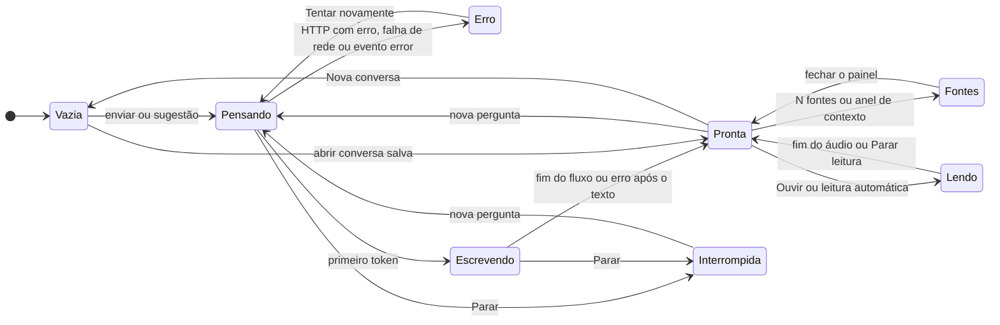

# Lumina 3.0 — Documentação Técnica

## Parte 3 de 3: front-end, experiência conversacional e guia de execução

| Item | Valor |
|---|---|
| Repositório | `github.com/oaxiapsolrac/lumina-ia` (público) |
| Branch | `Lumina3.0` |
| Commit de referência | `87da800` (11/11/2026) |
| Data da análise | 12/11/2026 |
| Arquivos analisados | os 34 arquivos de `novodesign/` no commit: `package.json`, `package-lock.json`, `index.html`, `vite.config.ts`, `tsconfig.json`, `.env.example`, `.gitignore`, `README.md`, `public/favicon.svg`, `src/main.tsx`, `src/vite-env.d.ts`, `src/App.tsx`, `src/index.css`, os 12 arquivos de `src/components/`, os 3 *hooks* de `src/hooks/` e os 6 módulos de `src/lib/` |

### Como esta parte foi verificada

O guia do capítulo 8 foi executado do zero em 12/11/2026: clone do GitHub (`git clone -b Lumina3.0`), `npm ci` no backend e no front-end, `npm run avaliar:validar`, `npm run avaliar:busca`, `npm start`, `npm run typecheck`, `npm run build`, `npm run dev` e `npm run preview`, num macOS com Node 26.7.0 e npm 11.19.0. Os tempos e mensagens citados são dessa execução. A interface não foi aberta num navegador durante a análise: o comportamento visual descrito no capítulo 7 vem da leitura do código. O tratamento de erros e a troca de conversa durante uma resposta (seções 7.3.4 e 7.5) também foram executados com o `useChat.ts` publicado, num teste temporário em Node, fora do repositório: jsdom no lugar do navegador e um `fetch` simulado no lugar do backend.

### Correções em relação ao escopo pedido

1. **Não há `App.jsx` nem `App.js`.** O front-end da Lumina 3.0 é a pasta `novodesign/`, escrita em TypeScript: o componente raiz é `src/App.tsx`, montado por `src/main.tsx`. O README da pasta registra que ela "substitui o cliente antigo (`index.html` na raiz, removido)".
2. **O serviço de API é um único módulo**, `src/lib/api.ts`, com três funções: `conversarStream()`, `buscarEstatisticas()` e `sintetizarVoz()`. Não há cliente HTTP externo; tudo usa `fetch`.
3. **Os estilos principais estão em `src/index.css`.** O Tailwind CSS 4 é configurado no próprio CSS (`@import "tailwindcss"`, `@theme`, `@custom-variant`); não existe `tailwind.config.js`.
4. **`teste_busca_cli.js` não existe na 3.0** (Parte 2, seção 5.3.1). No guia, a verificação da busca usa `npm run avaliar:busca` e o comando de pergunta isolada que o substitui.
5. **O nome da branch é `Lumina3.0`**, com L maiúsculo. O Git diferencia maiúsculas nos nomes de branch, e `lumina3.0` não existe no repositório.

---

## 7. Arquitetura do Front-end e Interface Conversacional

### 7.1 Estrutura e stack

| Camada | Pacote (versão instalada pelo `package-lock.json`) | Uso na Lumina |
|---|---|---|
| Interface | `react` e `react-dom` 19.3.1 | componentes de função e *hooks*; `createRoot` com `StrictMode` em `main.tsx` |
| Linguagem | `typescript` 7.0.2 | `tsc -p tsconfig.json` só checa tipos (`noEmit: true`); `strict`, `noUnusedLocals`, `noUnusedParameters` |
| Build e servidor de desenvolvimento | `vite` 8.3.7 (empacotador `rolldown` 1.2.18) e `@vitejs/plugin-react` 6.3.0 | `vite.config.ts`: plugins `react()` e `tailwindcss()`, porta 5173 |
| Estilo | `tailwindcss` e `@tailwindcss/vite` 4.3.5 | classes utilitárias e *tokens* de tema em `src/index.css` |
| Componentes acessíveis | `radix-ui` 1.8.1 | `Dialog` (barra lateral no celular e painel de fontes), `DropdownMenu` (modelos e anexos), `Popover` (filtros e voz) e `Tooltip` (dicas) |
| Animação | `motion` 14.12.0 | `motion.article`, `AnimatePresence` e `MotionConfig reducedMotion="user"` |
| Ícones | `lucide-react` 1.71.0 | todos os ícones da interface |
| Markdown | `react-markdown` 10.1.0 e `remark-gfm` 4.0.1 | respostas da Lumina, com tabelas e listas do GitHub Flavored Markdown |
| Classes condicionais | `clsx` 2.1.1 | função `cn()` de `src/lib/util.ts` |
| Fontes | Google Fonts | Inter (texto) e Lora (títulos), carregadas no `index.html` |

Não há biblioteca de estado global, roteador nem cliente HTTP: o estado fica em `App.tsx` e no *hook* `useChat`, a aplicação tem uma tela só, e as chamadas usam `fetch`.

Scripts de `novodesign/package.json`:

| Script | Comando | Resultado medido no clone novo |
|---|---|---|
| `dev` | `vite` | "VITE v8.3.7 ready in 284 ms", em `http://localhost:5173/` |
| `typecheck` | `tsc -p tsconfig.json` | sem erros, 1,4 s |
| `build` | `tsc -p tsconfig.json && vite build` | `dist/assets/index-*.js` com 699,11 kB (220,95 kB com gzip) e `index-*.css` com 44,76 kB (9,00 kB com gzip), em 236 ms |
| `preview` | `vite preview` | serve `dist/` em `http://localhost:4173/` |

O build termina com o aviso do Vite "Some chunks are larger than 500 kB after minification": todo o JavaScript sai num arquivo só, sem divisão de código.

**Organização dos arquivos**

```text
novodesign/
├── index.html            ← script inline que aplica o tema salvo antes do React (evita piscar claro/escuro); fontes Inter e Lora
├── vite.config.ts        ← plugins react() e tailwindcss(); server.port 5173
├── tsconfig.json         ← ES2022, moduleResolution "bundler", strict, noEmit
├── .env.example          ← VITE_API_BASE (URL do backend)
├── public/favicon.svg
└── src/
    ├── main.tsx          ← createRoot(...).render(<StrictMode><App /></StrictMode>)
    ├── App.tsx           ← layout, estado da interface e ligação entre componentes
    ├── index.css         ← Tailwind 4, temas claro/escuro, animações e estilo .prosa das respostas
    ├── vite-env.d.ts     ← tipo de import.meta.env.VITE_API_BASE
    ├── hooks/
    │   ├── useChat.ts       ← conversas, mensagens, envio e leitura do streaming
    │   ├── useTema.ts       ← preferência sistema/claro/escuro em localStorage ("lumina_tema")
    │   └── useMediaQuery.ts ← largura da tela (barra lateral fixa a partir de 1024 px)
    ├── lib/
    │   ├── api.ts        ← API_BASE, conversarStream(), buscarEstatisticas(), sintetizarVoz()
    │   ├── historico.ts  ← persistência das conversas e preferências no localStorage
    │   ├── modelos.ts    ← catálogo MODELOS, limites de anexos, PAISES e OPCOES_TOPK
    │   ├── types.ts      ← Mensagem, Conversa, Documento, Anexo, VerificacaoNumeros...
    │   ├── util.ts       ← cn(), lerArquivoComoDataUrl(), formatarMs(), statusDoContexto()
    │   └── voz.ts        ← leitor de voz (Gemini pelo /tts ou síntese do navegador)
    └── components/
        ├── BoasVindas.tsx    ← tela inicial com SUGESTOES e o fundo Aurora
        ├── Mensagens.tsx     ← lista da conversa: MensagemUsuario, MensagemLumina, Pensando, AvisoNumeros, ChipMidia
        ├── Markdown.tsx      ← renderização das respostas (react-markdown + remark-gfm)
        ├── Compositor.tsx    ← caixa de mensagem, anexos, botões Enviar e Parar
        ├── SeletorModelo.tsx ← menu dos modelos, agrupados em "Nuvem" e "Local (Ollama)"
        ├── Filtros.tsx       ← país e número de documentos por resposta
        ├── AnelContexto.tsx  ← anel de uso da janela de contexto
        ├── GavetaFontes.tsx  ← painel "Fontes e métricas" com os documentos recuperados
        ├── BarraLateral.tsx  ← conversas salvas, agrupadas por data
        ├── Cabecalho.tsx     ← abrir barra lateral, voz e tema
        ├── ControleVoz.tsx   ← leitura automática e escolha da voz
        └── ui.tsx            ← Dica (tooltip), BotaoIcone, LogoLumina, TextoOculto
```

### 7.2 Árvore de componentes e estado

```text
main.tsx
└── <StrictMode>
    └── App                                      (Tooltip.Provider › MotionConfig reducedMotion="user")
        ├── link "Pular para a caixa de mensagem"
        ├── BarraLateral                         (<aside> fixa a partir de 1024 px; Dialog em telas menores)
        ├── Aurora                               (só com a conversa vazia)
        ├── Cabecalho
        │   ├── ControleVoz                      (Popover)
        │   └── BotaoIcone de tema
        ├── <main>
        │   ├── BoasVindas                       (conversa vazia)  ou  Mensagens
        │   │                                                          ├── MensagemUsuario › ChipMidia
        │   │                                                          └── MensagemLumina  › Pensando | Markdown › BlocoCodigo, AvisoNumeros
        │   ├── botão "Ir para a última mensagem" (quando a usuária rolou para cima)
        │   └── Compositor
        │       ├── anexos selecionados, <textarea id="caixa-mensagem">
        │       ├── menu "Anexar arquivo" (DropdownMenu) e <input type="file"> ocultos por tipo
        │       ├── Filtros (Popover), SeletorModelo (DropdownMenu)
        │       └── AnelContexto, BotaoIcone Enviar ou Parar
        ├── GavetaFontes                         (Dialog à direita) › CartaoDocumento
        └── <div role="status" aria-live="polite"> (anúncios para leitores de tela)
```

**Onde cada estado vive**

| Dono | Estado | Para quê |
|---|---|---|
| `App` | `modelo`, `pais`, `topK` | configuração do próximo envio; salvos por `salvarPreferencias()` |
| `App` | `barraDesktop`, `barraMovel`, `fontesAbertas` | barra lateral (fixa ou em gaveta) e painel de fontes |
| `App` | `vozAtiva`, `voz`, `lendoId`, `estadoLeitura` | leitura em voz e qual resposta está sendo lida |
| `App` | `anuncio`, `noFim` (e `noFimRef`) | texto da região `aria-live` e rolagem automática |
| `useChat` | `conversas`, `conversaId`, `mensagens` | histórico salvo e conversa aberta |
| `useChat` | `gerando`, `contexto`, `fontes`, `totalDocumentos` | resposta em andamento, anel de contexto, painel de fontes e total da base |
| `Compositor` | `texto`, `anexos`, `aviso` | rascunho da mensagem e anexos ainda não enviados |
| `useTema` | `preferencia`, `tema` | tema escolhido e tema efetivo (`light` ou `dark`) |
| módulo `voz.ts` | instância única `leitor` (classe `Leitor`) | garante que só uma resposta seja lida por vez |

`useChat` guarda cópias das listas em *refs* (`mensagensRef`, `conversasRef`, `conversaIdRef`) e atualiza estado e *ref* juntos em `aplicarMensagens()` e `aplicarConversas()`. O comentário do código explica o motivo: o streaming atualiza a mensagem muitas vezes por segundo, e os *callbacks* precisam ler o valor atual sem esperar a próxima renderização.

**Mensagem: usuária e assistente.** Cada item de `mensagens` é um `Mensagem` (`src/lib/types.ts`). O campo `papel` distingue `'user'` de `'lumina'`:

| Campo | Usuária | Lumina |
|---|---|---|
| `texto` | o que foi digitado | a resposta acumulada, em Markdown |
| `midias` / `anexos` | `midias`: só `{ tipo, nome }` (vai para o histórico salvo); `anexos`: o conteúdo em *data URL* (só nesta sessão) | — |
| `status` | — | `'gerando'`, `'pronta'`, `'erro'` ou `'interrompida'` |
| `modelo`, `docs`, `metricas`, `query` | — | vêm do evento `metadata` e do `usage` |
| `verificacao` | — | só é guardada quando `status === 'alerta'` |
| `avaliacao` | — | `'boa'`, `'ruim'` ou `null` (👍/👎, salvo só no navegador) |

**Envio de uma pergunta** (`App.enviar()` → `useChat.enviar(texto, anexos, { modelo, pais, topK })`):

1. `App.enviar()` ignora o clique se `chat.gerando` é verdadeiro, para qualquer leitura em voz (`leitor.parar()`) e liga a rolagem automática.
2. `useChat.enviar()` não faz nada se já existe um envio em andamento (`abortRef.current`) ou se não há texto nem anexo.
3. Numa conversa nova, cria o id com `novoId('chat')`; o título é o começo do texto, até 48 caracteres, ou "Análise de mídia".
4. `montarHistorico()` monta o `historico` só com pares pergunta/resposta concluídos: respostas com `status` `'erro'` ou `'gerando'` ficam fora, e uma pergunta só com anexo entra como "Imagem/mídia anexada".
5. Acrescenta a mensagem da usuária e uma resposta vazia com `status: 'gerando'`, e salva a conversa (`persistir()`).
6. Marca `gerando = true`, anuncia "Lumina está respondendo." e cria um `AbortController`.
7. Chama `conversarStream()` (seção 7.3) com os *callbacks*:
   - `onMetadata`: guarda `docs`, `metricas`, `modelo` e `query` na resposta, atualiza o painel de fontes e `totalDocumentos`;
   - `onToken`: acumula o texto em `bufferRef` e agenda `descarregar()` com `requestAnimationFrame`, para o Markdown ser renderizado no máximo uma vez por quadro, e não a cada token;
   - `onUso`: atualiza o anel de contexto (`atualizarContexto()`, que só deixa o uso crescer dentro da mesma janela) e as métricas finais;
   - `onVerificacao`: guarda o resultado só se houver alerta;
   - `onErro`: guarda a mensagem de erro.
8. No fim (`finally`), descarrega o que restou no *buffer* e decide o `status`: `'interrompida'` se houve `AbortError`; `'erro'` se houve erro sem nenhum texto; `'pronta'` nos outros casos. Erro depois de texto parcial mantém o texto e acrescenta `> ⚠️ **Erro:** <mensagem>`.
9. Salva a conversa, marca `gerando = false` e anuncia a resposta (até 1.500 caracteres do texto limpo por `limparTextoParaFala()`), o erro ou "Resposta interrompida.".
10. Com a leitura automática ligada, `aoConcluirResposta` chama `ouvir()`.

`parar()` aborta o `AbortController`; `novaConversa()` e `abrirConversa()` também abortam a resposta em andamento.

**Histórico da sessão e persistência.** O servidor não guarda conversa (Parte 2, seção 4.3.1); tudo fica no `localStorage` do navegador:

| Chave | Conteúdo | Arquivo |
|---|---|---|
| `lumina_chat_history_v3` | todas as conversas | `src/lib/historico.ts` (`carregarConversas()`, `salvarConversas()`) |
| `lumina_prefs_v1` | `modelo`, `pais`, `topK` e `barraLateralAberta` | `historico.ts` (`carregarPreferencias()`, `salvarPreferencias()`) |
| `lumina_tema` | `sistema`, `claro` ou `escuro` | `src/hooks/useTema.ts` e o script do `index.html` |
| `lumina_voice_enabled`, `lumina_voice_name` | leitura automática e voz escolhida | `src/lib/voz.ts` |

- **Compatibilidade.** A chave e o formato de `lumina_chat_history_v3` são os do cliente antigo (`index.html` da versão 2), para que conversas salvas no mesmo domínio continuem visíveis. `deSalva()` e `paraSalva()` convertem entre o formato antigo (`role`, `text`, `rawText`, `modelName`, `messages`...) e o tipo `Conversa`.
- **O que não é salvo.** Mensagens com `status: 'gerando'` ficam fora. Os anexos são salvos só como `{ tipo, nome }`; ao reabrir a conversa, aparecem como etiquetas (`ChipMidia`), sem a imagem.
- **Cota cheia.** Se `localStorage.setItem` falhar (limite de cerca de 5 MB), `salvarConversas()` troca as mídias em base64 de históricos antigos por `{ tipo, nome: 'anexo' }` e tenta de novo; se falhar outra vez, registra o erro no console.
- **Barra lateral.** `BarraLateral` agrupa as conversas por `criadaEm` em "Hoje", "Ontem", "Últimos 7 dias" e "Mais antigas". Excluir pede confirmação (`window.confirm`).
- **Reabrir uma conversa** (`abrirConversa()`) restaura as mensagens, o modelo da conversa e as fontes da última resposta que tinha documentos. O anel de contexto volta a zero e só reaparece depois da próxima resposta.

**Indicadores de carregamento**

| Momento | O que aparece | Onde |
|---|---|---|
| resposta pedida, nenhum token ainda | "Pensando…", com efeito de brilho (`animate-shimmer`) | `Pensando` em `Mensagens.tsx` |
| mais de 8 s sem token | o texto muda para "Acordando o servidor…". O comentário explica: no plano gratuito, o Render "dorme", e a primeira resposta pode levar até um minuto | `Pensando` |
| durante toda a resposta | `LogoLumina` com anel girando (`animado`), `aria-busy` no artigo, botão Parar no lugar de Enviar e seletor de modelo desabilitado | `MensagemLumina`, `Compositor`, `SeletorModelo` |
| texto chegando | o Markdown parcial e um cursor pulsante no fim | `MensagemLumina` |
| leitura em voz pelo Gemini | ícone de carregamento enquanto o `/tts` responde, depois o botão Parar leitura | `MensagemLumina` (`estadoLeitura`) |
| rolagem | a tela acompanha a resposta, a menos que a usuária tenha subido mais de 120 px; nesse caso surge "Ir para a última mensagem" | `App` (`aoRolar()`, `irParaFim()`) |

Para leitores de tela, `anunciar()` escreve na região `aria-live`: "Lumina está respondendo.", a resposta (até 1.500 caracteres), "Erro: ...", "Resposta interrompida.", "Modelo selecionado: ...", "Resposta copiada." e outros avisos.

**Sugestões de perguntas iniciais.** Com a conversa vazia, `BoasVindas` mostra "Olá! Como posso ajudar?" e quatro botões da lista `SUGESTOES`. O clique envia a pergunta na hora (`onEscolher` → `enviar(pergunta, [])`), sem passar pela caixa de texto. O que cada sugestão recupera na busca publicada (`topK` 4, como o chat):

| Rótulo do botão | Pergunta enviada | Documentos enviados ao modelo | Observação |
|---|---|---|---|
| Mulheres na Engenharia | "Segundo os microdados do INEP, qual a porcentagem de mulheres na Engenharia Mecânica e Automação?" | Censo INEP: Engenharia Mecânica, Engenharia De Controle E Automação, Automação Industrial, Engenharia Automotiva | os três cursos pedidos estão no top-3 |
| Iniciativas no Peru e na Bolívia | "Quais iniciativas existem no Peru e na Bolívia mapeadas pelo Projeto ELLAS?" | MetaRed Perú (GreyLiterature), WarmiLab & Women in STEM Peru, uma lei de parentalidade do WBL (Bolívia) e o marco legal do UNESCO Her Atlas (Bolívia) | com dois países e 4 vagas, só uma das vagas é uma iniciativa de fato; a resposta tende a ser curta |
| Quem foi Sonia Guimarães? | "Quem foi Sonia Guimarães e quais foram suas contribuições para a física e ciência no Brasil?" | Sonia Guimarães (biografia da base curada) | o corte relativo deixa só esse documento (3 cortados) |
| Políticas de igualdade | "Quais são as principais políticas públicas e fatores que afetam a igualdade de gênero na ciência?" | políticas da Costa Rica, do México, do Chile e da Colômbia (STIP) | nenhum documento de fator entra, então a parte "fatores" fica sem base |

### 7.3 Integração com o backend e renderização

#### 7.3.1 URL da API e variáveis de ambiente

```ts
// src/lib/api.ts
const configurado = import.meta.env.VITE_API_BASE as string | undefined;
export const API_BASE = (configurado && configurado.trim() ? configurado.trim() : 'https://lumina-backend-zsak.onrender.com').replace(/\/+$/, '');
```

- `VITE_API_BASE` é a única variável do front-end; `src/vite-env.d.ts` declara o tipo. Sem ela, ou vazia, a interface usa o backend de produção no Render. Barras no fim da URL são removidas.
- O Vite **substitui o valor no build**. No teste, um build com `VITE_API_BASE=http://localhost:3002` ficou sem nenhuma ocorrência da URL do Render no JavaScript gerado. Trocar o backend de um build publicado exige um novo build; no Vercel, a variável precisa existir antes do build.
- O `.env.example` da pasta já traz `VITE_API_BASE=https://lumina-backend-zsak.onrender.com`. Para usar o backend local, a variável deve apontar para `http://localhost:3001` (capítulo 8). Os arquivos `novodesign/.env` e `novodesign/.env.local` são ignorados pelo `.gitignore` da raiz (padrões `.env` e `.env.*`).

#### 7.3.2 Chamadas HTTP

| Função (`src/lib/api.ts`) | Rota | Quando | Tratamento |
|---|---|---|---|
| `conversarStream(payload, eventos, signal)` | `POST /chat/stream` | a cada pergunta, por `useChat.enviar()` | lê o SSE e chama os *callbacks*; lança erro em resposta não OK ou falha de rede |
| `buscarEstatisticas()` | `GET /stats` | uma vez, quando `App` monta | em qualquer falha devolve `null`; o total aparece em "Base indexada" no painel de fontes |
| `sintetizarVoz(texto, voz, signal)` | `POST /tts` | "Ouvir" com uma voz Gemini, ou leitura automática | devolve um `Blob` com o `Content-Type` da resposta (`audio/wav` se faltar) |

As rotas `/chat`, `/search`, `/reindex` e `GET /` não são usadas pelo front-end.

Corpo enviado ao `/chat/stream` (`PayloadChat`):

| Campo | Valor enviado | Observação |
|---|---|---|
| `mensagem` | texto aparado | — |
| `modelo` | `modelo.valor` do catálogo `MODELOS` | padrão `groq` |
| `imagens` | as *data URLs* de **todos** os anexos, inclusive vídeo e áudio | o backend aceita qualquer *data URL* em `imagens` (`coletarAnexos()`); o campo `arquivos` não é usado |
| `historico` | o resultado de `montarHistorico()` | só texto, em pares `user`/`assistant` |
| `pais` | o país do filtro, ou `null` quando é "Todos os países" | valores de `PAISES` sem acento ("Bolivia", "Mexico", "Colombia") |
| `topK` | 3, 4, 6 ou 8 (`OPCOES_TOPK`) | padrão 4 |

#### 7.3.3 Leitura do streaming

`conversarStream()` não usa `EventSource` (que não envia `POST` com corpo). Usa `fetch` e lê o corpo como fluxo:

1. `res.body.getReader()` e `TextDecoder('utf-8')` com `{ stream: true }`, para não quebrar caracteres acentuados entre pedaços;
2. o texto acumulado é dividido em blocos por linha em branco (`\n\n`); o último pedaço, possivelmente incompleto, fica no *buffer*;
3. `processarBloco()` lê as linhas `event:` e `data:` e faz `JSON.parse` do dado;
4. o evento é repassado: `metadata` → `onMetadata`, `token` → `onToken`, `verificacao` → `onVerificacao`, `usage` → `onUso`, `error` → `onErro`;
5. `data: [DONE]` é ignorado, e o fim do fluxo encerra o laço. Os comentários de *keepalive* do servidor (`: aguardando o modelo`) não têm `event:` nem `data:` e são descartados.

Antes de ler o fluxo, uma resposta não OK (os 400, 413, 429 e 500 em JSON da Parte 2, seção 5.1.5) vira exceção com a mensagem de `mensagemDeErro()`, que procura `erro` e depois `resposta` no JSON.

#### 7.3.4 Tratamento visual de erros

Toda falha de uma pergunta termina em `useChat.enviar()`, que a converte no `status` da resposta. `MensagemLumina` escolhe o visual a partir desse `status`. Erros de anexo, de voz e de cópia são tratados nos próprios componentes.

| Situação | O que a interface mostra | Onde no código |
|---|---|---|
| o backend recusa antes do SSE: 400 (anexo que o modelo não aceita), 413 (corpo acima de 25 MB), 429 (mais de 30 pedidos em 60 s) ou 500 | caixa vermelha (`role="alert"`) com o campo `erro` do JSON, por exemplo "Muitas requisições. Tente novamente em 60s.", e o botão "Tentar novamente". O leitor de tela ouve "Erro: ..." | `conversarStream()` lança `Error(await mensagemDeErro(res))`; `status: 'erro'` |
| backend fora do ar, URL errada ou origem barrada pelo CORS | a mesma caixa, com a mensagem do navegador para a falha do `fetch` (no Chrome, "Failed to fetch"). O texto "Erro ao conectar com o servidor." só aparece se a exceção vier sem mensagem | `catch` de `useChat.enviar()` |
| evento `error` antes de qualquer texto: chave ausente, erro do provedor ou 90 s sem resposta (Parte 2, seção 5.1.5) | a caixa vermelha com o `erro` do evento, ou "Falha no processamento." quando ele vem vazio | `processarBloco()` → `onErro` |
| evento `error` depois de texto parcial, como o limite de 300 s | o texto recebido e, no fim, `> ⚠️ **Erro:** <mensagem>`. O Markdown mostra essa linha como bloco de citação (borda lilás e texto cinza), não como caixa vermelha, e o `status` fica `'pronta'` | fim de `useChat.enviar()` |
| a conexão cai no meio do fluxo | `leitor.read()` rejeita com a mensagem do navegador: caixa vermelha se nenhum texto chegou, linha de erro no fim do texto se já havia texto | `conversarStream()` |
| botão Parar | o texto recebido até ali e "Interrompida." em itálico, e o anúncio "Resposta interrompida" para leitores de tela. Quando a conexão fecha, o servidor cancela a chamada ao modelo (Parte 2, seção 5.2.3) | `parar()` → `AbortError` → `status: 'interrompida'` |
| número da resposta que não aparece nos documentos (`verificacao.status === 'alerta'`) | quadro âmbar (`role="note"`): "Este número não aparece nos documentos consultados: **X**. Pode ser um cálculo do modelo ou um erro; confira nas fontes." | `AvisoNumeros` |
| anexo além do limite | linha vermelha (`role="alert"`) abaixo da caixa de mensagem: `Limite de 8 imagem(s) por mensagem.` ou `"foto.png" ultrapassa o limite total de 18 MB.` | `Compositor.adicionarArquivos()` |
| uso da janela de contexto | o anel passa de verde a âmbar acima de 60% e a vermelho acima de 80% (`statusDoContexto()`). Acima de 100%, a dica do anel e o painel de fontes acrescentam "Janela excedida, inicie uma nova conversa" | `AnelContexto`, `GavetaFontes` |
| `GET /stats` falha | nada visível; "Base indexada" mostra "—" até o primeiro `metadata` trazer `totalDocumentosNoBanco` | `buscarEstatisticas()` devolve `null` |
| `/tts` falha (por exemplo, sem `GEMINI_API_KEY`) | nenhum aviso: o ícone de carregamento some e o botão volta a "Ouvir". O erro vai para `console.warn('Gemini TTS indisponível:', ...)`, e a leitura não passa para a voz do navegador | `Leitor.falarGemini()` |
| a cópia falha | só o anúncio "Não foi possível copiar." para leitores de tela | `App.copiar()` |

"Tentar novamente" só aparece quando a pergunta anterior tem texto. O botão chama `enviar(texto, [])`: reenvia o texto como um par novo, **sem os anexos**, e a resposta com erro continua na tela. `montarHistorico()` deixa de fora as respostas com `status: 'erro'`, mas inclui as que terminaram com a linha de erro, porque essas ficam com `status: 'pronta'`. No teste em jsdom, depois de uma resposta "Resposta parcial" cortada por um evento `error` e de um 429, o `historico` da pergunta seguinte foi este:

```json
[
  { "role": "user", "content": "Pergunta 1" },
  { "role": "assistant", "content": "Resposta parcial\n\n> ⚠️ **Erro:** O modelo ficou 90 s sem responder e a resposta foi interrompida. Tente outro modelo." }
]
```

O par do 429 ficou de fora, e a resposta dele ficou na tela como "Muitas requisições. Tente novamente em 60s.", com `status: 'erro'`. Abaixo da caixa de mensagem, o aviso fixo "A Lumina pode cometer erros." aparece sempre.

#### 7.3.5 Renderização das respostas, dos anexos, do tema e da voz

**Markdown das respostas.** `MensagemLumina` passa o texto acumulado para `Markdown` (`src/components/Markdown.tsx`), um componente `memo` sobre `react-markdown` com o plugin `remark-gfm`:

| Elemento | Como aparece | Código |
|---|---|---|
| parágrafos, negrito, itálico, listas com marcador e numeradas | estilo `.prosa` de `index.css`: corpo de 1 rem, entrelinha 1,7 e marcadores em cinza | `<div className="prosa">` |
| títulos (`#` a `######`) | deslocados para começar em `<h3>`, porque cada mensagem já tem um `<h2>` oculto ("A Lumina disse") | `criarTitulos()` |
| tabelas GFM | dentro de um contêiner com borda e rolagem horizontal | componente `table` |
| blocos de código | cabeçalho com a linguagem (da classe `language-*`, ou "texto") e botão "Copiar código" | `BlocoCodigo` |
| código em linha | fonte monoespaçada com fundo `--surface-2` | `.prosa :not(pre) > code` |
| links | abrem em nova aba, com `target="_blank"` e `rel="noopener noreferrer"` | componente `a` |
| blocos de citação (`>`) | borda lilás à esquerda e texto cinza; é o formato da linha de erro depois de texto parcial | `.prosa blockquote` |
| HTML bruto | não é interpretado: o `react-markdown` o mostra como texto. O comentário do componente registra que a biblioteca também filtra URLs perigosas (`javascript:`) | `Markdown` |
| referências `[1]`, `[2]` | texto simples, sem link | — |

O número de cada referência é a posição do documento na lista do evento `metadata`. O backend numera os documentos do prompt como `[DOCUMENTO 1]`, `[DOCUMENTO 2]`... na mesma ordem (`formatarContextoRecuperado()`), e o painel de fontes mostra os cartões nessa ordem, com o número antes do nome. Assim, `[2]` na resposta é o cartão "2." de "Fontes e métricas" daquela resposta.

Durante o streaming, o Markdown é renderizado de novo a cada quadro de animação (`descarregar()`). Marcações ainda incompletas aparecem cruas por um instante, como um `**` cujo par ainda não chegou.

**Mensagens da usuária.** Texto simples, sem Markdown, com as quebras de linha preservadas (`whitespace-pre-wrap`), num balão à direita. Os anexos enviados na sessão aparecem como ``, `<video controls>` ou `<audio controls>`, a partir da *data URL*. Numa conversa reaberta, aparecem como etiquetas `ChipMidia`, com ícone e nome do arquivo, porque o conteúdo não é salvo (seção 7.2). Históricos antigos que guardavam a *data URL* de uma imagem ainda mostram a miniatura.

**Anexos no compositor** (`Compositor.tsx`):
- o botão "Anexar arquivo" só existe quando o modelo escolhido tem `midias`. No catálogo publicado, isso vale para o Nemotron 3 Nano Omni (imagem, vídeo e áudio) e o Mistral Large 4 (só imagem);
- tipos aceitos (`ACEITE_MIDIA`): PNG, JPEG e WebP; MP4, QuickTime e WebM; WAV e MP3;
- limites: 8 imagens, 1 vídeo e 1 áudio por mensagem (`LIMITE_ANEXOS`), e 18 MB somados (`LIMITE_TOTAL_ANEXOS_MB`). O comentário explica a margem: o servidor aceita 25 MB por requisição, e o base64 aumenta o tamanho em cerca de 33%;
- colar uma imagem na caixa de mensagem a anexa, se o modelo aceitar imagem;
- ao trocar de modelo, os anexos que o novo modelo não aceita são descartados sem aviso;
- os arquivos são lidos como *data URL* (`lerArquivoComoDataUrl()`) e vão no campo `imagens` (seção 7.3.2);
- Enter envia e Shift+Enter quebra a linha. O Enter que confirma um acento numa composição (IME) não envia. A caixa cresce até 220 px.

**Painel "Fontes e métricas"** (`GavetaFontes`). Abre pelo botão "N fontes" de uma resposta ou pelo anel de contexto, e mostra:
- "Busca usada": a `queryUtilizada`, que pode ser a pergunta reescrita por `recontextualizarQuery()` (Parte 2, seção 4.3.3);
- as métricas Modelo, Busca vetorial e Inferência da IA (formatadas por `formatarMs()`, como "11 ms" ou "1,2 s"), Documentos ("1 de 4"), Filtro de país e Base indexada;
- a barra "Uso de contexto da conversa", com a porcentagem no formato brasileiro;
- um cartão por documento (`CartaoDocumento`): posição, nome, relevância (`Math.round(score * 100)`%, no máximo 100%, porque o backend limita o `score` a 1), país, categoria, detalhes cortados em 4 linhas quando passam de 220 caracteres ("Mostrar mais"), a `fonte` e até 3 links de `urlsFonte`. `linkSeguro()` só aceita `http:` e `https:`, e `rotuloLink()` mostra o domínio no primeiro link e "domínio (consulta exata)" nos seguintes.

**Tema.** `useTema` tem três preferências (`sistema`, `claro` e `escuro`), salvas em `lumina_tema`. O script inline do `index.html` aplica `data-theme` no `<html>` antes de o React carregar, para a tela não piscar; se o `localStorage` falhar, usa o escuro. `index.css` define as cores como variáveis CSS por `[data-theme]` e cria a variante `dark:` com `@custom-variant dark (&:where([data-theme=dark], [data-theme=dark] *))`. `useTema` também troca a `<meta name="theme-color">` (`#0e0e11` no escuro, `#f6f5f8` no claro). O botão do cabeçalho alterna entre claro e escuro (`alternar()`); depois do primeiro clique, a preferência deixa de ser `sistema`.

**Acessibilidade no código:**
- link "Pular para a caixa de mensagem", o primeiro elemento focável da página;
- títulos ocultos (`sr-only`): `<h1>` "Conversa com a Lumina" e um `<h2>` por mensagem ("Você disse", "A Lumina disse"), para navegar de mensagem em mensagem pelo leitor de tela;
- a região `aria-live` da seção 7.2, `aria-busy` na resposta em andamento, `role="alert"` nos erros, `role="note"` no aviso de números e `role="progressbar"` com `aria-valuetext` no uso de contexto;
- `BotaoIcone`: `aria-label` nos botões só com ícone, alvo de 40 px e dica (`Dica`, do Radix `Tooltip`) no foco do teclado e no *hover*;
- contorno de foco sempre visível (`:focus-visible` em `index.css`);
- movimento reduzido: `MotionConfig reducedMotion="user"`, classes `motion-safe:` nas animações e uma regra `@media (prefers-reduced-motion: reduce)` que reduz animações e transições a 0,01 ms;
- `index.html` com `lang="pt-BR"` e sem `maximum-scale` nem `user-scalable=no`; o comentário cita a WCAG 1.4.4, porque bloquear o zoom impede quem precisa ampliar o texto.

O README da pasta afirma "Acessibilidade conferida com axe (WCAG 2.2 AA) nos dois temas". Esta análise não repetiu essa verificação.

**Voz** (`src/lib/voz.ts` e `ControleVoz`). O ícone do cabeçalho abre um *popover* com a chave "Ler respostas em voz alta" (leitura automática ao fim de cada resposta, por `aoConcluirResposta` → `ouvir()`) e o seletor de voz, com dois grupos:
- **Gemini:** as 7 vozes de `VOZES_GEMINI`, com valor `gemini:<id>`. `Leitor.falarGemini()` envia o texto ao `POST /tts`, que o limpa no servidor (Parte 2, seção 5.1.7), e toca o áudio devolvido. Se o navegador bloquear a reprodução, por exemplo depois de uma espera longa, decodifica o áudio e o toca pelo `AudioContext` liberado no primeiro clique ou tecla (`desbloquear()`);
- **Navegador:** "Automática" e as vozes em português de `speechSynthesis`, ordenadas por `prioridade()` (pt-BR, vozes do Google e vozes "natural", "neural" ou "online" primeiro). `Leitor.falarNativo()` limpa o texto com `limparTextoParaFala()`, que remove tabelas, links, URLs e símbolos de Markdown e troca "45%" por "45 por cento". Depois, `fatiar()` divide o texto em blocos de até 200 caracteres, porque, segundo o comentário, o Chrome corta falas longas da voz do Google. A velocidade é 1,05.

A voz padrão é `auto`, a do navegador: o `/tts` só é chamado quando a usuária escolhe uma voz Gemini. `leitor` é uma instância única, então uma leitura nova interrompe a anterior. Enviar uma pergunta, abrir uma conversa ou começar outra também param a leitura (`leitor.parar()` em `App`).

### 7.4 Diagrama de fluxo do front-end

Estados da área de conversa e o que provoca cada transição:



**Em linguagem simples**

**O que o desenho mostra.** As situações em que a tela de conversa pode estar e o que faz a tela passar de uma situação para outra. Cada situação se chama estado.

**Como ler.**
- Cada caixa é um estado da tela.
- O ponto escuro, à esquerda, marca o começo: a tela abre no estado Vazia.
- Cada seta é uma mudança de estado. O texto sobre a seta diz o que provoca a mudança: uma ação da pessoa, como um clique, ou algo que chega do servidor.

**Os estados**

| Estado | O que a pessoa vê |
|---|---|
| Vazia | a tela inicial, com "Olá! Como posso ajudar?" e quatro sugestões de perguntas |
| Pensando | a pergunta já foi enviada e aparece "Pensando…" enquanto a resposta não começa. Depois de 8 segundos, o texto muda para "Acordando o servidor…" |
| Escrevendo | o texto da resposta aparecendo aos poucos |
| Pronta | a resposta completa, com os botões para ouvir, copiar, avaliar e ver as fontes |
| Erro | um quadro vermelho com o motivo do erro e o botão "Tentar novamente" |
| Interrompida | o pedaço da resposta que chegou antes de a pessoa clicar em Parar, com a palavra "Interrompida." |
| Fontes | o painel "Fontes e métricas", com os documentos que a Lumina consultou |
| Lendo | a resposta sendo lida em voz alta |

**Um caminho comum.**
1. A tela começa Vazia. A pessoa clica numa sugestão ou envia uma pergunta, e a tela passa a Pensando.
2. Quando chega o primeiro pedaço da resposta, a tela passa a Escrevendo. Quando a resposta termina, fica Pronta.
3. Dali, a pessoa pode abrir as fontes, ouvir a resposta ou fazer outra pergunta, que leva de novo a Pensando.

**Outros caminhos.**
- Se algo dá errado antes de a resposta começar, a tela vai para Erro. "Tentar novamente" envia a pergunta outra vez.
- Se o erro acontece depois de parte da resposta já ter chegado, a tela fica Pronta, com um aviso de erro no fim do texto.
- Clicar em Parar leva a Interrompida. Dali, a pessoa pode fazer outra pergunta.
- "Nova conversa" volta à tela Vazia, e abrir uma conversa salva leva direto a Pronta.

**Leitura do diagrama**

O estado vem de `useChat`: `gerando` e o `status` da última resposta. Uma resposta `'gerando'` sem texto é Pensando; com texto, Escrevendo. Fontes e Lendo vêm de `fontesAbertas`, `lendoId` e `estadoLeitura`, em `App`. Mais detalhes:
- em Pensando, o texto muda de "Pensando…" para "Acordando o servidor…" depois de 8 s sem token;
- em Pensando e Escrevendo, Parar substitui Enviar e o seletor de modelo fica desabilitado. A caixa de mensagem continua editável, mas `enviar()` ignora novos envios até a resposta terminar;
- as ações Ouvir, Copiar, 👍/👎 e "N fontes" também aparecem nas respostas interrompidas; nas respostas com erro, só "Tentar novamente";
- "Nova conversa", abrir outra conversa e excluir a atual funcionam em qualquer estado. Em Pensando e Escrevendo, abortam a resposta e provocam o defeito descrito na seção 7.5.

### 7.5 Limitações conhecidas do front-end

| Limitação | Efeito | Onde no código |
|---|---|---|
| **Trocar de conversa durante uma resposta sobrescreve a conversa que estava sendo respondida** | No fim de `enviar()`, `persistir(id, meta)` grava em `id` o conteúdo de `mensagensRef.current`, que a essa altura já tem as mensagens da tela nova. No teste em jsdom, a conversa A tinha 3 mensagens salvas e uma resposta em andamento. "Nova conversa" deixou A com 0 mensagens; abrir a conversa B gravou em A as 2 mensagens de B; excluir A a recriou vazia, no topo da lista | `useChat.enviar()` e `persistir()`. `BarraLateral` não desabilita esses botões durante a resposta |
| catálogo de anexos diferente do backend | `anexos.js` aceita imagem e vídeo no `nemotron-3-super-120b`, mas `MODELOS` declara `midias: []` para ele, apesar do comentário "espelha backend/anexos.js". A interface não oferece anexo para esse modelo | `src/lib/modelos.ts` |
| sem *error boundary* | uma exceção durante a renderização desmonta a aplicação inteira, e a tela fica vazia, sem mensagem | `src/main.tsx` |
| falha da voz Gemini silenciosa | sem aviso na tela e sem troca para a voz do navegador (seção 7.3.4) | `Leitor.falarGemini()` |
| erro de rede com a mensagem crua do navegador | a caixa vermelha mostra, por exemplo, "Failed to fetch", em inglês | `catch` de `useChat.enviar()` |
| erro depois de texto parcial entra no histórico | a linha `> ⚠️ **Erro:** ...` segue para o modelo no `historico` das perguntas seguintes (seção 7.3.4) | `montarHistorico()` |
| anexos descartados sem aviso | trocar para um modelo que não aceita o tipo remove o anexo do compositor | efeito sobre `midias` em `Compositor.tsx` |
| JavaScript num arquivo só | 699 kB (221 kB com gzip), sem divisão de código; o Vite avisa no build (seção 7.1) | `vite.config.ts` |
| sem volta ao tema do sistema | depois do primeiro clique no botão de tema, a única forma de voltar a `sistema` é apagar a chave `lumina_tema` | `useTema.alternar()` |
| duas sugestões iniciais recuperam mal | "Iniciativas no Peru e na Bolívia" recebe só uma iniciativa entre os 4 documentos, e "Políticas de igualdade" não recebe nenhum documento de fator (seção 7.2) | `SUGESTOES` em `BoasVindas.tsx` |

---

## 8. Guia de Instalação e Execução Local (Quickstart)

Este roteiro sobe a Lumina 3.0 publicada numa máquina sem nada do projeto: o backend em `http://localhost:3001` e a interface em `http://localhost:5173`. Ele foi executado do zero num clone novo em 12/11/2026, e as saídas mostradas são dessa execução. No teste, o backend rodou com `PORT=3002`, porque a porta 3001 estava ocupada; as mensagens são as mesmas, com a porta trocada.

São dois processos, cada um num terminal: o backend fica no primeiro, e o front-end, no segundo.

### 8.1 Pré-requisitos

| Item | Requisito | Motivo |
|---|---|---|
| Git | qualquer versão recente | clonar a branch |
| Node.js | 20.19 ou mais novo na linha 20, ou 22.12 ou mais novo | o Vite 8.3.7, o `rolldown` 1.2.18 e o `@vitejs/plugin-react` 6.3.0 do front-end declaram `node: ^20.19.0 \|\| >=22.12.0`. O backend pede Node 18 ou mais novo (Express 5). O teste usou Node 26.7.0 e npm 11.19.0 |
| npm | o que vem com o Node | `npm ci` instala as versões exatas dos dois `package-lock.json` |
| Internet | na instalação e na primeira execução do backend | `npm ci` baixa os pacotes. O modelo de embeddings (23 MB) é baixado do Hugging Face na primeira busca e fica em `backend/node_modules/@xenova/transformers/.cache/` |
| Disco | cerca de 550 MB | clone com 63 MB (23 MB de `.git`), `backend/node_modules` com cerca de 290 MB, já com o modelo, e `novodesign/node_modules` com cerca de 180 MB |
| Memória | pelo menos 512 MB livres para o backend | o processo ocupa cerca de 406 MB de RSS depois de carregar o índice (Parte 2, seção 4.1.4) |

**Chaves de API**, no arquivo `backend/.env` (seção 8.3.2):

| Variável | Obrigatória? | O que acontece sem ela |
|---|---|---|
| `GROQ_API_KEY` | sim, para conversar com o modelo padrão (`groq`) | a resposta do chat termina em erro, e a reescrita das perguntas de continuação (`recontextualizarQuery()`) é pulada. A busca (`/search`, `npm run avaliar:*`) funciona sem chave |
| `GEMINI_API_KEY` | não | o modelo Gemini emite o evento `error`, e as vozes Gemini não tocam (`/tts` responde 500) |
| `NVIDIA_API_KEY` e as chaves por modelo (Parte 1, seção 1.6) | não | os modelos da NVIDIA (Nemotron, Mistral, MiniMax e GPT-OSS 20B) respondem com o erro de chave ausente |
| `OLLAMA_ENDPOINT` | não | Phi-3, Gemma 2 e Qwen tentam `http://localhost:11434/v1/chat/completions` |
| `ADMIN_TOKEN` | não | a rota `POST /reindex` fica desligada; `npm run reindex` funciona sem ela |

A chave do Groq é criada no console do Groq (console.groq.com); a do Gemini, no Google AI Studio; as da NVIDIA, no catálogo build.nvidia.com. O plano gratuito do Groq tem cota diária de tokens (Parte 2, seção 5.3.2).

### 8.2 Clonar a branch `Lumina3.0`

```bash
git clone -b Lumina3.0 https://github.com/oaxiapsolrac/lumina-ia.git
cd lumina-ia
git log -1 --oneline
```

```text
87da800 (HEAD -> Lumina3.0, origin/Lumina3.0) Lumina 3.0: bases CEPALSTAT, OECD STIP e World Bank WBL e prompt para conversa
```

O clone levou 6 s. O repositório tem 54 arquivos versionados: o `.gitignore` da raiz, 19 em `backend/` e 34 em `novodesign/`. O nome da branch tem L maiúsculo; com `-b lumina3.0`, o Git para com `fatal: Remote branch lumina3.0 not found in upstream origin` (código de saída 128). Se a branch tiver commits depois desta documentação, `git checkout 87da800` volta à versão descrita aqui.

### 8.3 Backend

#### 8.3.1 Instalar as dependências

```bash
cd backend
npm ci
```

No teste, levou 5,6 s. O npm 11 terminou com o aviso `npm warn install-scripts 2 packages have install scripts not yet covered by allowScripts`, sobre `protobufjs@6.11.6` e `sharp@0.32.6`, dependências do `@xenova/transformers`. Com essa instalação, a busca, o servidor e o chat funcionaram normalmente.

`npm ci` apaga a pasta `node_modules` antes de instalar. Como o modelo de embeddings fica dentro dela, a primeira busca depois de cada `npm ci` baixa o modelo de novo.

#### 8.3.2 Configurar o `.env`

```bash
cp .env.example .env
```

Edite `backend/.env`. Para a execução local, bastam estas linhas; as demais podem ficar como vieram (lista completa na Parte 1, seção 1.6):

```dotenv
# Obrigatória para o chat com o modelo padrão (groq)
GROQ_API_KEY=sua-chave-do-groq
# Opcional: modelo Gemini e vozes Gemini
GEMINI_API_KEY=
# Porta local; a variável PORT, se existir, tem prioridade
PORT_TESTE=3001
# Vazio na máquina local; se preencher, inclua http://localhost:5173
CORS_ORIGINS=
```

- `server_vetorial.js` lê o `.env` pelo caminho do próprio arquivo (`dotenv.config({ path: path.join(__dirname, '.env') })`), e `avaliacao/avaliar.js` faz o mesmo. Já `npm run reindex` e o comando de pergunta isolada da seção 8.3.4 usam `import("dotenv/config")`, que lê o `.env` da pasta atual: rode tudo dentro de `backend/`.
- O `.env` é ignorado pelo Git (`backend/.env` no `.gitignore` da raiz). Só o `.env.example` é versionado.

#### 8.3.3 Verificar o índice vetorial (`vector_store_cache.json`)

O índice já vem pronto no repositório: 2.595 documentos com vetores de 384 dimensões do `Xenova/all-MiniLM-L6-v2` (Parte 2, seção 4.1.3). **Não é preciso gerá-lo** para rodar a Lumina.

```bash
ls -l vector_store_cache.json
git status --short vector_store_cache.json
npm run avaliar:validar
```

O tamanho deve ser 33.902.388 bytes, e o `git status` não deve imprimir nada: o arquivo está igual ao do commit. `avaliar:validar` carrega o índice pelo próprio motor e confere os documentos esperados pelo conjunto de avaliação. As duas últimas linhas da saída:

```text
93 casos em 13 categorias: pessoas 3, inep 12, indicadores 13, iniciativas 13, paises 6, politicas 7, fatores 8, idiomas 4, seguimento 3, sem_dados 5, novos_dados 11, fora_escopo 4, armadilhas 4
✅ Todos os alvos existem na base (2595 documentos).
```

A primeira execução levou 30,5 s, quase todo o tempo baixando o modelo; as seguintes, menos de 1 s. Um cache corrompido derruba o processo com `SyntaxError` (Parte 2, seção 4.1.5); nesse caso, `git checkout -- vector_store_cache.json` restaura o arquivo do commit.

#### 8.3.4 Testar a busca no terminal (no lugar do `teste_busca_cli.js`)

O `teste_busca_cli.js` foi removido antes da 3.0 (Parte 2, seção 5.3.1). Os comandos abaixo cobrem o que ele fazia, sem servidor e sem chamar modelo de linguagem.

**Conjunto de avaliação da busca** (77 perguntas com documento-alvo; `--sem-salvar` não grava o resultado em `avaliacao/resultados/`):

```bash
npm run avaliar:busca -- --sem-salvar
```

Fim da saída, em 2,3 s:

```text
=== Resultado: 74/77 casos passaram (96%)
   pessoas       3/3
   inep          12/12
   indicadores   13/13
   iniciativas   13/13
   paises        6/6
   politicas     6/7
   fatores       7/8
   idiomas       3/4
   novos_dados   11/11
   busca: documento certo em 1º 68/77 | entre os 4 primeiros 74/77 | MRR 0.923
   documentos enviados ao modelo (de 4): 3.27 em média nas perguntas com alvo, 3.85 nas sem dados/fora do escopo | documento certo cortado: 0
   embeddings: Xenova/all-MiniLM-L6-v2 (Local ONNX)
```

Um resultado diferente de 74/77 e MRR 0,923 num clone sem alterações indica outro índice ou outro modelo de embeddings, como um `EMBEDDING_PROVIDER=nvidia` no `.env`. As três falhas esperadas estão explicadas na Parte 2, seção 4.2.8.

**Pergunta isolada**, com os 4 documentos que o chat enviaria ao modelo:

```bash
node --input-type=module -e '
await import("dotenv/config");
const { vectorEngine } = await import("./vector_engine.js");
const r = await vectorEngine.search(process.argv[1], { topK: 4 });
for (const [i, d] of r.resultados.entries()) console.log(`${i + 1}. ${d.score} (cos ${d.scoreSemantico}) ${d.nome} [${d.categoria}]`);
console.log(`modo ${r.modoBusca} | cortados ${r.documentosCortados} | ${r.tempoBuscaMs} ms`);
' "Qual a porcentagem de mulheres em Ciência de Dados?"
```

```text
1. 0.8736 (cos 0.5236) Censo INEP: Ciência De Dados [Indicador / Censo INEP]
2. 0.6941 (cos 0.4817) Porcentagem de mulheres negras e indígenas jovens na área de tecnologia. [Indicator]
3. 0.6815 (cos 0.4726) Porcentagem de mulheres negras e indígenas na área de TI/tecnologia [Indicator]
4. 0.6671 (cos 0.4612) Porcentagem de mulheres entre os trabalhadores do setor de TIC menores de 18 anos. [Indicator]
modo hibrida | cortados 0 | 525 ms
```

Antes dessas linhas, o motor imprime as mensagens de carga do modelo e do índice. Os 525 ms incluem o aquecimento do ONNX Runtime na primeira busca do processo; depois dele, uma busca leva de 9 a 15 ms (Parte 2, seção 4.1.4).

#### 8.3.5 Subir o `server_vetorial.js`

No **terminal 1**, dentro de `backend/`:

```bash
npm start
```

Saída depois das linhas do npm:

```text
⚠ AVISO: CORS_ORIGINS não definido; qualquer site pode chamar este servidor. Defina-o antes de publicar.
🚀 Inicializando Servidor Vetorial de Teste da LUMINA...
⏳ Inicializando modelo de embeddings local (Xenova/all-MiniLM-L6-v2)...
⚡ Carregando banco vetorial do cache local (vector_store_cache.json)...
✅ Banco vetorial carregado com 2595 documentos indexados da Ontologia ELLAS!

======================================================
🚀 SERVIDOR VETORIAL DA LUMINA RODANDO NA PORTA 3001
📡 URL Base: http://localhost:3001
📊 Endpoint de Estatísticas: http://localhost:3001/stats
💬 Endpoint RAG Vetorial: http://localhost:3001/chat
======================================================
```

O servidor respondeu cerca de 1 s depois do comando. A porta só abre depois de o índice carregar (Parte 2, seção 5.2.1), e o aviso de CORS é esperado na máquina local. Deixe este terminal aberto.

No **terminal 2**, os testes vão do mais barato ao que usa a chave do Groq:

```bash
# 1. Estado do índice (sem custo)
curl -s http://localhost:3001/stats

# 2. Busca (sem custo: só o modelo de embeddings local)
curl -s -X POST http://localhost:3001/search \
  -H "Content-Type: application/json" \
  -d '{"query": "Quem foi Sonia Guimarães?", "topK": 4}'

# 3. Resposta em streaming (uma chamada ao Groq)
curl -N -X POST http://localhost:3001/chat/stream \
  -H "Content-Type: application/json" \
  -d '{"mensagem": "Quem é Sonia Guimarães?", "modelo": "groq", "topK": 4}'
```

Resultados esperados:
1. `/stats` começa com `{"totalDocumentos":2595,"dimensoesVetor":384,"modeloEmbeddings":"Xenova/all-MiniLM-L6-v2 (Local ONNX)","busca":"híbrida: cosseno + 0.25 × BM25, corte de relevância 0.75",...` e termina com `"cacheStatus":"Salvo em disco"`.
2. `/search` devolve um documento, "Sonia Guimarães" (categoria `Biografia`, `score` 0.7703), com `"documentosCortados":3`, `"totalEncontrados":1387` e `"modoBusca":"hibrida"`. A busca levou 17 ms.
3. `/chat/stream` envia os eventos `metadata`, vários `token`, `verificacao`, `usage` e `done`, como no fluxo real da Parte 2, seção 5.1.5. Sem uma `GROQ_API_KEY` válida, o fluxo termina com um evento `error` que traz a mensagem do SDK do Groq, sem `usage` nem `done`.

#### 8.3.6 Quando regenerar o índice

Só é preciso rodar `npm run reindex` depois de mudar uma base (`base_*.json`) ou o modelo de embeddings (Parte 2, seção 5.3.3). Antes, confira:
- **A base curada fica fora do repositório.** `conhecimento.js` é procurado em `backend/`, na pasta do repositório e na pasta acima dela, ou no caminho de `CONHECIMENTO_PATH`, relativo a `backend/` quando não é absoluto. Sem ele, a reindexação avisa `⚠ Fontes não encontradas (ficarão fora do índice): base curada (conhecimento.js / CONHECIMENTO_PATH)` e gera um índice com 2.567 documentos em vez de 2.595. Entre os 28 que saem está a biografia de Sonia Guimarães, usada por uma das sugestões da tela inicial e pelo caso de avaliação `pessoa-sonia`.
- **Demora.** Cerca de 2 min e 50 s na máquina de teste (169 s), recalculando os 2.595 vetores. O cache anterior é copiado para `vector_store_cache.anterior.json`, que o Git ignora.
- **Não versione um índice incompleto.** Com o `conhecimento.js` presente, o índice regenerado saiu idêntico, byte a byte, ao publicado. Se `git status` mostrar o cache alterado sem que alguma base tenha mudado, restaure-o com `git checkout -- vector_store_cache.json`.

```bash
CONHECIMENTO_PATH=/caminho/para/conhecimento.js npm run reindex
npm run avaliar:validar
npm run avaliar:busca -- --sem-salvar
```

A regeneração das bases em si (`npm run parse:ttl` e `npm run extrair:inep`) exige o export TTL da ontologia e a credencial `ELLAS_AUTH_BASE64` do GraphDB, que não estão no repositório (Parte 1, seções 1.6 e 2.2).

### 8.4 Front-end

#### 8.4.1 Instalar as dependências

No **terminal 2**, a partir de `backend/`:

```bash
cd ../novodesign
npm ci
```

No teste, levou 1,8 s, com um aviso de `install-scripts` semelhante ao do backend, sobre o `fsevents` (pacote opcional do macOS). O README da pasta usa `npm install`; `npm ci` instala exatamente as versões do `package-lock.json`.

#### 8.4.2 Apontar para o backend local

```bash
printf 'VITE_API_BASE=http://localhost:3001\n' > .env.local
```

Também funciona a forma do README, sem arquivo: `VITE_API_BASE=http://localhost:3001 npm run dev`.

- **Não copie o `.env.example` sem editar.** Ele traz `VITE_API_BASE=https://lumina-backend-zsak.onrender.com`, e sem a variável o código usa esse mesmo endereço (seção 7.3.1). Nos dois casos, a interface local conversa com o backend de produção e gasta a cota dele.
- O Vite dá prioridade ao `.env.local` sobre o `.env`, e a uma variável definida no próprio comando sobre os dois arquivos. No teste, um build com o `.env.example` copiado para `.env` e um `.env.local` com `http://localhost:3001` usou `http://localhost:3001`, e a URL do Render não apareceu no JavaScript gerado.
- `novodesign/.env` e `novodesign/.env.local` são ignorados pelo Git (padrões `.env` e `.env.*` do `.gitignore` da raiz).
- Se o backend usar outra porta, por exemplo com `PORT=3002 npm start`, a URL do `.env.local` precisa acompanhar.

#### 8.4.3 Servidor de desenvolvimento

```bash
npm run dev
```

```text
  VITE v8.3.7  ready in 230 ms

  ➜  Local:   http://localhost:5173/
  ➜  Network: use --host to expose
  ➜  press h + enter to show help
```

Abra `http://localhost:5173/`. Se a porta 5173 estiver ocupada, o Vite avisa `Port 5173 is in use, trying another one...` e usa a 5174. Para conferir qual backend a página está usando, peça ao servidor de desenvolvimento o módulo da API já transformado:

```bash
curl -s http://localhost:5173/src/lib/api.ts | grep -o '"VITE_API_BASE": *"[^"]*"'
```

```text
"VITE_API_BASE": "http://localhost:3001"
```

#### 8.4.4 Checagem de tipos e build de produção (opcional)

```bash
npm run typecheck
npm run build
npm run preview
```

- `typecheck`: `tsc -p tsconfig.json`, sem erros, em 1,4 s.
- `build`: gera `dist/` (ignorado pelo Git), com o JavaScript de 699,11 kB e o aviso de pacote acima de 500 kB (seção 7.1). O `VITE_API_BASE` fica gravado no JavaScript nesse momento: para trocar o backend, é preciso gerar o build de novo.
- `preview`: serve o `dist/` em `http://localhost:4173/`, para conferir o build antes de publicar.

### 8.5 Conferência de ponta a ponta

Com os dois terminais rodando, este roteiro confere a ligação entre a interface e o backend. O resultado esperado de cada passo vem do código e das buscas medidas na seção 7.2; não foi observado num navegador. Cada resposta usa uma chamada ao Groq.

1. Em `http://localhost:5173/`, a tela mostra "Olá! Como posso ajudar?" e os quatro botões de sugestão. Com 1024 px de largura ou mais, a barra lateral fica aberta à esquerda.
2. Clique em "Quem foi Sonia Guimarães?". A resposta começa com "Pensando…", e o texto chega aos poucos. No fim aparecem Ouvir, Copiar, 👍, 👎 e "1 fonte", porque a busca dessa pergunta envia um documento só.
3. Clique em "1 fonte". O painel "Fontes e métricas" deve mostrar Modelo "Groq (openai/gpt-oss-120b)", Documentos "1 de 4", Filtro de país "Todos", Base indexada "2.595 documentos" e o cartão "1. Sonia Guimarães".
4. Recarregue a página. A conversa continua na barra lateral, no grupo "Hoje", com os primeiros 48 caracteres da pergunta como título.
5. Pare o backend (Ctrl+C no terminal 1) e envie outra pergunta. A resposta vira a caixa vermelha, com a mensagem de falha de rede do navegador e o botão "Tentar novamente". Suba o backend de novo com `npm start` e clique em "Tentar novamente".

### 8.6 Problemas comuns

| Sintoma | Causa | O que fazer |
|---|---|---|
| `fatal: Remote branch lumina3.0 not found in upstream origin` | branch escrita em minúsculas | `git clone -b Lumina3.0 ...` |
| aviso `EBADENGINE` no `npm ci` do front-end, ou o Vite não inicia | Node abaixo de 20.19, Node 21, ou Node 22 abaixo de 22.12 | instalar Node 22.12 ou mais novo |
| `npm start` imprime "SERVIDOR VETORIAL DA LUMINA RODANDO NA PORTA 3001" e o terminal volta ao *prompt* | a porta já estava ocupada. O Express 5.2.1 entrega o erro `EADDRINUSE` ao *callback* de `app.listen()`, e o *callback* do `server_vetorial.js` não lê esse argumento. O processo imprime o banner, sai com código 0 e não mostra erro; quem responde na porta é o outro processo. Isso foi reproduzido no teste com uma segunda instância na mesma porta | `lsof -nP -iTCP:3001 -sTCP:LISTEN` mostra o processo que ocupa a porta. Encerre-o, ou use `PORT=3002 npm start` e ajuste o `.env.local` do front-end |
| a interface mostra "Failed to fetch" (ou o equivalente do navegador) | backend parado, `VITE_API_BASE` com a porta errada, ou `CORS_ORIGINS` definido sem `http://localhost:5173` | conferir o terminal 1, `curl -s http://localhost:3001/stats` e o valor injetado (seção 8.4.3). Com `CORS_ORIGINS` preenchido, incluir a origem do Vite |
| as requisições vão para `lumina-backend-zsak.onrender.com` (aba Rede do navegador) | `VITE_API_BASE` ausente, ou `.env.example` copiado sem edição | criar o `.env.local` da seção 8.4.2 e reiniciar o `npm run dev` |
| "Muitas requisições. Tente novamente em 60s." | mais de 30 pedidos por minuto do mesmo IP em `/search`, `/chat`, `/chat/stream` ou `/tts` | esperar 60 s. Na máquina local, `RATE_LIMIT_MAX=0` no `backend/.env` desliga o limite |
| a primeira busca demora cerca de 30 s, ou falha sem internet | download do modelo de embeddings (23 MB), que se repete depois de cada `npm ci` | aguardar, com acesso ao Hugging Face |
| o backend sai no boot com `SyntaxError` ao ler JSON | `vector_store_cache.json` corrompido ou truncado | `git checkout -- vector_store_cache.json` |
| a resposta termina em erro com mensagem de autenticação do Groq | `GROQ_API_KEY` vazia ou inválida | corrigir a chave em `backend/.env` e reiniciar o `npm start`: o `.env` só é lido no boot |
| uma mudança no `.env` não tem efeito | arquivo fora de `backend/`, com outro nome, ou servidor não reiniciado | o arquivo deve ser `backend/.env`; reiniciar o processo |
| `avaliar:busca` diferente de 74/77 e MRR 0,923 num clone sem mudanças | cache alterado ou `EMBEDDING_PROVIDER` diferente de `local` | `git status` no cache e conferir o `.env` |
| `Port 5173 is in use, trying another one...` | outra instância do Vite | usar a porta indicada (5174) ou encerrar a outra. Com `CORS_ORIGINS` preenchido, incluir a nova origem |
| o processo do backend é encerrado por falta de memória | o backend ocupa cerca de 406 MB depois de carregar o índice | deixar pelo menos 512 MB livres para ele |

### 8.7 Publicação (resumo)

- **Front-end no Vercel**, conforme o README de `novodesign/`: Root Directory `novodesign`, Framework Preset Vite (build `npm run build`, saída `dist`) e a variável `VITE_API_BASE` com o endereço do backend. A variável precisa existir antes do build, porque o valor fica gravado no JavaScript (seção 7.3.1).
- **Backend no Render.** A configuração do serviço não está versionada: não há `render.yaml` no repositório. Pelo código, o serviço roda `npm start` em `backend/`, com as chaves no ambiente do Render e `CORS_ORIGINS` com o endereço publicado do Vercel. `PORT` e `RENDER` vêm da plataforma (Parte 1, seção 1.6). O índice vai junto no deploy, porque está versionado; sem ele, o boot esperaria cerca de 3 minutos de reindexação (Parte 2, seção 4.1.5). No plano gratuito, o serviço dorme sem uso, e por isso a interface troca "Pensando…" por "Acordando o servidor…" depois de 8 s.

---

**Fim da Parte 3.** Com ela, a documentação técnica da Lumina 3.0 está completa: Parte 1 (`PARTE_1_visao_geral_arquitetura_dados.md`), Parte 2 (`PARTE_2_motor_vetorial_api_capacidades.md`) e Parte 3 (este arquivo).
